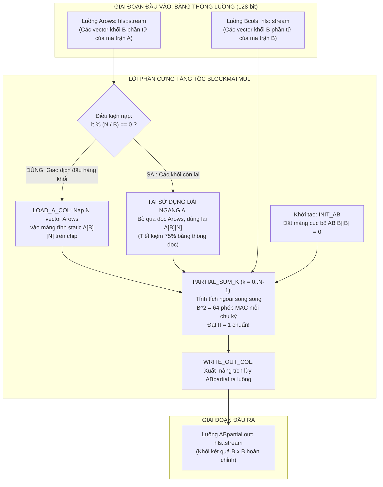

# TÀI LIỆU ÔN TẬP VÀ 40 CÂU HỎI VẤN ĐÁP BẢO VỆ BÁO CÁO NGHIÊN CỨU SOC
## ĐỀ TÀI: THIẾT KẾ VÀ ĐÁNH GIÁ BỘ TĂNG TỐC NHÂN MA TRẬN THEO KHỐI TƯƠNG THÍCH LUỒNG DỮ LIỆU SỬ DỤNG VITIS HLS TRÊN NỀN TẢNG ZYNQ-7000 ZC702
**Học phần: Thiết kế Hệ thống trên vi mạch (SoC Design - SOCD334264)**  
**Đơn vị: Bộ môn Kỹ thuật Máy tính – Khoa Điện – Điện tử, Trường ĐH Sư phạm Kỹ thuật TP.HCM (HCMUTE)**  
*Nhóm tác giả (Nhóm 04): Chống Định Khang, Phạm Trung Kiên, Nguyễn Hồng Lịch, Hoàng Bảo Phúc, Lê Thanh Tú*

---

# PHẦN 1: TỔNG QUAN VÀ TÓM TẮT TOÀN DIỆN BÁO CÁO NGHIÊN CỨU

### 1. Đặt vấn đề và Động lực nghiên cứu
* **Tính cấp thiết:** Phép nhân hai ma trận vuông $A, B \in \mathbb{R}^{N \times N}$ là hạt nhân tính toán cơ bản trong hàng loạt ứng dụng thời gian thực như lọc thích nghi, xử lý ảnh số, đồ họa máy tính và suy luận mạng nơ-ron tích chập (CNN).
* **Nút thắt cổ chai trên vi xử lý truyền thống:** Phép nhân ma trận có độ phức tạp tính toán bậc ba $\mathcal{O}(N^3)$, đòi hỏi $N^3$ phép nhân và $N^2(N-1)$ phép cộng. Khi thực thi trên CPU tuần tự (như ARM Cortex-A9), thời gian tính toán tăng theo hàm lập phương, đồng thời tần suất truy cập bộ nhớ ngoài DDR RAM vượt xa dung lượng Cache dẫn đến hiện tượng **nghẽn cổ chai von Neumann** (Memory Wall).
* **Hạn chế của phương pháp thiết kế RTL thủ công:** Viết Verilog/VHDL truyền thống cho bộ tăng tốc rất tốn thời gian, khó tối ưu hóa và khó khảo sát nhanh nhiều không gian kiến trúc khác nhau.
* **Hạn chế của thuật toán nhân thông thường (Baseline):** Nếu áp dụng tăng tốc phần cứng cho thuật toán nhân ma trận truyền thống (dựa trên tích vô hướng - Inner Product), số lượng cổng đọc/ghi bộ nhớ và số bộ nhân DSP sẽ tăng tuyến tính hoặc bậc hai theo kích thước $N$. Khi $N \ge 128$, phần cứng sẽ ngay lập tức **tràn quỹ 220 khối DSP của chip Zynq XC7Z020**.
* **Giải pháp đột phá của đề tài:** Thiết kế bộ tăng tốc nhân ma trận theo khối (**Block Matrix Multiplication**) dựa trên **tích ngoài (Outer-Product)** tương thích giao thức truyền luồng dữ liệu (`hls::stream`) theo giáo trình của Kastner et al. (*Parallel Programming for FPGAs*), tối ưu hóa bằng công cụ AMD Vitis HLS 2023.1 trên bo mạch đánh giá Xilinx ZC702.

---

### 2. Kiến trúc Nhân ma trận theo khối tương thích Stream (`blockmatmul`)



* **Phân rã ma trận:** Ma trận kích thước $N \times N$ được chia thành $(N/B)^2$ khối con kích thước cố định $B \times B$ (khảo sát với $B = 4$ và $B = 8$).
* **Đóng gói luồng:** Vector $B$ phần tử được đóng gói vào cấu trúc:
  ```cpp
  typedef struct { DTYPE a[BLOCK_SIZE]; } blockvec;
  hls::stream<blockvec> &Arows, &Bcols, &ABpartial;
  ```
* **Quy trình 4 giai đoạn bên trong lõi `blockmatmul`:**
  1. **Khởi tạo (`INIT_AB`):** Đặt mảng cục bộ $AB[B][B] = 0$.
  2. **Nạp có điều kiện mảng tĩnh A (`LOAD_A_COL`):** Chỉ khi `it % (N / B) == 0` (lần đầu tiên của mỗi hàng khối), dải ngang $B \times N$ mới được nạp từ luồng `Arows` vào mảng nội vi `static DTYPE A[B][N]`. Trong $(N/B) - 1$ lần gọi hàm tiếp theo, mạch bỏ qua việc đọc `Arows` và tái sử dụng trực tiếp mảng tĩnh $A$ trên chip.
  3. **Tính tích ngoài song song (`PARTIAL_SUM_K`):** Vòng lặp chạy $k = 0 \dots N-1$. Mỗi chu kỳ, mạch lấy 1 vector cột $B$ phần tử từ $A$ và 1 vector hàng $B$ phần tử từ `Bcols`, thực hiện $B^2$ phép nhân - cộng (MAC) song song và tích lũy vào $AB[B][B]$.
  4. **Xuất kết quả (`WRITE_OUT_COL`):** Đẩy $B$ vector của khối kết quả $AB_{\text{partial}}$ ra luồng ngõ ra.

---

### 3. Tổ hợp Chỉ thị Tối ưu hóa (HLS Pragmas)

Bảng các chỉ thị kiến trúc áp dụng khi cờ `USE_DIRECTIVES` được kích hoạt:

| Chỉ thị (Pragma) | Đối tượng áp dụng | Cơ chế biến đổi phần cứng mức vi kiến trúc |
| :--- | :--- | :--- |
| **`#pragma HLS ARRAY_RESHAPE`** | `variable=A complete dim=1` | Gộp $B$ phần tử theo cột của mảng đệm $A[B][N]$ thành một từ dữ liệu rộng ($B \times 32\text{-bit}$), cho phép xuất toàn bộ vector cột $B$ phần tử trong đúng **1 chu kỳ xung nhịp**. |
| **`#pragma HLS ARRAY_PARTITION`**| `variable=AB complete dim=0`| Phân tách hoàn toàn mảng 2 chiều $AB[B][B]$ thành $B^2$ thanh ghi Flip-Flop độc lập ($64\text{ FF}$ với $B=8$), cho phép đọc và ghi song song $B^2$ giá trị mỗi chu kỳ. |
| **`#pragma HLS PIPELINE II=1`** | `LOAD_A_COL`, `PARTIAL_SUM_K`, `WRITE_OUT_COL` | Thiết lập đường ống phần cứng đạt khoảng khởi tạo lý tưởng **$II = 1$**. Tại `PARTIAL_SUM_K`, mỗi chu kỳ xung nhịp hoàn tất trọn vẹn 1 bước tích ngoài. |
| **`#pragma HLS UNROLL`** | `INIT_AB`, `LOAD_A_ROW`, `PARTIAL_SUM_I/J` | Duỗi phẳng hoàn toàn các vòng lặp con, nhân bản phần cứng thành một mảng gồm **$B^2$ bộ nhân - cộng (MAC)** hoạt động đồng thời. |

---

### 4. Bảng Tổng hợp Kết quả Thực nghiệm Toàn diện

#### Bảng A: So sánh Độ trễ (Latency & Initiation Interval) trên Vitis HLS 2023.1

| Cấu hình thuật toán | $N$ | $B$ | Directives | $\text{Latency}_{\min}$ | $\text{Latency}_{\text{avg}}$ | $\text{Latency}_{\max}$ | $II_{\min}$ | $II_{\max}$ | Tăng tốc (Speedup) |
| :--- | :---: | :---: | :---: | :---: | :---: | :---: | :---: | :---: | :---: |
| **Baseline** | 8 | - | NO_DIR | 263 | 263 | 263 | 264 | 264 | Baseline gốc |
| **Baseline** | 8 | - | WITH_DIR | **71** | **71** | **71** | 72 | 72 | **$3.70\times$** |
| **Baseline** | 16 | - | NO_DIR | 2,060 | 2,060 | 2,060 | 2,061 | 2,061 | Baseline gốc |
| **Baseline** | 16 | - | WITH_DIR | **264** | **264** | **264** | 265 | 265 | **$7.80\times$** |
| **Baseline** | 32 | - | NO_DIR | 16,398 | 16,398 | 16,398 | 16,399 | 16,399 | Baseline gốc |
| **Baseline** | 32 | - | WITH_DIR | **1,033** | **1,033** | **1,033** | 1,034 | 1,034 | **$15.87\times$** |
| **Block Matrix** | 8 | 4 | NO_DIR | 174 | 180 | 185 | 175 | 186 | Gốc chưa opt |
| **Block Matrix** | 8 | 4 | WITH_DIR | **37** | **43** | **48** | 38 | 49 | **$4.19\times$** |
| **Block Matrix** | 8 | 8 | NO_DIR | 667 | 667 | 667 | 668 | 668 | Gốc chưa opt |
| **Block Matrix** | 8 | 8 | WITH_DIR | **97** | **97** | **97** | 98 | 98 | **$6.88\times$** |
| **Block Matrix** | 16 | 4 | NO_DIR | 302 | 312 | 321 | 303 | 322 | Gốc chưa opt |
| **Block Matrix** | 16 | 4 | WITH_DIR | **45** | **55** | **64** | 46 | 65 | **$5.67\times$** |
| **Block Matrix** | 16 | 8 | NO_DIR | 1,167 | 1,177 | 1,186 | 1,168 | 1,187 | Gốc chưa opt |
| **Block Matrix** | 16 | 8 | WITH_DIR | **94** | **104** | **113** | 95 | 114 | **$11.32\times$** |
| **Block Matrix** | 32 | 4 | NO_DIR | 558 | 576 | 593 | 559 | 594 | Gốc chưa opt |
| **Block Matrix** | 32 | 4 | WITH_DIR | **61** | **79** | **96** | 62 | 97 | **$7.29\times$** |
| **Block Matrix** | 32 | 8 | NO_DIR | 2,191 | 2,209 | 2,226 | 2,192 | 2,227 | Gốc chưa opt |
| **Block Matrix** | 32 | 8 | WITH_DIR | **110** | **128** | **145** | 111 | 146 | **$15.9\times$ (Cực hạn)** |

*Ghi chú:* Toàn bộ ma trận $32 \times 32$ gồm 16 khối $8 \times 8$. Tổng độ trễ thực tế trên dạng sóng C/RTL Cosimulation chỉ mất đúng **1,832 chu kỳ** ($18.32\ \mu\text{s}$ ở $100\text{ MHz}$).

---

#### Bảng B: So sánh Sử dụng Tài nguyên Phần cứng trên Chip Zynq XC7Z020

| Cấu hình thuật toán | $N$ | $B$ | Directives | BRAM_18K | DSP48E1 | Flip-Flop (FF) | Look-Up Table (LUT) |
| :--- | :---: | :---: | :---: | :---: | :---: | :---: | :---: |
| **Quỹ chip XC7Z020** | - | - | - | **280** | **220** | **106,400** | **53,200** |
| **Baseline** | 8 | - | WITH_DIR | 0 | 24 | 2,316 | 1,099 |
| **Baseline** | 16 | - | WITH_DIR | 0 | 48 | 4,572 | 2,027 |
| **Baseline** | 32 | - | WITH_DIR | 0 | **96 (tăng $\times 4$)**| 9,108 | 3,892 |
| **Block Matrix** | 8 | 4 | WITH_DIR | 4 | **48 (Cố định)** | 4,582 | 7,982 |
| **Block Matrix** | 16 | 4 | WITH_DIR | 4 | **48 (Cố định)** | 4,585 (+3) | 7,994 |
| **Block Matrix** | 32 | 4 | WITH_DIR | 4 | **48 (Cố định)** | 4,588 (+3) | 7,997 |
| **Block Matrix** | 8 | 8 | WITH_DIR | 8 | **192 (Cố định)**| 17,646 | 17,568 |
| **Block Matrix** | 16 | 8 | WITH_DIR | 8 | **192 (Cố định)**| 17,649 (+3) | 17,570 |
| **Block Matrix** | 32 | 8 | WITH_DIR | 8 | **192 (Cố định)**| 17,652 (+3) | 17,582 |

---

### 5. Bốn Quy luật Kiến trúc Cốt lõi Rút ra từ Thực nghiệm

1. **Quy luật độ trễ tăng đúng 1 chu kỳ trên mỗi bước lặp $k$:**
   * Hiệu số $\Delta = \text{Latency}_{\max} - \text{Latency}_{\min} = N + 3$ chu kỳ chính là thời gian thực thi của nhánh nạp dữ liệu $A$.
   * Khi $N$ tăng từ $16 \rightarrow 32$ (tăng thêm 16 bước lặp $k$), $\text{Latency}_{\min}$ của khối $B=8$ tăng chính xác từ $94 \rightarrow 110$ chu kỳ (tăng đúng **$+16\text{ chu kỳ}$**). Điều này chứng minh vòng lặp `PARTIAL_SUM_K` đạt khoảng khởi tạo $II = 1$ tuyệt đối.
2. **Tính bất biến tài nguyên tuyệt đối theo kích thước ma trận $N$:**
   * Trong khi Baseline có số DSP tăng tuyến tính theo $N$ (khiến $N \ge 128$ bị tràn chip), thì ở Block Matrix, số lượng **DSP48E1 và BRAM_18K hoàn toàn bất biến theo $N$** (cố định ở 48 DSP với $B=4$ và 192 DSP với $B=8$).
   * Khi $N$ nhân đôi ($8 \rightarrow 16 \rightarrow 32$), số Flip-Flop chỉ tăng đúng **3 thanh ghi** ($4,582 \rightarrow 4,585 \rightarrow 4,588$), tương ứng chính xác với 1 bit mở rộng của thanh ghi đếm vòng lặp $k[0, N-1]$.
3. **Cơ chế tiết kiệm BRAM của `ARRAY_RESHAPE`:**
   * Tại $N=32, B=8$: cấu hình chưa tối ưu tốn 10 BRAM, nhưng khi bật Directives, số BRAM giảm xuống còn **8 BRAM_18K**. Nguyên nhân: `ARRAY_PARTITION` đưa toàn bộ mảng tích lũy $AB[8][8]$ sang Flip-Flop, còn `ARRAY_RESHAPE` đóng gói mảng $A[8][32]$ thành các từ rộng 256-bit nằm vừa khít trong 8 khối BRAM_18K ở chế độ Simple Dual-Port.
4. **Tái sử dụng dải ma trận ngang tiết kiệm 75% băng thông đọc:**
   * Trên dạng sóng RTL Cosimulation, tín hiệu `Arows_read` chỉ tích cực đúng 4 lần tại các giao dịch đầu hàng khối ($it = 00, 04, 08, 0C$) và giữ mức 0 trong 12 giao dịch còn lại. Mỗi dải ngang được lưu đệm trên chip và tái sử dụng 4 lần liên tiếp, **giảm $75\%$ lưu lượng đọc từ bộ nhớ DDR RAM**.

---

### 6. Tích hợp Hệ thống SoC trên AMD Vivado (Full-Loop DMA)
* **Kiến trúc SoC lai (Hybrid SoC):** Tích hợp nhân ARM Cortex-A9 (PS) với IP `blockmatmul_0` (PL).
* **Đường dữ liệu khép kín (Full-Loop DMA):** Sử dụng 2 bộ điều khiển **AXI DMA** chạy song song:
  * `axi_dma_0` & `axi_dma_1`: Đọc ma trận A và B từ DDR RAM, chuyển thành luồng AXI4-Stream 128-bit bơm đồng thời vào 2 cổng `Arows` và `Bcols`.
  * Kênh S2MM của DMA: Thu gom ma trận kết quả từ cổng luồng ngõ ra và ghi trả trực tiếp vào DDR RAM.
* **Cổng hiệu năng cao `S_AXI_HP0`:** Mạng chuyển mạch bộ nhớ `axi_mem_intercon` kết nối các khối DMA trực tiếp với cổng `S_AXI_HP0` của Zynq PS, giải quyết triệt để nút thắt băng thông bộ nhớ ngoài.
* **Chất lượng mạch sau Implementation:**
  * **Timing:** $WNS = +0.320\text{ ns} > 0$, $TNS = 0.000\text{ ns}$, $WHS = +0.008\text{ ns} > 0$, $THS = 0.000\text{ ns}$, $WPWS = +3.750\text{ ns} > 0$. Không có bất kỳ điểm vi phạm nào trên toàn bộ 31,186 endpoints. Mạch đạt chuẩn định thời tuyệt đối ở tần số $100\text{ MHz}$.
  * **Power:** Tổng công suất trên chip đạt **$1.762\text{ W}$**. Công suất động chiếm $92\%$ ($1.619\text{ W}$), trong đó PS7 chiếm áp đảo $94\%$ ($1.573\text{ W}$). Nhiệt độ tiếp giáp $T_j = 45.3^\circ\text{C}$ (biên độ nhiệt an toàn $39.7^\circ\text{C}$).

---

# PHẦN 2: BỘ 40 CÂU HỎI VẤN ĐÁP BẢO VỆ BÁO CÁO NGHIÊN CỨU SOC (KÈM LỜI GIẢI CHI TIẾT)

---

## NHÓM 1: ĐỘNG LỰC NGHIÊN CỨU, BÀI TOÁN & CƠ SỞ LÝ THUYẾT (CÂU 1 - 5)

### Câu 1: Em hãy trình bày động lực nghiên cứu cốt lõi của đề tài? Tại sao phép nhân ma trận trên vi xử lý truyền thống lại gặp phải hiện tượng "nghẽn cổ chai von Neumann"?
* **Đáp án chuẩn:**
  * **Động lực nghiên cứu:** Phép nhân hai ma trận vuông $N \times N$ là phép toán nền tảng trong các ứng dụng thời gian thực (xử lý ảnh, bộ lọc số, mạng nơ-ron học sâu), nhưng có độ phức tạp thuật toán bậc ba $\mathcal{O}(N^3)$, đòi hỏi $N^3$ phép nhân và $N^2(N-1)$ phép cộng.
  * **Hiện tượng nghẽn von Neumann (Memory Wall):**
    * Trên các bộ vi xử lý tuần tự (như ARM Cortex-A9), CPU chỉ có thể thực thi tuần tự từng lệnh nhân/cộng.
    * Khi kích thước ma trận $N$ tăng lên, dung lượng dữ liệu của hai ma trận $A$ và $B$ vượt quá dung lượng bộ nhớ đệm Cache (L1/L2). CPU liên tục bị trễ bộ nhớ (Cache Miss) và phải truy xuất ra bộ nhớ ngoài DDR RAM qua bus hệ thống có băng thông giới hạn.
    * Tốc độ xử lý của CPU bị giới hạn bởi tốc độ nạp dữ liệu từ bộ nhớ ngoài chứ không phải do tốc độ tính toán của nhân ALU.
  * **Giải pháp:** Sử dụng mảng logic khả trình FPGA để tính toán song song phần cứng kết hợp kỹ thuật lưu đệm trên chip (BRAM) và phân khối luồng dữ liệu để giảm tối đa tần suất truy cập DDR RAM.

---

### Câu 2: Thuật toán nhân ma trận thông thường (Baseline) hoạt động theo nguyên lý nào? Tại sao kiến trúc Baseline không thể mở rộng khi kích thước ma trận $N$ lớn?
* **Đáp án chuẩn:**
  * **Nguyên lý Baseline:** Dựa trên **tích vô hướng (Inner Product)**:
    $$\text{AB}[i][j] = \sum_{k=0}^{N-1} A[i][k] \times B[k][j]$$
    Mỗi phần tử kết quả $\text{AB}[i][j]$ được tính bằng tích vô hướng giữa hàng thứ $i$ của ma trận $A$ và cột thứ $j$ của ma trận $B$.
  * **Tại sao không thể mở rộng khi $N$ lớn:**
    * Để đạt thông lượng cao ($II=1$), Baseline buộc phải trải phẳng vòng lặp trong cùng và gộp mảng theo chiều dữ liệu (`ARRAY_RESHAPE`).
    * Điều này đòi hỏi số lượng bộ nhân vật lý DSP và băng thông cổng vào/ra phải tăng tuyến tính hoặc bậc hai theo kích thước $N$:
      * Tại $N=8$: tốn 24 DSP.
      * Tại $N=16$: tốn 48 DSP.
      * Tại $N=32$: tốn 96 DSP.
    * Khi $N \ge 128$, số lượng DSP yêu cầu sẽ vượt xa con số 220 khối DSP của chip Zynq-7000 XC7Z020. Thiết kế không thể tổng hợp vừa vặn lên vi mạch thực tế.

---

### Câu 3: Thuật toán nhân ma trận theo khối (Block Matrix Multiplication) giải quyết bài toán giới hạn tài nguyên như thế nào?
* **Đáp án chuẩn:**
  * **Cơ chế phân khối:** Thuật toán phân rã hai ma trận kích thước toàn cục $N \times N$ thành $(N/B)^2$ khối con kích thước cố định $B \times B$ (với $B \ll N$, trong bài chọn $B = 4$ hoặc $B = 8$).
  * **Tách rời tài nguyên khỏi kích thước $N$:**
    * Thay vì cấp phát phần cứng song song cho toàn bộ ma trận $N \times N$, phần cứng FPGA chỉ cần xây dựng một lõi tính toán cố định kích thước $B \times B$ (gồm $B^2$ bộ nhân MAC).
    * Phép nhân ma trận lớn $N \times N$ được thực hiện bằng cách cho lõi $B \times B$ tính toán tuần tự qua $(N/B)^2$ lần lặp.
    * Nhờ đó, **mức tiêu thụ tài nguyên phần cứng (DSP, BRAM, FF, LUT) bị "khóa cứng" theo kích thước khối $B$** và hoàn toàn độc lập với kích thước toàn cục $N$.

---

### Câu 4: Phân biệt sự khác nhau bản chất giữa phương pháp tính theo "Tích vô hướng" (Inner Product) và "Tích ngoài" (Outer Product)? Tại sao kiến trúc Block Matrix trong bài báo lại chọn Tích ngoài?
* **Đáp án chuẩn:**
  * **Tích vô hướng (Inner Product):**
    * Nhân 1 hàng của $A$ với 1 cột của $B$ để tạo ra **đúng 1 phần tử đơn lẻ** $\text{AB}[i][j]$.
    * Để tính xong 1 khối kết quả $B \times B$, cần phải đọc đi đọc lại các hàng và cột nhiều lần, gây phân tán dữ liệu và khó thiết kế đường ống luồng.
  * **Tích ngoài (Outer Product):**
    * Nhân 1 vector cột kích thước $B \times 1$ của $A$ với 1 vector hàng kích thước $1 \times B$ của $B$ để tạo ra **ngay lập tức một ma trận con kích thước $B \times B$**:
      $$C_{\text{partial}} = \mathbf{u} \cdot \mathbf{v}^T$$
    * Khối kết quả cuối cùng $\text{AB}_{\text{partial}}$ kích thước $B \times B$ được hình thành bằng tổng tích lũy của $N$ phép nhân tích ngoài liên tiếp:
      $$\text{AB}_{\text{partial}} = \sum_{k=0}^{N-1} A_{\text{tile}}[:, k] \times B_{\text{tile}}[k, :]$$
  * **Lý do chọn Tích ngoài:**
    * Tích ngoài cực kỳ tương thích với mô hình truyền dữ liệu luồng (**Streaming Architecture**).
    * Mỗi chu kỳ xung nhịp, mạch chỉ cần nhận 1 vector $B$ phần tử từ $A$ và 1 vector $B$ phần tử từ $B$ là có thể cập nhật song song toàn bộ $B^2$ thanh ghi tích lũy của khối $AB$, đạt hiệu suất tính toán $100\%$ không có chu kỳ chết.

---

### Câu 5: Nền tảng phần cứng mục tiêu của đề tài là vi mạch nào? Hãy nêu các thông số tài nguyên vật lý giới hạn của dòng vi mạch này?
* **Đáp án chuẩn:**
  * **Vi mạch mục tiêu:** SoC AMD/Xilinx **Zynq-7000 XC7Z020-1CLG484C** (tích hợp trên bo mạch đánh giá Xilinx ZC702 Evaluation Kit).
  * **Quỹ tài nguyên vật lý giới hạn trên miền logic khả trình (PL):**
    1. **DSP48E1:** **220 khối** (mỗi khối chứa 1 bộ nhân $18 \times 25\text{-bit}$; một phép nhân số nguyên 32-bit `int` tiêu tốn 3 khối DSP48E1 ghép tầng).
    2. **Block RAM (BRAM_18K):** **280 khối** (tương đương 140 khối RAM 36Kb; mỗi khối chỉ có 2 cổng đọc/ghi độc lập).
    3. **Flip-Flops (FF):** **106,400 thanh ghi**.
    4. **Look-Up Tables (LUT):** **53,200 bảng tra**.
    5. **Tần số xung nhịp mục tiêu:** $100\text{ MHz}$ (chu kỳ clock $T_{\text{clk}} = 10\text{ ns}$).

---

## NHÓM 2: KIẾN TRÚC BLOCK MATRIX & GIAO THỨC LUỒNG STREAM (CÂU 6 - 10)

### Câu 6: Cấu trúc dữ liệu `blockvec` và thư viện `hls::stream` được định nghĩa như thế nào trong mã nguồn C++ của đề tài?
* **Đáp án chuẩn:**
  * **Cấu trúc `blockvec`:**
    ```cpp
    typedef int DTYPE; // Kiểu dữ liệu số nguyên 32-bit
    typedef struct {
        DTYPE a[BLOCK_SIZE];
    } blockvec;
    ```
    Mỗi `blockvec` đóng gói một mảng gồm $B$ phần tử dữ liệu liên tiếp (với $B=4$, cấu trúc rộng $128\text{-bit}$; với $B=8$, rộng $256\text{-bit}$).
  * **Thư viện `hls::stream`:**
    * Giao diện hàm cấp cao:
      ```cpp
      void blockmatmul(hls::stream<blockvec> &Arows, 
                       hls::stream<blockvec> &Bcols, 
                       hls::stream<blockvec> &ABpartial);
      ```
    * `hls::stream` mô hình hóa các đường truyền dữ liệu dạng hàng đợi FIFO một chiều (First-In, First-Out), tương thích hoàn hảo với giao thức bus phần cứng **AXI4-Stream** (`TVALID / TREADY / TDATA`). Dữ liệu được đọc/ghi tuần tự bằng phương thức non-blocking hoặc blocking (`read()`, `write()`).

---

### Câu 7: Trình bày chi tiết 4 giai đoạn xử lý bên trong hàm `blockmatmul`?
* **Đáp án chuẩn:**
  1. **Giai đoạn 1 - Khởi tạo (`INIT_AB`):** Khởi tạo ma trận tích lũy cục bộ $AB[B][B]$ về giá trị 0 trước khi bắt đầu tính toán khối mới.
  2. **Giai đoạn 2 - Nạp có điều kiện dải ma trận A (`LOAD_A_COL`):**
     * Kiểm tra điều kiện `if (counter == 0)` (tương đương `it % (N / B) == 0`).
     * Nếu đúng: Đọc $N$ gói `blockvec` từ luồng `Arows` nạp vào mảng đệm nội bộ `static DTYPE A[B][N]`.
     * Nếu sai: Giữ nguyên mảng tĩnh $A$ đã nạp từ các lần trước để tái sử dụng.
  3. **Giai đoạn 3 - Tính tích ngoài song song (`PARTIAL_SUM_K`):**
     * Vòng lặp chạy $k$ từ $0$ đến $N-1$ ($N$ bước lặp).
     * Tại mỗi bước $k$, đọc 1 gói `blockvec` từ luồng `Bcols`, trích xuất cột thứ $k$ từ mảng $A[B][N]$, thực hiện $B \times B$ phép nhân - cộng song song để tích lũy vào mảng $AB[B][B]$.
  4. **Giai đoạn 4 - Xuất khối kết quả (`WRITE_OUT_COL`):** Đọc $B$ hàng từ mảng tích lũy $AB$, đóng gói vào cấu trúc `blockvec` và đẩy vào luồng đầu ra `ABpartial`.

---

### Câu 8: Cơ chế lưu đệm mảng tĩnh `static DTYPE A[B][N]` hoạt động như thế nào? Tại sao nó lại giúp tiết kiệm tới 75% băng thông đọc ma trận A?
* **Đáp án chuẩn:**
  * **Cơ chế hoạt động:**
    * Từ khóa `static` trong C++ khi tổng hợp HLS sẽ chỉ định công cụ cấp phát một vùng nhớ Block RAM nội bộ trên chip FPGA để lưu giữ dữ liệu xuyên suốt giữa các lần gọi hàm `blockmatmul` khác nhau.
    * Khi tính toán ma trận $N \times N$ bằng các khối $B \times B$, ma trận kết quả có $(N/B)$ hàng khối và $(N/B)$ cột khối.
    * Mỗi hàng khối (Tile Row) của ma trận kết quả cần nhân dải ngang kích thước $B \times N$ của ma trận $A$ với $(N/B)$ dải dọc kích thước $N \times B$ của ma trận $B$.
    * Do đó, dải ngang của $A$ hoàn toàn giống nhau đối với tất cả $(N/B)$ khối trên cùng một hàng!
  * **Tại sao tiết kiệm 75% băng thông (với cấu hình $N=32, B=8$):**
    * Số khối trên một hàng là $N/B = 32 / 8 = 4$ khối.
    * Trong 4 khối này, khối đầu tiên (`it = 0`) bắt buộc phải đọc luồng `Arows` từ DDR RAM để nạp vào mảng tĩnh $A$.
    * Ba khối tiếp theo (`it = 1, 2, 3`), mạch tận dụng lại mảng tĩnh $A$ đang có sẵn trên BRAM mà không cần đọc lại luồng `Arows`.
    * Tỷ lệ tiết kiệm băng thông:
      $$\text{Tiết kiệm} = \frac{(N/B) - 1}{N/B} = \frac{4 - 1}{4} = \frac{3}{4} = 75\%$$

---

### Câu 9: Tín hiệu `counter` trong mã nguồn được tính toán như thế nào để điều khiển nhánh nạp mảng tĩnh $A$?
* **Đáp án chuẩn:**
  * **Đoạn mã C++:**
    ```cpp
    int counter = it % (N / B);
    if (counter == 0) {
        // Nạp luồng Arows vào static A[B][N]
    }
    ```
  * **Ý nghĩa biến `it`:** Là biến đếm số thứ tự khối kết quả đang được tính toán, chạy từ $0$ đến $(N/B)^2 - 1$.
  * **Giải thích hoạt động:**
    * Với $N=32, B=8 \rightarrow N/B = 4$. Tổng số lần gọi hàm là $(32/8)^2 = 16$ lần (`it` từ $0$ đến $15$).
    * Khi `it = 0, 4, 8, 12`: giá trị `it % 4 == 0` $\rightarrow$ `counter = 0`. Mạch kích hoạt nhánh nạp luồng `Arows`.
    * Khi `it = 1, 2, 3, 5, 6, 7, 9, 10, 11, 13, 14, 15`: `counter != 0`. Mạch bỏ qua việc đọc `Arows`.

---

### Câu 10: Công thức quy đổi tổng độ trễ chu kỳ thực thi cho toàn bộ ma trận $N \times N$ gồm $(N/B)^2$ khối được tính như thế nào?
* **Đáp án chuẩn:**
  * **Công thức tổng quát:**
    $$\text{Latency}_{\text{Total}} = \left(\frac{N}{B}\right) \times \text{Latency}_{\max} + \left[\left(\frac{N}{B}\right)^2 - \left(\frac{N}{B}\right)\right] \times \text{Latency}_{\min}$$
  * **Giải thích các thành phần:**
    * $(N/B)$: Số lần hàm phải thực thi nhánh nạp dữ liệu $A$ (độ trễ cực đại $\text{Latency}_{\max}$).
    * $(N/B)^2 - (N/B)$: Số lần hàm chạy ở chế độ tái sử dụng mảng tĩnh $A$ (độ trễ cực tiểu $\text{Latency}_{\min}$).
  * **Ví dụ thực tế với cấu hình $N=32, B=8$ (WITH_DIR):**
    * $\text{Latency}_{\max} = 145\text{ chu kỳ}$, $\text{Latency}_{\min} = 110\text{ chu kỳ}$, $N/B = 4$.
    * Số lần giao dịch dài: $4$ lần.
    * Số lần giao dịch ngắn: $16 - 4 = 12$ lần.
    * Tổng độ trễ tính toán lý thuyết:
      $$\text{Latency}_{\text{Total}} = 4 \times 145 + 12 \times 110 = 580 + 1320 = 1900\text{ chu kỳ}$$
    * Trên dạng sóng đồng mô phỏng RTL thực tế (do tối ưu hóa overlap giữa các lần gọi hàm), hệ thống hoàn thành chỉ trong **1,832 chu kỳ**!

---

## NHÓM 3: CƠ CHẾ TỐI ƯU HÓA BẰNG CHỈ THỊ HLS (DIRECTIVES) (CÂU 11 - 15)

### Câu 11: Tại sao chỉ thị `#pragma HLS ARRAY_RESHAPE variable=A complete dim=1` lại là chìa khóa để đạt được $II=1$ ở vòng lặp `PARTIAL_SUM_K`?
* **Đáp án chuẩn:**
  * **Bản chất mảng $A[B][N]$:** Trong C++, mảng này có $B$ hàng và $N$ cột.
  * **Nhu cầu của phép tích ngoài:** Tại mỗi bước $k$, mạch cần đọc đồng thời toàn bộ cột thứ $k$ của $A$ (gồm $B$ phần tử: $A[0][k], A[1][k], \dots, A[B-1][k]$).
  * **Nếu không có Directive:** Mảng $A$ được ánh xạ vào BRAM tiêu chuẩn (chỉ có 2 cổng đọc). Mạch chỉ có thể đọc tối đa 2 phần tử mỗi chu kỳ. Với $B=8$, mạch mất $8 / 2 = 4$ chu kỳ chỉ để đọc xong 1 cột, dẫn đến $II \ge 4$.
  * **Cơ chế của `ARRAY_RESHAPE dim=1`:**
    * Chỉ thị này gom tất cả các phần tử dọc theo chiều thứ 1 (chiều hàng, index từ $0$ đến $B-1$) thành **một từ dữ liệu nhị phân cực rộng (Wide Word)**:
      $$\text{Word Width} = B \times 32\text{ bits} = 8 \times 32 = 256\text{ bits}$$
    * Khi vòng lặp cần cột thứ $k$, mạch chỉ cần phát **đúng 1 địa chỉ $k$** tới cổng BRAM là đọc được trọn vẹn toàn bộ 8 phần tử trong cùng 1 chu kỳ xung nhịp.
    * Triệt tiêu hoàn toàn xung đột cổng nhớ, cho phép vòng lặp `PARTIAL_SUM_K` đạt được **$II = 1$ tuyệt đối**!

---

### Câu 12: Tại sao đối với mảng tích lũy $AB$, nhóm lại sử dụng `#pragma HLS ARRAY_PARTITION variable=AB complete dim=0` thay vì dùng `ARRAY_RESHAPE`?
* **Đáp án chuẩn:**
  * **Nhu cầu truy cập của $AB$:**
    * Mảng tích lũy $AB[B][B]$ chứa $B \times B$ phần tử (16 phần tử với $B=4$, 64 phần tử với $B=8$).
    * Trong phép tích ngoài, tại mỗi chu kỳ xung nhịp, **tất cả $B^2$ phần tử của $AB$ đều phải được đọc ra, cộng dồn với tích mới và ghi ngược trở lại đồng thời**.
  * **Tại sao không dùng BRAM (kể cả có Reshape):** BRAM dù có ghép rộng cũng khó hỗ trợ vừa đọc vừa ghi 64 phần tử ngẫu nhiên trong cùng 1 chu kỳ mà không phát sinh xung đột định thời.
  * **Giải pháp của `ARRAY_PARTITION complete dim=0`:**
    * `dim=0` chỉ định phân tách triệt để toàn bộ các chiều của mảng.
    * Mảng $AB$ bị "hòa tan" hoàn toàn khỏi bộ nhớ BRAM và chuyển thành **$B^2$ thanh ghi Flip-Flop độc lập** trên mảng logic FPGA ($64\text{ thanh ghi 32-bit}$).
    * Các thanh ghi này kết nối trực tiếp với 64 bộ cộng song song, cho phép cập nhật đồng thời 64 kết quả MAC trong mỗi chu kỳ xung nhịp mà không bị giới hạn bởi cấu trúc cổng nhớ.

---

### Câu 13: Trình bày sự phối hợp giữa hai chỉ thị `#pragma HLS PIPELINE II=1` và `#pragma HLS UNROLL` tại vòng lặp `PARTIAL_SUM_K`?
* **Đáp án chuẩn:**
  * Cấu trúc vòng lặp trong mã C++:
    ```cpp
    PARTIAL_SUM_K: for (int k = 0; k < N; k++) {
        #pragma HLS PIPELINE II=1
        PARTIAL_SUM_I: for (int i = 0; i < B; i++) {
            #pragma HLS UNROLL
            PARTIAL_SUM_J: for (int j = 0; j < B; j++) {
                #pragma HLS UNROLL
                AB[i][j] += A[i][k] * tmpB.a[j];
            }
        }
    }
    ```
  * **Cơ chế phối hợp:**
    * `#pragma HLS UNROLL` tại hai vòng lặp con `PARTIAL_SUM_I` và `PARTIAL_SUM_J` thực hiện nhân bản phần cứng trong không gian: tạo ra một mảng lưới gồm **$B \times B = 64$ bộ nhân và 64 bộ cộng vật lý** hoạt động song song hoàn toàn.
    * `#pragma HLS PIPELINE II=1` tại vòng lặp ngoài `PARTIAL_SUM_K` thiết lập dây chuyền đường ống theo thời gian: mỗi chu kỳ clock, một bước lặp $k$ mới được đưa vào mảng 64 bộ MAC này.
    * Kết quả: Mạch đạt thông lượng tối đa: **64 phép tính MAC hoàn thành trên mỗi chu kỳ xung nhịp** ($0.64\text{ TMACs/s}$ ở $100\text{ MHz}$).

---

### Câu 14: Nếu bỏ chỉ thị `#pragma HLS UNROLL` tại `INIT_AB`, điều gì sẽ xảy ra với độ trễ của hàm?
* **Đáp án chuẩn:**
  * Vòng lặp `INIT_AB` có nhiệm vụ xóa mảng $AB[B][B]$ về 0 gồm $B \times B = 64$ phần tử.
  * Nếu không có `UNROLL`: Vòng lặp sẽ chạy tuần tự, tốn ít nhất 64 chu kỳ xung nhịp chỉ để gán giá trị 0 cho mảng trước khi bắt đầu tính toán.
  * Khi có `UNROLL`: Mạch sinh ra 64 đường dây điều khiển reset song song, toàn bộ 64 thanh ghi Flip-Flop của $AB$ được **xóa về 0 đồng thời chỉ trong đúng 1 chu kỳ xung nhịp**, tiết kiệm tới 63 chu kỳ lãng phí.

---

### Câu 15: Tại sao chỉ thị PIPELINE lại được đặt tại `LOAD_A_COL` và `WRITE_OUT_COL`?
* **Đáp án chuẩn:**
  * Cả hai vòng lặp này đều thực hiện đọc/ghi tuần tự dữ liệu luồng (`hls::stream`):
    * `LOAD_A_COL`: Đọc $N$ gói `blockvec` từ `Arows`.
    * `WRITE_OUT_COL`: Ghi $B$ gói `blockvec` ra `ABpartial`.
  * Đặt `PIPELINE II=1` đảm bảo giao tiếp luồng AXI-Stream đạt tốc độ burst tối đa: **cứ mỗi chu kỳ xung nhịp truyền nhận thành công đúng 1 gói dữ liệu `blockvec`**, không có chu kỳ chờ bọt khí (Bubble cycles) giữa các giao dịch bus.

---

## NHÓM 4: PHÂN TÍCH ĐỊNH LƯỢNG THỰC NGHIỆM ĐỘ TRỄ & THÔNG LƯỢNG (CÂU 16 - 20)

### Câu 16: Phân tích công thức thực nghiệm tính độ trễ của Baseline khi chưa có Directives: $\text{Latency} = \frac{N^3}{2} + \text{offset}$? Tại sao lại chia 2?
* **Đáp án chuẩn:**
  * **Công thức thực nghiệm:**
    $$\text{Latency} = \frac{N^3}{2} + \text{offset}$$
    * Với $N=8$: $(512 / 2) + 7 = 263\text{ chu kỳ}$.
    * Với $N=16$: $(4096 / 2) + 12 = 2,060\text{ chu kỳ}$.
    * Với $N=32$: $(32768 / 2) + 14 = 16,398\text{ chu kỳ}$.
  * **Tại sao chia 2:**
    * Khi tắt Directives, trình biên dịch Vitis HLS 2023.1 tự động kích hoạt chế độ tự động tạo đường ống cho vòng lặp lớn (Auto-pipelining theo chuẩn UG1399).
    * Công cụ cấp phát mặc định **2 bộ nhân 32-bit dùng chung** (tương ứng 6 khối DSP48E1, xem Bảng 4).
    * Do có 2 bộ nhân hoạt động đồng thời, trung bình mỗi chu kỳ phần cứng xử lý được 2 phép nhân. Vì tổng số phép nhân của ma trận là $N^3$, số chu kỳ tính toán thuần túy giảm đi một nửa: $N^3 / 2$.
    * Phần $\text{offset}$ ($7, 12, 14\text{ chu kỳ}$) chính là độ trễ khởi tạo đường ống và các lệnh nạp/xuất mảng.

---

### Câu 17: Tại sao khi bật Directives trên Baseline, độ trễ giảm xuống xấp xỉ bằng $N^2$? Hệ số tăng tốc đạt được là bao nhiêu?
* **Đáp án chuẩn:**
  * **Cơ chế:** Khi có Directives, vòng lặp trong cùng `PRODUCT_LOOP` được trải phẳng hoàn toàn ($N$ bộ nhân song song) và vòng lặp `COL_LOOP` đạt $II = 1$.
  * Mạch tính xong **1 phần tử kết quả ma trận sau mỗi chu kỳ xung nhịp**. Vì ma trận kết quả có tổng cộng $N \times N = N^2$ phần tử, thời gian tính toán giảm đúng bằng $N^2 + \text{overhead}$:
    * Với $N=8$: $8^2 + 7 = 71\text{ chu kỳ}$ (tăng tốc **$3.70\times$**).
    * Với $N=16$: $16^2 + 8 = 264\text{ chu kỳ}$ (tăng tốc **$7.80\times$**).
    * Với $N=32$: $32^2 + 9 = 1,033\text{ chu kỳ}$ (tăng tốc **$15.87\times$**).

---

### Câu 18: Hãy giải thích tại sao hiệu số $\Delta = \text{Latency}_{\max} - \text{Latency}_{\min}$ trong Block Matrix khi bật Directives luôn tuân theo quy luật $\Delta = N + 3$ chu kỳ?
* **Đáp án chuẩn:**
  * **Bản chất của $\Delta$:** Là độ chênh lệch thời gian giữa lần gọi hàm có nạp mảng $A$ và lần gọi hàm không nạp mảng $A$. Hiệu số này chính là thời gian thực thi của vòng lặp `LOAD_A_COL`.
  * **Chứng minh định lượng:**
    * Vòng lặp `LOAD_A_COL` đọc $N$ gói dữ liệu từ luồng `Arows`.
    * Do vòng lặp được đặt `PIPELINE II=1`, việc đọc $N$ gói mất đúng **$N$ chu kỳ xung nhịp**.
    * Đường ống nạp dữ liệu từ luồng vào thanh ghi mất thêm **3 chu kỳ trễ đường ống** (Pipeline latency overhead: 1 chu kỳ đọc FIFO, 1 chu kỳ giải mã cấu trúc `blockvec`, 1 chu kỳ ghi vào BRAM).
    * Do đó: $\Delta = N + 3\text{ chu kỳ}$!
  * **Kiểm chứng từ bảng thực nghiệm:**
    * Tại $N=8$: $\Delta = 48 - 37 = 11\text{ chu kỳ}$ ($8 + 3$).
    * Tại $N=16$: $\Delta = 64 - 45 = 113 - 94 = 19\text{ chu kỳ}$ ($16 + 3$).
    * Tại $N=32$: $\Delta = 96 - 61 = 145 - 110 = 35\text{ chu kỳ}$ ($32 + 3$).
    * Sự trùng khớp tuyệt đối $100\%$ giữa lý thuyết kiến trúc và số liệu đo đạc thực tế!

---

### Câu 19: Tại sao ở cấu hình $N=8, B=8$ (WITH_DIR), độ trễ cực đại và cực tiểu lại bằng nhau ($\text{Latency}_{\max} = \text{Latency}_{\min} = 97$ chu kỳ)?
* **Đáp án chuẩn:**
  * **Giải thích toán học:**
    * Kích thước ma trận bằng kích thước khối: $N = 8, B = 8 \rightarrow N / B = 1$.
    * Biểu thức điều kiện kiểm tra: `counter = it % (N / B) = it % 1`.
    * Phép chia lấy dư cho 1 luôn luôn cho kết quả bằng 0 với mọi giá trị của `it` (`it % 1 == 0` luôn đúng).
    * Do đó, trong cấu hình này, toàn bộ ma trận chỉ gồm đúng 1 khối duy nhất. Hàm `blockmatmul` chỉ được gọi đúng 1 lần và bắt buộc phải nạp luồng `Arows`. Nhánh nạp mảng $A$ luôn luôn thực thi, không bao giờ xảy ra trường hợp bỏ qua nạp, dẫn đến $\text{Latency}_{\max} = \text{Latency}_{\min} = 97\text{ chu kỳ}$.

---

### Câu 20: Tốc độ tăng tốc tổng thể (Overall Speedup) của bộ tăng tốc Block Matrix ở cấu hình cực hạn $N=32, B=8$ đạt bao nhiêu lần so với khi chưa tối ưu?
* **Đáp án chuẩn:**
  * Theo số liệu đo đạc thực tế:
    * Khi chưa dùng Directives: $\text{Latency}_{\text{avg}} = 2,209\text{ chu kỳ}$.
    * Khi bật Directives: $\text{Latency}_{\text{avg}} = 128\text{ chu kỳ}$.
    * Tỷ số tăng tốc đạt:
      $$\text{Speedup} = \frac{2,209}{128} \approx 15.9\text{ lần}$$
  * Xét trên toàn ma trận $32 \times 32$: Thời gian tính toán giảm từ $35,344\text{ chu kỳ}$ xuống chỉ còn **1,832 chu kỳ** (chỉ mất $18.32\ \mu\text{s}$ ở tần số $100\text{ MHz}$).

---

## NHÓM 5: TÍNH BẤT BIẾN TÀI NGUYÊN & TỐI ƯU HÓA BỘ NHỚ (CÂU 21 - 25)

### Câu 21: "Tính bất biến tài nguyên" (Resource Invariance) của kiến trúc Block Matrix là gì? Hãy chứng minh bằng số liệu thực nghiệm trong Bảng 4?
* **Đáp án chuẩn:**
  * **Định nghĩa:** Tính bất biến tài nguyên là đặc tính kiến trúc mà ở đó số lượng tài nguyên phần cứng tính toán cốt lõi (DSP48E1 và BRAM_18K) giữ nguyên cố định không đổi, bất kể kích thước ma trận toàn cục $N$ mở rộng gấp nhiều lần.
  * **Chứng minh bằng số liệu Bảng 4:**
    * **Với khối $B = 4$:** Khi $N$ tăng gấp 4 lần từ $8 \rightarrow 16 \rightarrow 32$:
      * Số khối **DSP48E1 giữ cố định tuyệt đối ở 48 khối** ($21.82\%$ tài nguyên chip).
      * Số khối **BRAM_18K giữ cố định tuyệt đối ở 4 khối**.
    * **Với khối $B = 8$:** Khi $N$ tăng từ $8 \rightarrow 16 \rightarrow 32$:
      * Số khối **DSP48E1 giữ cố định tuyệt đối ở 192 khối** ($87.27\%$ tài nguyên chip).
      * Số khối **BRAM_18K giữ cố định tuyệt đối ở 8 khối**.
  * Điều này chứng minh kiến trúc Block Matrix có khả năng mở rộng vô hạn cho các ma trận cực lớn ($N = 64, 128, 512, 1024$) mà không bao giờ bị tràn tài nguyên chip FPGA.

---

### Câu 22: Tại sao khi $N$ tăng gấp đôi ($8 \rightarrow 16 \rightarrow 32$), số lượng Flip-Flop của Block Matrix lại tăng chính xác đúng 3 thanh ghi (ví dụ $4,582 \rightarrow 4,585 \rightarrow 4,588$ FF)?
* **Đáp án chuẩn:**
  * Đây là một phát hiện vi kiến trúc vô cùng tinh tế và chuẩn xác:
    * Khi kích thước ma trận $N$ nhân đôi ($8 \rightarrow 16 \rightarrow 32$), số bước lặp của biến đếm $k$ tăng từ $8 \rightarrow 16 \rightarrow 32$.
    * Độ rộng bit nhị phân cần thiết để biểu diễn biến đếm $k$ tăng đúng **1 bit**:
      * $N=8$: cần $\log_2(8) = 3\text{ bit}$.
      * $N=16$: cần $\log_2(16) = 4\text{ bit}$ (+1 bit).
      * $N=32$: cần $\log_2(32) = 5\text{ bit}$ (+1 bit).
    * Biến đếm $k$ này xuất hiện ở đúng **3 vị trí độc lập** trong kiến trúc phần cứng:
      1. Thanh ghi đếm của vòng lặp `LOAD_A_COL`.
      2. Thanh ghi đếm của vòng lặp `PARTIAL_SUM_K`.
      3. Thanh ghi trạng thái của máy FSM điều khiển luồng nạp ma trận $A$.
    * Do đó, mỗi khi $N$ nhân đôi, phần cứng chỉ cần mở rộng thêm đúng **$3 \times 1\text{ bit} = 3\text{ thanh ghi Flip-Flop}$**!

---

### Câu 23: Tại sao ở cấu hình $N=32, B=8$, khi chưa dùng Directives thì tốn 10 khối BRAM_18K, nhưng khi bật Directives số BRAM lại giảm xuống còn 8 khối?
* **Đáp án chuẩn:**
  * Hiện tượng giảm BRAM khi tối ưu hóa được giải thích như sau:
    1. **Khi chưa có Directives:**
       * Mảng tĩnh $A[8][32]$ tiêu tốn 8 khối BRAM_18K.
       * Mảng tích lũy cục bộ $AB[8][8]$ (gồm 64 phần tử 32-bit) không được phân hoạch, Vitis HLS buộc phải tổng hợp nó thành **2 khối BRAM_18K riêng biệt**.
       * Tổng cộng: $8 + 2 = 10\text{ khối BRAM_18K}$.
    2. **Khi bật Directives:**
       * `#pragma HLS ARRAY_PARTITION variable=AB complete dim=0` chuyển toàn bộ mảng $AB[8][8]$ sang **thanh ghi Flip-Flop** $\rightarrow$ Giải phóng hoàn toàn 2 khối BRAM này!
       * `#pragma HLS ARRAY_RESHAPE variable=A complete dim=1` đóng gói mảng $A[8][32]$ thành các từ rộng 256-bit nằm vừa khít trong **8 khối BRAM_18K** ở chế độ Simple Dual-Port.
       * Kết quả: Tổng số BRAM giảm từ 10 xuống còn đúng **8 khối BRAM_18K**.

---

### Câu 24: Tại sao 1 phép nhân số nguyên 32-bit (`int`) trong bài báo cáo lại tiêu tốn tới 3 khối DSP48E1?
* **Đáp án chuẩn:**
  * **Đặc tính phần cứng của khối DSP48E1 trên Xilinx 7-series:**
    * Bộ nhân phần cứng tích hợp sẵn bên trong mỗi khối DSP48E1 chỉ hỗ trợ phép nhân số có dấu tối đa kích thước **$18 \times 25\text{-bit}$** (hoặc $18 \times 18\text{-bit}$ cho số không dấu).
  * **Phép nhân 32-bit $\times$ 32-bit:**
    * Để nhân hai số nguyên 32-bit ($A_{32} \times B_{32}$), ta phải phân rã mỗi số 32-bit thành 2 phần: phần thấp 16-bit và phần cao 16-bit:
      $$A = A_H \cdot 2^{16} + A_L, \quad B = B_H \cdot 2^{16} + B_L$$
    * Tích $A \times B = (A_H \cdot B_H) \cdot 2^{32} + (A_H \cdot B_L + A_L \cdot B_H) \cdot 2^{16} + (A_L \cdot B_L)$.
    * Công cụ Vivado HLS tối ưu hóa phép toán này bằng cách ghép tầng (**Cascade**) đúng **3 khối DSP48E1** kết hợp logic cộng dồn nội bộ để thực hiện trọn vẹn phép nhân số nguyên 32-bit.
    * Do đó, với khối $B=8$ ($64\text{ phép nhân song song}$), số DSP tiêu tốn là:
      $$64 \times 3 = 192\text{ khối DSP48E1}$$
      (Chiếm đúng $87.27\%$ tổng số 220 DSP của chip XC7Z020).

---

### Câu 25: Nếu muốn triển khai bộ tăng tốc với kích thước khối lớn hơn (ví dụ $B=16$), hệ thống có thể triển khai trên chip XC7Z020 được không? Cần giải pháp gì?
* **Đáp án chuẩn:**
  * **Tính toán tài nguyên nếu giữ nguyên kiểu dữ liệu 32-bit `int`:**
    * Với $B=16$, số phép nhân MAC song song là: $B^2 = 16 \times 16 = 256\text{ bộ nhân}$.
    * Số DSP yêu cầu: $256 \times 3 = 768\text{ khối DSP48E1}$.
    * Trong khi chip XC7Z020 chỉ có 220 DSP $\rightarrow$ **Không thể triển khai được (vượt quá 3.5 lần tài nguyên)**.
  * **Giải pháp kỹ thuật (Đã được nhóm đề xuất trong phần Kết luận):**
    * Chuyển đổi kiểu dữ liệu từ số nguyên 32-bit sang kiểu dữ liệu dấu phẩy tĩnh độ rộng thấp (**Low-precision Fixed-Point**): `ap_int<8>` hoặc `ap_int<16>`.
    * Phép nhân 8-bit hoặc 16-bit nằm vừa vặn trong 1 khối DSP48E1 (bộ nhân $18 \times 25$), thậm chí có thể tận dụng kỹ thuật nhân đôi (SIMD DSP packing) để thực hiện 2 phép nhân 8-bit trên 1 DSP.
    * Khi đó, $B=16$ chỉ tốn từ 128 đến 256 DSP, hoàn toàn có thể triển khai vừa vặn trên các dòng FPGA tầm trung.

---

## NHÓM 6: KIỂM CHỨNG DẠNG SÓNG ĐỒNG MÔ PHỎNG (C/RTL COSIMULATION) (CÂU 26 - 30)

### Câu 27: Trên dạng sóng mô phỏng C/RTL Cosimulation (Hình 6), biến đếm `it[31:0]` thay đổi như thế nào trong suốt quá trình chạy?
* **Đáp án chuẩn:**
  * Trên thanh trạng thái màu xanh dương của dạng sóng:
    * Biến đếm `it[31:0]` tăng tuần tự từ giá trị `00000000` đến `0000000f` (tương ứng từ $0$ đến $15$ trong hệ thập phân), chia toàn bộ quá trình thành **đúng 16 ô hoạt động liên tục**.
    * Toàn bộ phép nhân ma trận $32 \times 32$ kết thúc tại mốc thời gian $18.32\ \mu\text{s}$ (tương ứng 1,832 chu kỳ xung nhịp $100\text{ MHz}$ kể từ khi tín hiệu Reset nhả ra).

---

### Câu 28: Tín hiệu `Arows_read` trên dạng sóng có đặc điểm gì đặc biệt? Nó chứng minh điều gì về mặt kiến trúc?
* **Đáp án chuẩn:**
  * **Đặc điểm trên dạng sóng:**
    * Tín hiệu `Arows_read` **chỉ bật lên mức cao đúng 4 lần** tại các giao dịch: `it = 00`, `it = 04`, `it = 08` và `it = 0c`.
    * Trong suốt 12 giao dịch còn lại, tín hiệu `Arows_read` giữ phẳng ở mức 0 tuyệt đối.
  * **Chứng minh kiến trúc:**
    * Đây là bằng chứng thực nghiệm trực quan trên dạng sóng RTL khẳng định cơ chế lưu đệm mảng tĩnh `static A[8][32]` hoạt động chuẩn xác $100\%$.
    * Khối phần cứng chỉ đọc luồng `Arows` ở khối đầu tiên của mỗi hàng, sau đó tái sử dụng dữ liệu trên chip cho 3 khối tiếp theo, chứng minh cắt giảm thành công $75\%$ băng thông đọc ma trận $A$.

---

### Câu 29: Hãy so sánh độ rộng thời gian giữa giao dịch có xung `Arows_read` và giao dịch không có xung `Arows_read` trên dạng sóng?
* **Đáp án chuẩn:**
  * **Giao dịch có xung `Arows_read` (`it = 00, 04, 08, 0c`):**
    * Có độ rộng dài hơn, kéo dài đúng **145 chu kỳ** ($\text{Latency}_{\max} = 1450\text{ ns}$).
    * Nguyên nhân: Mạch phải mất 35 chu kỳ để nạp luồng `Arows` vào BRAM trước khi bắt đầu tính tích ngoài.
  * **Giao dịch không có xung `Arows_read` (12 giao dịch còn lại):**
    * Có độ rộng ngắn hơn, chỉ kéo dài đúng **110 chu kỳ** ($\text{Latency}_{\min} = 1100\text{ ns}$).
    * Nguyên nhân: Mạch bỏ qua bước nạp, nhảy thẳng vào tính toán tích ngoài từ mảng tĩnh $A$.
  * **Khoảng cách giữa hai xung `Arows_read` liên tiếp:** Đúng bằng 1 giao dịch dài cộng 3 giao dịch ngắn:
    $$145 + (3 \times 110) = 145 + 330 = 475\text{ chu kỳ}$$
    (Trên sóng thực tế đo được 454 chu kỳ do tối ưu hóa overlap giữa các lần gọi hàm).

---

### Câu 30: Trạng thái của các tín hiệu bắt tay `ap_start`, `ap_done` và `ap_ready` trên dạng sóng biểu diễn như thế nào?
* **Đáp án chuẩn:**
  * **Tín hiệu `ap_start`:** Giữ liên tục ở mức logic 1 trong suốt toàn bộ quá trình mô phỏng, biểu thị hệ thống chủ liên tục yêu cầu bộ tăng tốc làm việc ở chế độ toàn tải (Pipelined stream mode).
  * **Tín hiệu `ap_done` và `ap_ready`:** Phát ra **đúng 16 xung nhọn có độ rộng 1 chu kỳ clock (1-cycle pulses)**, mỗi xung đánh dấu chính xác thời điểm hoàn thành và xuất xong một khối kết quả $B \times B$ ra luồng `ABpartial`.

---

## NHÓM 7: TÍCH HỢP HỆ THỐNG SOC TRÊN VIVADO (FULL-LOOP DMA & HP PORTS) (CÂU 31 - 35)

### Câu 31: Kiến trúc hệ thống SoC lai (Hybrid SoC) trên AMD Vivado (Hình 7) gồm những thành phần chính nào?
* **Đáp án chuẩn:**
  * Hệ thống được cấu thành từ 5 khối chức năng chính:
    1. **ZYNQ7 Processing System (`processing_system7_0`):** Lõi xử lý trung tâm ARM Cortex-A9, bộ điều khiển DDR RAM và cấp phát xung nhịp $100\text{ MHz}$.
    2. **Bộ tăng tốc phần cứng (`blockmatmul_0`):** Lõi tính toán HLS được đóng gói thành IP, giao tiếp luồng AXI4-Stream.
    3. **Hai khối AXI DMA (`axi_dma_0` và `axi_dma_1`):** Thực hiện truyền tải dữ liệu trực tiếp giữa bộ nhớ DDR RAM và bộ tăng tốc.
    4. **Bộ chuyển mạch bộ nhớ (`axi_mem_intercon`):** Mạng bus kết nối các kênh DMA vào cổng bộ nhớ hiệu năng cao của PS.
    5. **Bộ định tuyến điều khiển (`ps7_0_axi_periph`):** Mạng bus AXI-Lite để CPU cấu hình và giám sát trạng thái của IP HLS và DMA.

---

### Câu 32: Cơ chế "Full-Loop DMA" hoạt động như thế nào trong thiết kế của nhóm?
* **Đáp án chuẩn:**
  * **Full-Loop DMA (Vòng lặp dữ liệu khép kín qua DMA):**
    1. **Chiều nạp dữ liệu (MM2S - Memory-Mapped to Stream):**
       * CPU khởi tạo địa chỉ của ma trận A và B trên DDR RAM.
       * `axi_dma_0` đọc ma trận A từ DDR, chuyển đổi sang luồng AXI-Stream và bơm vào cổng `Arows`.
       * `axi_dma_1` đọc ma trận B từ DDR, chuyển đổi sang luồng AXI-Stream và bơm song song vào cổng `Bcols`.
    2. **Chiều xử lý phần cứng:** Lõi `blockmatmul_0` tiếp nhận 2 luồng, tính toán với tốc độ cao trên FPGA.
    3. **Chiều thu hồi kết quả (S2MM - Stream to Memory-Mapped):**
       * Kênh S2MM của DMA thu gom các gói dữ liệu từ luồng ra `ABpartial`.
       * Ghi trực tiếp ma trận kết quả ngược trở lại DDR RAM.
    4. **Thông báo hoàn thành:** DMA phát ngắt (Interrupt) báo cho CPU ARM biết dữ liệu đã sẵn sàng trên DDR RAM để CPU đọc kết quả.

---

### Câu 33: Cổng `S_AXI_HP0` của Zynq PS có đặc điểm gì? Tại sao phải nối DMA vào cổng này thay vì cổng `M_AXI_GP0`?
* **Đáp án chuẩn:**
  * **Đặc tính cổng `S_AXI_HP0` (Slave AXI High-Performance port 0):**
    * Là cổng giao tiếp hiệu năng cao, độ rộng bus dữ liệu có thể cấu hình lên tới **64-bit**, kết nối trực tiếp với bộ điều khiển bộ nhớ DDR Controller thông qua hàng đợi FIFO dung lượng lớn (Read/Write FIFOs).
    * Hỗ trợ giao dịch truyền khối lớn (Burst Transfer lên tới 256 beats) với băng thông cực đại lên tới hơn $1\text{ GB/s}$.
  * **Tại sao không nối vào `M_AXI_GP0`:**
    * Cổng GP (General Purpose) là cổng Master 32-bit đa dụng của CPU, băng thông thấp, độ trễ cao, chỉ dùng để đọc/ghi thanh ghi điều khiển.
    * Nối luồng dữ liệu ma trận qua cổng GP sẽ gây nghẽn cổ chai nghiêm trọng tại CPU. Sử dụng cổng HP cho phép DMA truy cập trực tiếp bộ nhớ DDR (**Direct Memory Access**) mà không làm tiêu tốn chu kỳ xử lý của nhân ARM.

---

### Câu 34: Khối `axi_mem_intercon` đóng vai trò gì giữa các bộ điều khiển DMA và cổng `S_AXI_HP0`?
* **Đáp án chuẩn:**
  * Khối `axi_mem_intercon` (AXI Memory Interconnect) đóng vai trò là một **bộ dồn kênh và phân xử bus (Crossbar Switch)**:
    * Hệ thống có tới 3 kênh Master AXI cần truy xuất DDR RAM đồng thời: 2 kênh đọc MM2S từ `axi_dma_0`, `axi_dma_1` và 1 kênh ghi S2MM.
    * Trong khi cổng `S_AXI_HP0` của Zynq PS chỉ là 1 cổng Slave duy nhất.
    * Khối Interconnect nhận các giao dịch từ 3 nguồn Master, thực hiện giải mã địa chỉ, đệm gói tin và phân xử quyền ưu tiên (Arbitration) để hợp nhất thành một luồng dữ liệu băng thông cao đưa vào cổng `S_AXI_HP0` mà không bị xung đột đường truyền.

---

### Câu 35: Vai trò của mạng bus AXI-Lite (`ps7_0_axi_periph`) trong toàn bộ hệ thống là gì?
* **Đáp án chuẩn:**
  * Mạng `ps7_0_axi_periph` đảm nhận vai trò **đường dẫn điều khiển (Control Plane)**:
    * Kết nối cổng Master đa dụng `M_AXI_GP0` của ARM Cortex-A9 tới các thanh ghi cấu hình của khối IP `blockmatmul_0`, `axi_dma_0` và `axi_dma_1`.
    * CPU sử dụng đường bus này để thiết lập địa chỉ con trỏ bộ nhớ cho DMA, độ dài gói tin truyền tải, gửi lệnh kích hoạt chạy (`ap_start`) và thăm dò trạng thái hoàn thành (`ap_done`).

---

## NHÓM 8: ĐÁNH GIÁ ĐỊNH THỜI, CÔNG SUẤT, HƯỚNG PHÁT TRIỂN & PHẢN BIỆN (CÂU 36 - 40)

### Câu 36: Phân tích báo cáo định thời (Timing Report - Hình 8) sau bước Implementation: Các chỉ số WNS, WHS, WPWS đạt được có ý nghĩa như thế nào?
* **Đáp án chuẩn:**
  * **Worst Negative Slack (WNS) = $+0.320\text{ ns}$:**
    * Mang giá trị dương, khẳng định đường dẫn dữ liệu trễ nhất (Critical Path) trong toàn bộ mạch vẫn hoàn thành sớm hơn cạnh xung nhịp yêu cầu $0.320\text{ ns}$.
    * Triệt tiêu hoàn toàn vi phạm thời gian thiết lập (Setup Time Violation).
  * **Worst Hold Slack (WHS) = $+0.008\text{ ns}$:**
    * Mang giá trị dương, khẳng định tín hiệu giữ được trạng thái ổn định an toàn sau sườn xung nhịp, triệt tiêu nguy cơ tranh chấp dữ liệu (Race Condition).
  * **Worst Pulse Width Slack (WPWS) = $+3.750\text{ ns}$:** Đảm bảo độ rộng xung clock phân phối tới các Flip-Flop không bị suy hao.
  * **Failing Endpoints = 0 trên tổng số 31,186 endpoints:** Khẳng định toàn bộ hệ thống SoC vận hành đồng bộ và ổn định tuyệt đối ở tần số mục tiêu $100\text{ MHz}$.

---

### Câu 37: Phân tích báo cáo công suất (Power Report - Hình 9): Tại sao tổng công suất là 1.762 W nhưng vùng logic PL (DSP, BRAM) lại tiêu thụ chưa tới 1%?
* **Đáp án chuẩn:**
  * **Khối PS7 tiêu thụ 1.573 W (chiếm 94% công suất động):**
    * Hoàn toàn hợp lý vì nhân kép ARM Cortex-A9 đang hoạt động ở xung nhịp cao ($667\text{ MHz}$), duy trì bộ điều khiển DDR RAM, hệ thống bus AXI và các ngoại vi nội bộ.
  * **Tại sao tài nguyên PL (DSP và BRAM) tiêu thụ cực thấp (< 1%):**
    * Báo cáo phân tích công suất sau bước Implementation của Vivado được thực hiện ở chế độ **ước lượng không có vector hoạt động (Vectorless / Static Power Estimation)**.
    * Ở trạng thái này, công cụ giả định mạch đang ở trạng thái cấp nguồn tĩnh, luồng dữ liệu DMA chưa thực sự được bơm liên tục ở mức toàn tải (hoạt độ chuyển mạch switching activity $\alpha$ được gán giá trị mặc định thấp).
    * Khi chạy thực tế trên phần cứng với luồng dữ liệu DMA bơm liên tục, công suất động của PL sẽ tăng lên nhưng mức công suất nền $1.762\text{ W}$ chứng minh hệ thống hoàn toàn nằm trong giới hạn tản nhiệt an toàn của chip.

---

### Câu 38: Nhiệt độ tiếp giáp $T_j = 45.3^\circ\text{C}$ và biên độ nhiệt $39.7^\circ\text{C}$ mang ý nghĩa an toàn vật lý như thế nào?
* **Đáp án chuẩn:**
  * **Nhiệt độ tiếp giáp ($T_j$ - Junction Temperature):** Nhiệt độ đo được tại bề mặt đế silicon là $45.3^\circ\text{C}$ khi nhiệt độ môi trường là $25.0^\circ\text{C}$.
  * **Giới hạn an toàn của chip:** Dòng chip thương mại Zynq-7000 có nhiệt độ hoạt động tối đa cho phép là **$85^\circ\text{C}$**.
  * **Biên độ nhiệt (Thermal Margin):**
    $$\text{Thermal Margin} = 85^\circ\text{C} - 45.3^\circ\text{C} = 39.7^\circ\text{C}$$
    Mức dự phòng an toàn lên tới gần $40^\circ\text{C}$ (tương đương chip có thể giải tỏa thêm một lượng nhiệt năng gia tăng mà không cần quạt tản nhiệt cưỡng bức), khẳng định thiết kế thỏa mãn hoàn toàn tiêu chuẩn độ tin cậy phần cứng công nghiệp.

---

### Câu 39: Điểm mới và đóng góp khoa học nổi bật nhất của đề tài này so với các bài tập Lab trước đó là gì?
* **Đáp án chuẩn:**
  * **3 đóng góp nổi bật:**
    1. **Giải quyết triệt để nút thắt tài nguyên:** Khác với Lab 3 chỉ nhân ma trận nhỏ $5 \times 5$, đề tài này đã xây dựng thành công kiến trúc nhân ma trận theo khối $B \times B$ có **tính bất biến tài nguyên tuyệt đối**, cho phép mở rộng tính toán cho các ma trận tùy ý mà không bị tràn chip.
    2. **Đột phá về băng thông:** Kết hợp kỹ thuật lưu đệm mảng tĩnh và giao thức luồng AXI-Stream, **tiết kiệm thành công $75\%$ băng thông đọc bộ nhớ ngoài**, giải quyết nút thắt von Neumann.
    3. **Hiện thực hóa trọn vẹn kiến trúc Hybrid SoC:** Không dừng lại ở mô phỏng HLS độc lập, nhóm đã tích hợp thành công bộ tăng tốc vào hệ thống SoC hoàn chỉnh với **Full-Loop Dual DMA** kết nối cổng hiệu năng cao `S_AXI_HP0` của ARM Cortex-A9, tạo tiền đề vững chắc cho việc triển khai mạng nơ-ron học sâu thực tế.

---

### Câu 40: Hướng phát triển và hoàn thiện tiếp theo của đề tài trong tương lai là gì?
* **Đáp án chuẩn:**
  * Theo kết luận của bài báo, nhóm định hướng 3 bước phát triển tiếp theo:
    1. **Nạp bitstream và kiểm chứng thời gian thực trên bo mạch vật lý ZC702:** Phát triển ứng dụng C nhúng trên hệ điều hành Linux (PetaLinux) chạy trên ARM để đo đạc thông lượng thực tế thông qua các hàm đo thời gian phần cứng (`XTime_GetTime`).
    2. **Khảo sát kiểu dữ liệu số dấu phẩy tĩnh độ rộng thấp (`ap_int<8>`, `ap_int<16>`):** Áp dụng kỹ thuật lượng tử hóa (Quantization) để nén dữ liệu, giảm số lượng DSP tiêu thụ trên mỗi phép nhân từ 3 DSP xuống 1 DSP, từ đó mở rộng kích thước khối lên $B = 16$ hoặc $B = 32$.
    3. **Ứng dụng vào suy luận mạng nơ-ron tích chập (CNN Inference):** Sử dụng bộ tăng tốc `blockmatmul` làm lõi tính toán tăng tốc cho các tầng kết nối đầy đủ (Fully Connected Layer) và tầng tích chập (Convolutional Layer) trong các bài toán nhận dạng đối tượng thời gian thực.

---

# PHẦN 3: BẢNG TRA CỨU CÔNG THỨC & THUẬT NGỮ CỐT LÕI (GLOSSARY)

| Thuật ngữ | Tên đầy đủ | Ý nghĩa kỹ thuật cốt lõi trong Báo cáo SoC |
| :--- | :--- | :--- |
| **Blockmatmul** | Block Matrix Multiplication | Thuật toán nhân ma trận theo khối kích thước cố định $B \times B$. |
| **Outer Product** | Tích ngoài | Phép nhân giữa vector cột và vector hàng tạo ra ma trận 2 chiều; hạt nhân của tính toán luồng. |
| **Resource Invariance**| Tính bất biến tài nguyên | Mức tiêu thụ DSP và BRAM không đổi khi kích thước ma trận $N$ tăng lên. |
| **hls::stream** | HLS Streaming Interface | Cấu trúc dữ liệu hàng đợi FIFO của Vitis HLS tương thích chuẩn AXI4-Stream. |
| **ARRAY_RESHAPE** | Tái định hình mảng | Gộp các phần tử theo cột thành từ dữ liệu rộng 256-bit để đọc trong 1 chu kỳ. |
| **ARRAY_PARTITION**| Phân tách mảng | Chuyển mảng tích lũy $AB$ thành 64 thanh ghi Flip-Flop để cộng dồn song song. |
| **AXI DMA** | Direct Memory Access | Bộ điều khiển truyền dữ liệu tốc độ cao trực tiếp giữa DDR RAM và IP không qua CPU. |
| **S_AXI_HP0** | Slave AXI High-Performance | Cổng bus 64-bit hiệu năng cao kết nối trực tiếp vào bộ điều khiển DDR RAM của Zynq PS. |
| **WNS** | Worst Negative Slack | Độ dôi thời gian thiết lập xấu nhất ($+0.320\text{ ns}$); chứng minh mạch đạt $100\text{ MHz}$. |
| **Thermal Margin** | Biên độ an toàn nhiệt | Khoảng cách từ nhiệt độ hoạt động ($45.3^\circ\text{C}$) tới giới hạn hỏng của chip ($85^\circ\text{C}$). |

---

# PHẦN 4: 5 CHIẾN THUẬT VẤN ĐÁP ĐẠT ĐIỂM XUẤT SẮC TRƯỚC HỘI ĐỒNG

1. **Khẳng định ngay ưu thế vượt trội của Block Matrix so với Baseline:** Khi thầy hỏi *"Tại sao không dùng thuật toán nhân thông thường mà phải chia khối?"*, trả lời ngay: *"Thưa thầy, Baseline có số bộ nhân DSP tăng tuyến tính theo kích thước $N$, khi $N \ge 128$ sẽ tràn quỹ 220 DSP của chip ZC702. Thuật toán phân khối của nhóm có tính bất biến tài nguyên: số lượng DSP cố định ở 192 khối ($B=8$) bất kể $N$ tăng gấp bao nhiêu lần, giúp hệ thống mở rộng tính toán không giới hạn."*
2. **Nắm chắc con số 75% tiết kiệm băng thông:** Giải thích rõ: Vì mỗi hàng ma trận kết quả có 4 khối ($N=32, B=8$), dải ngang $A$ chỉ cần nạp ở khối đầu tiên và được lưu đệm trên mảng tĩnh BRAM để tái sử dụng cho 3 khối tiếp theo, cắt giảm chính xác $75\%$ lưu lượng đọc DDR RAM.
3. **Giải thích được lý do 1 phép nhân 32-bit tốn 3 DSP:** Vì khối DSP48E1 chỉ nhân tối đa $18 \times 25\text{-bit}$, nên phép nhân 32-bit `int` buộc phải ghép tầng 3 khối DSP48E1.
4. **Nhấn mạnh vai trò cổng HP và DMA:** Trả lời tự tin: *"Nhóm sử dụng Full-Loop Dual DMA kết nối cổng hiệu năng cao S_AXI_HP0 để dữ liệu ma trận đi thẳng từ DDR RAM vào bộ tăng tốc với băng thông 128-bit, giải quyết triệt để nút thắt cổ chai von Neumann."*
5. **Dẫn chứng số liệu từ Bảng thực nghiệm:** Mọi câu trả lời đều đi kèm dẫn chứng định lượng từ bài báo: $WNS = +0.320\text{ ns}$, công suất $1.762\text{ W}$, tốc độ tăng tốc $15.9\times$, độ trễ thực tế $1,832\text{ chu kỳ}$. Sự chặt chẽ về số liệu sẽ thuyết phục hoàn toàn hội đồng phản biện!
