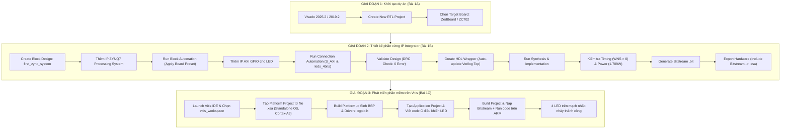

# TÀI LIỆU ÔN TẬP VÀ 20 CÂU HỎI VẤN ĐÁP BẢO VỆ LAB 1
## MÔN HỌC: THIẾT KẾ HỆ THỐNG TRÊN VI MẠCH (SOC DESIGN - SOCD334264)
**Khoa Điện – Điện tử, Trường Đại học Sư phạm Kỹ thuật TP.HCM (HCMUTE)**  
*Dành cho sinh viên ngành Kỹ thuật Máy tính / Điện tử ôn thi vấn đáp thực hành Lab 1*

---

# PHẦN 1: TỔNG QUAN VÀ TÓM TẮT TRỌNG TÂM BÀI LAB 1

### 1. Thông tin chung & Mục tiêu cốt lõi
* **Tên bài Lab:** Thiết kế hệ thống Zynq SoC cơ bản bằng Vivado IP Integrator và Vitis/SDK trên nền tảng bo mạch (ZedBoard / ZC702 / Pynq-Z2).
* **Mục tiêu chính:**
  1. Nắm vững phương pháp thiết kế đồng thời phần cứng và phần mềm (**Hardware/Software Codesign**) trên nền tảng vi mạch lai Xilinx Zynq-7000 SoC.
  2. Sử dụng thành thạo môi trường Vivado IP Integrator để xây dựng hệ thống nhúng dạng sơ đồ khối (**Block Design**).
  3. Hiểu rõ cơ chế kết nối bus tiêu chuẩn công nghiệp **AXI (ARM AMBA AXI4-Lite)** giữa khối xử lý trung tâm (**Processing System - PS**) và khối logic khả trình (**Programmable Logic - PL**).
  4. Thực hiện trọn vẹn luồng thiết kế phần cứng: Kiểm tra luật thiết kế (DRC), đóng gói top-level HDL Wrapper, tổng hợp (Synthesis), thực thi (Implementation), phân tích định thời (Timing Analysis) và công suất (Power Analysis), tạo tệp cấu hình bitstream (`.bit`).
  5. Xuất định nghĩa nền tảng phần cứng (`.xsa`) sang môi trường phát triển phần mềm **AMD Vitis IDE**.
  6. Xây dựng gói hỗ trợ bo mạch (**Board Support Package - BSP**) cho hệ điều hành độc lập (**Standalone / Bare-metal**) và viết mã nguồn C điều khiển ngoại vi AXI GPIO xuất tín hiệu nhấp nháy 4 đèn LED vật lý trên board mạch.

---

### 2. Quy trình thực hiện trọn vẹn (Workflow 3 giai đoạn)

---

### 3. Kiến trúc hệ thống phần cứng (Block Design Architecture)

Hệ thống được thiết kế theo mô hình **Master - Slave** trên kiến trúc bus AXI4-Lite:
1. **Khối ZYNQ7 Processing System (`processing_system7_0`):**
   * Đóng vai trò là **Master** duy nhất trong hệ thống.
   * Chứa lõi xử lý cứng kép ARM Cortex-A9 MPCore.
   * Cung cấp xung nhịp hệ thống `FCLK_CLK0` (50 MHz) và tín hiệu reset tích cực mức thấp `FCLK_RESET0_N` cho toàn bộ vùng PL.
   * Làm chủ giao tiếp bus dữ liệu thông qua cổng Master ngoại vi đa dụng `M_AXI_GP0` (General Purpose AXI Master port, độ rộng dữ liệu 32-bit).
   * Điều khiển bộ nhớ ngoài DDR RAM và các chân vào ra cố định `FIXED_IO` (UART, SD Card, MIO pins).
2. **Khối AXI Interconnect (`ps7_0_axi_periph`):**
   * Đóng vai trò là mạng chuyển mạch trung gian (Bus Matrix / Switch Crossbar).
   * Nhận lệnh từ cổng Master `M_AXI_GP0` của PS, giải mã địa chỉ và định tuyến các gói tin AXI-Lite tới đúng ngoại vi Slave tương ứng trong không gian địa chỉ bộ nhớ.
3. **Khối Processor System Reset (`rst_ps7_0_50M`):**
   * Nhận tín hiệu reset thô `FCLK_RESET0_N` và xung nhịp `FCLK_CLK0` từ PS.
   * Đồng bộ hóa và sinh ra các tín hiệu reset đồng bộ chuẩn cho hệ thống bus (`interconnect_aresetn`) và các khối ngoại vi (`peripheral_aresetn`), triệt tiêu hiện tượng bất định trạng thái (Metastability) khi khởi động.
4. **Khối AXI GPIO (`axi_gpio_0`):**
   * Đóng vai trò là **Slave** nằm trên vùng logic lập trình được (PL).
   * Giao tiếp với AXI Interconnect qua cổng `S_AXI` (Slave AXI-Lite) được ánh xạ vào không gian địa chỉ CPU (mặc định dải `0x41200000 - 0x4120FFFF`).
   * Xuất các đường tín hiệu ra cổng vật lý ngoài `leds_4bits` kết nối trực tiếp với 4 đèn LED trên bo mạch.

---

### 4. Báo cáo phân tích chất lượng thiết kế mạch (Implementation Reports)
* **Phân tích định thời (Static Timing Analysis):**
  * Tất cả các ràng buộc thời gian đều thỏa mãn hoàn toàn (*All user specified timing constraints are met*).
  * **Worst Negative Slack (WNS):** $+12.442\text{ ns}$ (mang giá trị dương lớn, đảm bảo đường truyền trễ nhất vẫn sớm hơn cạnh xung nhịp 50 MHz tới $12.442\text{ ns}$, triệt tiêu vi phạm thời gian thiết lập - *Setup Time Violation*).
  * **Worst Hold Slack (WHS):** $+0.060\text{ ns}$ (mang giá trị dương, loại bỏ vi phạm thời gian giữ - *Hold Time Violation*).
  * **Điểm lỗi định thời (Failing Endpoints):** $0 / 0$ điểm lỗi. Mạch hoạt động ổn định tuyệt đối ở tần số $50\text{ MHz}$.
* **Phân tích công suất tiêu thụ (Power Analysis):**
  * Tổng công suất trên chip: $1.709\text{ W}$.
  * Công suất động (Dynamic Power): $1.566\text{ W}$ (chiếm $92\%$). Trong đó, khối xử lý trung tâm Zynq PS tiêu thụ $1.564\text{ W}$ (chiếm tới $99.8\%$ công suất động), còn vùng logic PL chỉ tiêu thụ khoảng $0.002\text{ W}$ do thiết kế mạch PL chỉ gồm 1 IP GPIO cơ bản.
  * Công suất tĩnh (Static/Quiescent Power): $0.143\text{ W}$ (chiếm $8\%$, năng lượng rò rỉ cơ bản của đế bán dẫn).
  * Nhiệt độ tiếp giáp bán dẫn ($T_j$): $44.7^\circ\text{C}$ với biên độ nhiệt an toàn $40.3^\circ\text{C}$ (ngưỡng tối đa cho phép là $85^\circ\text{C}$).

---

# PHẦN 2: BỘ 20 CÂU HỎI VẤN ĐÁP LAB 1 (KÈM ĐÁP ÁN CHI TIẾT)

Bộ câu hỏi được phân loại theo 5 chuyên đề trọng tâm mà giảng viên thường xuyên kiểm tra.

---

## NHÓM 1: BẢN CHẤT KIẾN TRÚC ZYNQ SOC & KHÁI NIỆM CỐT LÕI

### Câu 1: Em hãy phân biệt bản chất giữa Processing System (PS) và Programmable Logic (PL) trên chip Zynq-7000? Tại sao nhà sản xuất lại tích hợp cả hai thành một hệ thống SoC?
* **Đáp án chuẩn:**
  * **Processing System (PS):** Là hệ thống xử lý phần cứng cố định (Hard IP/Hard Silicon), bao gồm cụm vi xử lý lõi kép ARM Cortex-A9, bộ nhớ đệm Cache (L1/L2), bộ điều khiển bộ nhớ (DDR Controller) và các ngoại vi chuẩn (UART, SPI, I2C, USB, GigE, SD/eMMC). PS hoạt động tuần tự bằng mã lệnh phần mềm, tần số xung nhịp cao (lên tới $667\text{ MHz} - 1\text{ GHz}$).
  * **Programmable Logic (PL):** Là mảng logic khả trình (FPGA Fabric dựa trên kiến trúc Artix-7 hoặc Kintex-7) gồm các bảng tra LUTs, thanh ghi Flip-Flops, khối xử lý tín hiệu số DSP48E1, bộ nhớ khối BRAM và các khối I/O có thể cấu hình lại bằng tệp bitstream. PL hoạt động song song hoàn toàn ở mức phần cứng.
  * **Lý do tích hợp SoC:** Tận dụng được sức mạnh của cả hai thế giới:
    * PS đảm nhận các tác vụ tính toán phức tạp tuần tự, quản lý hệ thống, giao diện mạng, giao diện người dùng và chạy hệ điều hành (Linux/RTOS).
    * PL đảm nhận tăng tốc phần cứng (Hardware Acceleration) cho các thuật toán đòi hỏi tính toán song song thời gian thực (xử lý tín hiệu, xử lý ảnh, AI/ML, điều khiển động cơ đa kênh) mà CPU đơn thuần không thể đáp ứng được băng thông.
    * Tích hợp trên cùng một phiến silicon giúp bus truyền thông giữa CPU và FPGA có băng thông cực lớn và độ trễ cực thấp so với dùng hai chip riêng biệt kết nối qua dây bus ngoài bo mạch.

---

### Câu 2: Quá trình khởi động (Boot Process) của hệ thống Zynq SoC diễn ra như thế nào? PS khởi động trước hay PL nạp trước?
* **Đáp án chuẩn:**
  * **Quy tắc bất biến trên Zynq:** **PS luôn luôn là bên làm chủ và khởi động trước (PS Boots First).** Khác với FPGA thuần túy (vốn khởi động ngay khi nạp bitstream từ SPI Flash), Zynq SoC là hệ thống lấy bộ xử lý làm trung tâm (*Processor-Centric*).
  * **Trình tự khởi động 3 giai đoạn:**
    1. **Giai đoạn 0 (Stage 0 - BootROM):** Ngay sau khi cấp nguồn (Power-On Reset), nhân ARM Cortex-A9 CPU0 đọc mã cứng trong BootROM nội của PS. BootROM kiểm tra chân cấu hình chế độ khởi động (Boot Mode Pins - chọn SD Card, QSPI Flash hay JTAG) và nạp đoạn mã khởi động thứ nhất (First Stage Bootloader - FSBL) vào bộ nhớ nội OCM (On-Chip Memory, dung lượng $256\text{ KB}$).
    2. **Giai đoạn 1 (Stage 1 - FSBL):** FSBL được thực thi, tiến hành khởi tạo cấu hình phần cứng cơ bản cho PS (cấu hình các bộ nhân tần PLL, xung clock hệ thống, khởi tạo bộ điều khiển DDR RAM, cấu hình các chân MIO). Sau đó, nếu có tệp cấu hình bitstream, FSBL sẽ điều khiển khối cấu hình phần cứng PCAP (Processor Configuration Access Port) hoặc DevC để nạp bitstream vào vùng PL.
    3. **Giai đoạn 2 (Stage 2 - User Application / OS):** Sau khi cấu hình xong DDR và nạp PL, FSBL chuyển quyền điều khiển cho chương trình ứng dụng của người dùng (chạy file `.elf` Bare-metal hoặc nạp U-Boot để khởi động Linux).

---

### Câu 3: Khái niệm "Hardware/Software Codesign" (Đồng thiết kế Phần cứng/Phần mềm) được thể hiện cụ thể như thế nào trong bài Lab 1?
* **Đáp án chuẩn:**
  * **Đồng thiết kế HW/SW** là phương pháp luận kỹ thuật cho phép phân chia bài toán thành hai phần thực thi song song và tương hỗ lẫn nhau: một phần được hiện thực bằng mạch điện tử phần cứng (Hardware) và một phần được hiện thực bằng mã lệnh chương trình (Software).
  * **Trong bài Lab 1, điều này thể hiện cụ thể:**
    * **Phần cứng (Hardware - Vivado):** Thiết kế sơ đồ khối phần cứng gồm vi xử lý ARM (PS), bus AXI Interconnect, bộ phân tích xung nhịp/reset và khối ngoại vi giao tiếp vào ra AXI GPIO nằm trong PL kết nối trực tiếp với 4 chân LED vật lý.
    * **Phần mềm (Software - Vitis):** Viết chương trình bằng ngôn ngữ C chạy trên nhân ARM, sử dụng các hàm API của driver cấp thấp (`xgpio.h`) để ghi các giá trị logic vào các thanh ghi được ánh xạ địa chỉ của IP AXI GPIO.
    * Hai phần liên kết chặt chẽ qua tệp tin giao tiếp phần cứng `.xsa` (chứa bitstream cấu hình PL và bảng địa chỉ thanh ghi để phần mềm biên dịch chuẩn xác).

---

### Câu 4: Trong bài Lab 1C, nhóm lựa chọn hệ điều hành là "Standalone". Standalone (Bare-metal) là gì và khác gì so với chạy trên Linux?
* **Đáp án chuẩn:**
  * **Standalone (còn gọi là Bare-metal):** Là mô hình lập trình mà ứng dụng C chạy trực tiếp trên nền tảng phần cứng của vi xử lý mà **không có bất kỳ hệ điều hành (OS) hay lớp trừu tượng hạt nhân (Kernel) nào ở giữa**. Chương trình C nắm toàn quyền kiểm soát thanh ghi CPU, bộ nhớ và các ngoại vi.
  * **So sánh với Linux nhúng (Petalinux):**
    * *Độ phức tạp & Kích thước:* Standalone cực kỳ nhẹ, kích thước mã chỉ vài chục đến vài trăm KB, thời gian khởi động tức thì (vài mili-giây). Linux đòi hỏi dung lượng bộ nhớ lớn (hàng chục đến hàng trăm MB DDR), cấu hình phức tạp (Device Tree, Kernel, Rootfs), khởi động mất hàng chục giây.
    * *Tính tiền định thời gian (Determinism):* Standalone đáp ứng thời gian thực nghiêm ngặt (Hard Real-Time), độ trễ ngắt cực thấp và cố định. Linux tiêu chuẩn là hệ thống chia sẻ thời gian (Time-sharing), không thể đảm bảo độ trễ chính xác mức micro-giây trừ khi dùng nhân RT-Linux.
    * *Trường hợp sử dụng:* Standalone phù hợp cho các bài Lab cơ bản, các ứng dụng điều khiển nhúng sâu, xử lý vòng lặp kín tốc độ cao hoặc kiểm tra (bring-up) mạch phần cứng ban đầu.

---

## NHÓM 2: GIAO TIẾP BUS AXI & CÁC KHỐI IP TRONG BLOCK DESIGN

### Câu 5: Chuẩn giao tiếp AXI là gì? Hãy nêu 3 loại chuẩn AXI4 phổ biến và cho biết khối AXI GPIO trong bài dùng loại nào? Vì sao?
* **Đáp án chuẩn:**
  * **Chuẩn AXI (Advanced eXtensible Interface):** Là một phần của đặc tả bus AMBA thế hệ thứ 4 do hãng ARM ban hành, là chuẩn giao tiếp bus điểm-tới-điểm tốc độ cao, hiệu năng cao, hỗ trợ đa luồng và các miền xung nhịp độc lập trên hệ thống SoC.
  * **3 loại giao thức AXI4:**
    1. **AXI4 (AXI4-Full):** Hỗ trợ truyền dữ liệu theo gói kích thước lớn (Burst Transfer lên tới 256 chu kỳ nhịp trên mỗi giao dịch), tối ưu cho việc đọc/ghi dữ liệu liên tục với bộ nhớ ngoài (DDR/BRAM).
    2. **AXI4-Lite:** Là phiên bản tinh giản của AXI4, **không hỗ trợ burst** (mỗi giao dịch chỉ đọc/ghi đúng 1 từ dữ liệu đơn lẻ 32-bit hoặc 64-bit). Cấu trúc phần cứng đơn giản, tốn rất ít tài nguyên logic FPGA.
    3. **AXI4-Stream:** Giao thức truyền luồng dữ liệu một chiều liên tục theo cơ chế Master-to-Slave, không sử dụng địa chỉ (chỉ gồm dữ liệu và tín hiệu bắt tay `TVALID/TREADY`), băng thông cực đại, tối ưu cho xử lý video, DSP và bộ tăng tốc HLS.
  * **Khối AXI GPIO dùng loại nào:** Dùng **AXI4-Lite**.
  * **Lý do:** Khối AXI GPIO chỉ cần vi xử lý đọc hoặc ghi các giá trị điều khiển 32-bit vào thanh ghi dữ liệu và thanh ghi hướng (Data/Tri-state Registers) theo từng chu kỳ rời rạc. Việc dùng AXI4-Lite giúp tiết kiệm tối đa tài nguyên logic (LUT, FF) trên FPGA mà vẫn đáp ứng hoàn hảo tốc độ điều khiển.

---

### Câu 6: Trong thiết kế Block Design của Lab 1, khối nào đóng vai trò Master, khối nào là Slave? Cổng `M_AXI_GP0` của Zynq PS có đặc tính kỹ thuật gì?
* **Đáp án chuẩn:**
  * **Master:** Là **ZYNQ7 Processing System** (thông qua cổng `M_AXI_GP0`). Khối Master là bên chủ động khởi phát các giao dịch đọc/ghi địa chỉ và dữ liệu.
  * **Slave:** Là khối **AXI GPIO** (thông qua cổng `S_AXI`). Khối Slave ở trạng thái thụ động lắng nghe, giải mã địa chỉ nhận được từ bus và thực hiện ghi dữ liệu vào thanh ghi hoặc trả dữ liệu về Master.
  * **Đặc tính kỹ thuật của cổng `M_AXI_GP0`:**
    * Tên đầy đủ: *Master AXI General Purpose port 0*.
    * Là cổng bus AXI 32-bit đa dụng thuộc miền PS kết nối sang PL.
    * Giao thức: Tương thích AXI3/AXI4.
    * Tần số hoạt động: Đồng bộ với xung nhịp `FCLK_CLK0` (50 MHz trong bài Lab).
    * Đặc điểm: Băng thông mức trung bình, độ trễ vừa phải, chuyên dùng cho CPU để cấu hình, đọc/ghi các thanh ghi trạng thái và thanh ghi điều khiển của các IP ngoại vi trong PL (khác với cổng `S_AXI_HP` hiệu năng cao dùng cho DMA truyền mảng lớn).

---

### Câu 7: Vai trò cốt lõi của khối IP "AXI Interconnect" (`ps7_0_axi_periph`) trong hệ thống là gì?
* **Đáp án chuẩn:**
  * **AXI Interconnect** đóng vai trò là một **mạng chuyển mạch bus trung tâm (Switch Fabric / Crossbar Matrix)**, kết nối một hoặc nhiều AXI Master với một hoặc nhiều AXI Slave.
  * **Nhiệm vụ cụ thể của nó trong bài Lab:**
    1. **Định tuyến địa chỉ và dữ liệu (Address Decoding & Routing):** Khi CPU ARM phát ra một địa chỉ bộ nhớ (ví dụ `0x41200000`), AXI Interconnect đọc địa chỉ đó, nhận diện xem địa chỉ đó thuộc về Slave nào trong bảng không gian địa chỉ (Address Map) và định tuyến giao dịch tới đúng cổng `S_AXI` của AXI GPIO đó.
    2. **Chuyển đổi giao thức (Protocol Conversion):** Tự động chuyển đổi giao thức giữa cổng Master của Zynq PS (AXI3) sang cổng Slave của ngoại vi (AXI4-Lite).
    3. **Đồng bộ miền xung nhịp và độ rộng dữ liệu (Clock Domain Crossing & Data Width Conversion):** Đảm bảo việc truyền nhận tin cậy nếu Master và Slave chạy ở hai tần số xung nhịp hoặc độ rộng bus dữ liệu khác nhau.
    4. **Phân xử tranh chấp bus (Arbitration):** Trong các hệ thống nhiều Master truy cập cùng một Slave, nó phân xử quyền ưu tiên để chống xung đột đường truyền.

---

### Câu 8: Tại sao trong Block Design bắt buộc phải có khối "Processor System Reset" (`rst_ps7_0_50M`)? Tại sao không dùng trực tiếp tín hiệu `FCLK_RESET0_N` từ PS nối thẳng vào GPIO?
* **Đáp án chuẩn:**
  * **Khối Processor System Reset có nhiệm vụ:** Tiếp nhận xung clock hệ thống (`FCLK_CLK0`) và tín hiệu reset thô bất đồng bộ (`FCLK_RESET0_N` từ PS hoặc nút bấm bên ngoài) để sinh ra chuỗi tín hiệu reset **đồng bộ hoàn toàn với cạnh xung nhịp** cung cấp cho toàn bộ logic trong PL.
  * **Lý do không được nối trực tiếp `FCLK_RESET0_N`:**
    1. **Nguy cơ bất định trạng thái (Metastability):** Tín hiệu `FCLK_RESET0_N` là tín hiệu reset giải phóng bất đồng bộ. Nếu tín hiệu này nhả ra (từ 0 lên 1) đúng vào thời điểm cửa sổ nhạy cảm (setup/hold window) của cạnh lên xung clock 50 MHz, các thanh ghi Flip-Flop trong PL sẽ rơi vào trạng thái bất định (không xác định là 0 hay 1), dẫn đến treo toàn bộ hệ thống ngay khi khởi động.
    2. **Đảm bảo độ rộng xung Reset (Reset Pulse Stretching):** Khối reset tự động giữ tín hiệu reset ở mức tích cực trong một số lượng chu kỳ xung clock cố định (thường tối thiểu 16 chu kỳ) để toàn bộ các khối nội vi và hệ thống bus hoàn tất việc xả trạng thái cũ.
    3. **Phân tách các miền Reset chuyên biệt:** Khối sinh ra nhiều đường reset với các mức tích cực khác nhau: `interconnect_aresetn` (reset tích cực mức thấp cho mạng bus), `peripheral_aresetn` (reset cho ngoại vi), `peripheral_reset` (tích cực mức cao cho các IP chuẩn cũ).

---

## NHÓM 3: THAO TÁC VIVADO, TỰ ĐỘNG HÓA & KHÂU TỔNG HỢP PHẦN CỨNG

### Câu 9: Trình bày sự khác nhau giữa tính năng "Run Block Automation" và "Run Connection Automation" trong Vivado IP Integrator?
* **Đáp án chuẩn:**
  * **Run Block Automation:**
    * Được kích hoạt riêng cho khối vi xử lý trung tâm **ZYNQ7 Processing System**.
    * **Chức năng:** Tự động nạp cấu hình phần cứng đặc thù của bo mạch đích (**Board Preset** từ thư viện board file của Xilinx). Nó tự động cấu hình các tham số nội bộ của PS: cấu hình bộ điều khiển bộ nhớ ngoài DDR (loại DDR3, timing, độ rộng bus), cấu hình bộ chia tần số xung clock (`FCLK_CLK0` = 50 MHz), kích hoạt các cổng ngoại vi phần cứng cố định `FIXED_IO` (UART, SD Card, Enthernet, chân cắm MIO).
  * **Run Connection Automation:**
    * Được kích hoạt khi thêm các khối IP ngoại vi vào sơ đồ (như AXI GPIO).
    * **Chức năng:** Tự động giải quyết các kết nối bus và cổng vật lý:
      * *Lần 1 (cho cổng `S_AXI`):* Tự động khởi tạo khối AXI Interconnect, Processor System Reset và nối dây bus địa chỉ/dữ liệu/clock/reset từ PS tới Slave.
      * *Lần 2 (cho cổng ngoại vi `GPIO`):* Tự động xuất cổng ra chân ngoài vi mạch (Make External) và ánh xạ cổng đó với thành phần phần cứng vật lý trên bo mạch (như `leds_4bits`), tự động gán tọa độ chân chip (Pin LOC) và chuẩn điện áp (IOSTANDARD) từ board file mà không cần người dùng viết file `.xdc`.

---

### Câu 10: Thao tác "Validate Design" trong Vivado IP Integrator làm nhiệm vụ gì? Nếu bỏ qua bước này mà bấm tổng hợp luôn thì có được không?
* **Đáp án chuẩn:**
  * **Nhiệm vụ của Validate Design:** Chạy công cụ kiểm tra luật thiết kế hệ thống (**System Design Rule Check - DRC**). Công cụ này kiểm tra:
    1. Tính toàn vẹn của hệ thống bus AXI (các chân Master/Slave đã được kết nối đầy đủ chưa, có bus nào bị hở mạch không).
    2. Tính tương thích giữa các miền xung nhịp (`aclk`) và tín hiệu reset (`aresetn`) giữa các khối.
    3. Không gian địa chỉ bộ nhớ (Address Space): Xác minh toàn bộ các IP ngoại vi đã được cấp phát dải địa chỉ bộ nhớ hợp lệ trong bảng `Address Editor`, không bị chồng lấn địa chỉ hoặc bị sót (Unmapped).
  * **Nếu bỏ qua bước này:** Mặc dù Vivado vẫn có thể cho phép chạy tiếp, nhưng nếu sơ đồ có lỗi hở mạch hoặc chưa phân giải địa chỉ, quy trình Synthesis hoặc Implementation sẽ bị lỗi ngắt quãng (*Critical Warning / Fatal Error*), hoặc nghiêm trọng hơn là tạo ra bitstream bị lỗi khiến CPU ARM không thể giao tiếp được với PL khi chạy thực tế. Do đó, Validate Design là bước bắt buộc để phòng ngừa rủi ro từ sớm.

---

### Câu 11: Tại sao sau khi thiết kế xong Block Design (.bd) lại bắt buộc phải thực hiện bước "Create HDL Wrapper"?
* **Đáp án chuẩn:**
  * **Bản chất kỹ thuật:** Sơ đồ khối Block Design (`.bd`) là một cấu trúc biểu diễn đồ họa nội bộ của công cụ IP Integrator (thực chất lưu dưới dạng cây XML/JSON).
  * Tuy nhiên, các trình biên dịch và tổng hợp mạch phần cứng tiêu chuẩn của Vivado (Vivado Synthesis Engine) chỉ có thể đọc và phân tích mã nguồn phân cấp dựa trên các tệp mô tả phần cứng tiêu chuẩn (**RTL - Verilog hoặc VHDL**).
  * Do đó, bước **Create HDL Wrapper** thực hiện nhiệm vụ: Tự động sinh ra một file mã nguồn Verilog cấp cao nhất (**Top-level Module**, ví dụ `first_zynq_system_wrapper.v`). File này khởi tạo (instantiate) module Block Design và đóng gói toàn bộ các đường tín hiệu vào/ra ngoài vi mạch (như chân DDR, chân FIXED_IO, chân `leds_4bits_tri_o`) thành các cổng `input/output` chuẩn của chip FPGA. Nếu không có file Top-level Wrapper này, công cụ Synthesis sẽ báo lỗi thiếu gốc phân cấp (*Top module is missing*) và không thể tổng hợp mạch.

---

### Câu 12: Khi tạo HDL Wrapper, Vivado đưa ra hai tùy chọn: "Let Vivado manage wrapper and auto-update" và "User-managed wrapper". Nhóm đã chọn tùy chọn nào và vì sao?
* **Đáp án chuẩn:**
  * **Nhóm chọn tùy chọn:** **"Let Vivado manage wrapper and auto-update"**.
  * **Giải thích nguyên nhân:**
    * Chế độ *Let Vivado manage wrapper and auto-update* cho phép Vivado tự động theo dõi file Block Design (`.bd`). Bất cứ khi nào người dùng chỉnh sửa sơ đồ khối (thêm IP mới, đổi tên cổng, đổi chân I/O), Vivado sẽ **tự động tái sinh và cập nhật lại mã nguồn Verilog của file wrapper** mà người dùng không cần phải can thiệp thủ công. Điều này loại bỏ hoàn toàn nguy cơ sai lệch tín hiệu giữa sơ đồ khối và mã bọc top-level.
    * Chế độ *User-managed wrapper* chỉ dùng khi kỹ sư muốn tự tay viết thêm các đoạn mã RTL tùy biến bên ngoài bao quanh Block Design. Khi đó, nếu sơ đồ khối thay đổi, người dùng phải tự sửa file wrapper bằng tay, rất dễ gây lỗi đồng bộ.

---

### Câu 13: Trong báo cáo Timing sau bước Implementation, chỉ số WNS đạt +12.442 ns và WHS đạt +0.060 ns. Ý nghĩa của các giá trị này là gì? Nếu WNS bị âm (< 0) thì hệ thống gặp hậu quả gì?
* **Đáp án chuẩn:**
  * **Slack (Độ dôi thời gian):** Là hiệu số giữa thời điểm tín hiệu thực tế đến đích so với thời điểm yêu cầu tối đa của chu kỳ xung nhịp. Giá trị Slack **phải mang giá trị dương** ($\ge 0$) thì mạch mới hoạt động chính xác.
  * **WNS (Worst Negative Slack):** Đo lường thời gian thiết lập (**Setup Time**). Giá trị $+12.442\text{ ns}$ (rất lớn trên chu kỳ $20\text{ ns}$ của xung 50 MHz) chứng minh rằng đường truyền dữ liệu logic trễ nhất trong mạch vẫn đến trước cạnh clock tiếp theo tới $12.442\text{ ns}$.
  * **WHS (Worst Hold Slack):** Đo lường thời gian giữ (**Hold Time**). Giá trị $+0.060\text{ ns}$ chứng minh tín hiệu được duy trì ổn định an toàn sau cạnh clock, triệt tiêu nguy cơ tranh chấp dữ liệu (Race Condition).
  * **Hậu quả nếu WNS bị âm ($< 0$):**
    * Mạch bị vi phạm thời gian thiết lập (**Setup Time Violation**).
    * Tín hiệu truyền qua các cổng logic không kịp chuyển trạng thái ổn định trước khi cạnh xung clock ập tới, dẫn đến dữ liệu ghi vào thanh ghi Flip-Flop bị sai lệch hoặc rơi vào trạng thái bất định (Metastability).
    * Hậu quả thực tế: Mạch logic sẽ hoạt động sai chức năng, chập chờn, hoặc hệ thống bị treo đột ngột khi chạy ở tần số thiết kế.

---

## NHÓM 4: BÁO CÁO NĂNG LƯỢNG & XUẤT NỀN TẢNG PHẦN CỨNG (.XSA)

### Câu 14: Báo cáo công suất (Power Analysis) ghi nhận tổng công suất là 1.709 W, trong đó PS chiếm đến 1.564 W còn PL chỉ chiếm 0.002 W. Hãy giải thích cơ sở khoa học của hiện tượng này?
* **Đáp án chuẩn:**
  * Hiện tượng này hoàn toàn hợp lý về mặt vật lý và kiến trúc:
    1. **Khối PS (Processing System):** Chứa nhân vi xử lý kép ARM Cortex-A9 chạy ở tần số rất cao ($667\text{ MHz}$), mạch vòng khóa pha PLL, hệ thống bus nội AXI tốc độ cao, các bộ nhớ đệm Cache L1/L2 và bộ điều khiển RAM DDR liên tục refresh. Các bóng bán dẫn bên trong PS hoạt động chuyển mạch với tần số cao liên tục nên tiêu tán công suất động ($P_{dyn} = C \cdot V^2 \cdot f$) rất lớn, chiếm tới $1.564\text{ W}$ ($99.8\%$ công suất động của toàn chip).
    2. **Khối PL (Programmable Logic):** Trong bài Lab 1, thiết kế phần cứng trên vùng FPGA cực kỳ đơn giản (chỉ gồm 1 IP AXI GPIO, 1 IP AXI Interconnect và 1 IP Processor System Reset), xung nhịp hoạt động chỉ là $50\text{ MHz}$. Số lượng bảng tra LUT và Flip-Flop sử dụng chiếm chưa tới $1\%$ tài nguyên của chip, các khối DSP và Block RAM hoàn toàn không sử dụng. Do đó, công suất chuyển mạch trên PL cực kỳ thấp ($\approx 0.002\text{ W}$).

---

### Câu 15: Tệp tin `.xsa` (Xilinx Support Archive) là gì? Trong tệp này chứa đựng những thông tin gì quan trọng?
* **Đáp án chuẩn:**
  * **Tệp `.xsa`:** Là tệp nén lưu trữ đóng gói toàn bộ đặc tả nền tảng phần cứng do Vivado sinh ra, đóng vai trò là "bản hợp đồng giao tiếp" duy nhất chuyển giao từ kỹ sư phần cứng (Vivado) sang kỹ sư phần mềm (Vitis/SDK).
  * **Các thành phần cốt lõi bên trong file `.xsa`:**
    1. **Sơ đồ kiến trúc hệ thống (Hardware Description XML/HWH):** Liệt kê danh sách các lõi xử lý, các IP ngoại vi có mặt trong hệ thống và cách chúng kết nối với nhau.
    2. **Bản đồ không gian địa chỉ bộ nhớ (Address Map):** Định nghĩa địa chỉ cơ sở (Base Address) và địa chỉ kết thúc (High Address) của từng ngoại vi (để Vitis sinh ra file định nghĩa `xparameters.h`).
    3. **Cấu hình tham số xung nhịp và ngắt (Clock & Interrupt Configuration):** Tần số của các đường clock hệ thống và bảng ánh xạ ID ngắt.
    4. **Tệp cấu hình bitstream (`.bit`):** Tệp cấu hình nạp cho FPGA (nếu người dùng chọn *Include bitstream* khi export).

---

### Câu 16: Tại sao ở bước Export Hardware trên Vivado, bắt buộc phải chọn "Include bitstream"? Nếu quên tích chọn mục này thì hậu quả là gì?
* **Đáp án chuẩn:**
  * **Tại sao phải chọn:** Khối ngoại vi AXI GPIO và các chân kết nối đèn LED được triển khai trên vùng logic lập trình được (**PL**). Vùng PL bản chất là bộ nhớ SRAM tĩnh, khi mới cấp nguồn nó hoàn toàn trống rỗng và chưa có chức năng. Tệp bitstream (`.bit`) là tệp duy nhất chứa cấu hình mạch điện để biến vùng PL thành khối AXI GPIO thực thụ.
  * **Hậu quả nếu quên chọn "Include bitstream":**
    * Tệp `.xsa` sinh ra chỉ chứa thông tin mô tả lý thuyết của hệ thống mà không có tệp cấu hình mạch nạp FPGA.
    * Khi sang môi trường Vitis, bạn vẫn có thể tạo Platform Project, vẫn sinh được BSP và vẫn biên dịch mã nguồn C ra file thực thi `.elf` thành công mà không gặp lỗi.
    * Tuy nhiên, khi bạn cắm mạch thực tế và bấm *Run/Debug*, Vitis sẽ không thể nạp cấu hình bitstream xuống FPGA. Lúc này, khối AXI GPIO **hoàn toàn chưa tồn tại trên phần cứng vật lý**.
    * Khi nhân ARM thực thi lệnh ghi dữ liệu tới địa chỉ của GPIO, bus AXI sẽ không nhận được phản hồi xác nhận (`RRESP / BRESP`) từ Slave, dẫn đến CPU bị rơi vào ngoại lệ lỗi bus (**Data Abort Exception / Bus Error**) và ứng dụng bị treo hoàn toàn, đèn LED không sáng.

---

## NHÓM 5: LẬP TRÌNH C TRÊN VITIS & XỬ LÝ LỖI / MỞ RỘNG

### Câu 17: Khái niệm BSP (Board Support Package) trong Vitis là gì? Thư viện `xgpio.h` lấy từ đâu ra?
* **Đáp án chuẩn:**
  * **BSP (Board Support Package):** Là một tập hợp các thư viện phần mềm cấp thấp, trình điều khiển thiết bị (**Device Drivers**), mã khởi tạo hệ thống (Startup code, Reset vector) và các tệp cấu hình đặc thù cho bo mạch do Vitis tự động sinh ra dựa trên phần cứng mô tả trong file `.xsa`.
  * **Nguồn gốc thư viện `xgpio.h`:**
    * Khi bạn nạp file `.xsa` vào Vitis, Vitis đọc bản đồ phần cứng và phát hiện có khối IP mang tên `axi_gpio`.
    * Vitis tự động trích xuất mã nguồn driver chuẩn tương ứng cho IP này từ thư mục cài đặt của Xilinx và đưa vào thư mục BSP của dự án. File `xgpio.h` chính là tệp tiêu đề (header file) định nghĩa các cấu trúc dữ liệu (`XGpio`), các hằng số và các hàm API cấp thấp (như `XGpio_Initialize`, `XGpio_SetDataDirection`, `XGpio_DiscreteWrite`) để lập trình viên gọi trong mã C.

---

### Câu 18: Trình bày cơ chế điều khiển AXI GPIO thông qua kỹ thuật Memory-Mapped I/O (MMIO)? Giải thích ý nghĩa của các hàm C điều khiển LED.
* **Đáp án chuẩn:**
  * **Cơ chế Memory-Mapped I/O (Ánh xạ bộ nhớ vào/ra):**
    * Khối ngoại vi AXI GPIO được gắn vào không gian địa chỉ bộ nhớ chung của vi xử lý tại một địa chỉ xác định (ví dụ Base Address = `0x41200000` được định nghĩa trong `xparameters.h`).
    * CPU ARM không cần lệnh I/O chuyên biệt, mà coi các thanh ghi bên trong AXI GPIO như những ô nhớ RAM thông thường. Việc điều khiển phần cứng đơn giản là thao tác ghi giá trị vào ô nhớ (Store) hoặc đọc giá trị từ ô nhớ (Load) thông qua bus AXI-Lite.
  * **Ý nghĩa các hàm C cốt lõi:**
    1. `XGpio_Initialize(&Gpio, GPIO_DEVICE_ID);`: Tìm kiếm cấu hình phần cứng của ngoại vi dựa trên ID/BaseAddress, khởi tạo cấu trúc dữ liệu điều khiển `Gpio` và xác nhận phần cứng đã sẵn sàng.
    2. `XGpio_SetDataDirection(&Gpio, 1, 0x0);`: Cấu hình thanh ghi hướng (Tri-state Register) cho Channel 1.
       * Quy ước chuẩn: **Bit = 0 là OUTPUT (Ngõ ra)**; **Bit = 1 là INPUT (Ngõ vào)**.
       * Truyền giá trị `0x0` nghĩa là thiết lập toàn bộ các chân của kênh GPIO làm ngõ ra để xuất tín hiệu điều khiển đèn LED.
    3. `XGpio_DiscreteWrite(&Gpio, 1, data);`: Ghi trực tiếp giá trị nhị phân `data` vào thanh ghi dữ liệu (Data Register) của kênh 1. Mức logic (0 hoặc 1) trên các bit sẽ được mạch AXI GPIO xuất thành mức điện áp vật lý (0V hoặc 3.3V) đưa thẳng ra 4 chân đèn LED trên bo mạch.

---

### Câu 19: Giả sử sau khi biên dịch và nạp code xuống bo mạch, 4 đèn LED không nhấp nháy như mong muốn. Hãy trình bày quy trình kiểm tra và cô lập lỗi (Troubleshooting) theo thứ tự logic?
* **Đáp án chuẩn:**
  * Trình tự cô lập lỗi bài bản gồm 4 bước từ phần cứng lên phần mềm:
    1. **Kiểm tra kết nối vật lý & Đèn báo trạng thái nguồn:**
       * Kiểm tra cáp nạp JTAG/UART đã cắm chắc chắn chưa, công tắc nguồn bo mạch đã bật chưa.
       * **Quan sát đèn LED "DONE" trên bo mạch FPGA:** Nếu đèn DONE sáng xanh, chứng tỏ tệp Bitstream đã được nạp thành công vào PL. Nếu đèn DONE **không sáng**, lỗi chắc chắn nằm ở khâu nạp bitstream (chưa Include bitstream trong file .xsa hoặc cáp JTAG lỗi).
    2. **Kiểm tra thông báo trên cổng UART Console:**
       * Mở phần mềm Terminal (như Tera Term, PuTTY hoặc Vitis Serial Terminal) ở tốc độ `115200 bps`. Nếu dòng chữ `xil_printf` chào mừng không hiển thị, chứng tỏ chương trình C trên ARM chưa chạy hoặc hàm `main()` bị treo ngay từ bước khởi tạo.
    3. **Kiểm tra mã trả về (Return Status) trong code C:**
       * Kiểm tra giá trị trả về của `XGpio_Initialize()`. Nếu hàm không trả về `XST_SUCCESS`, chứng tỏ ID thiết bị hoặc Base Address trong `xparameters.h` không khớp với phần cứng trong sơ đồ Vivado.
    4. **Kiểm tra cấu hình hướng chân (Data Direction):**
       * Kiểm tra xem hàm `XGpio_SetDataDirection` có bị gán nhầm thành `0xF` (Input) thay vì `0x0` (Output) hay không.
    5. **Kiểm tra ánh xạ chân trong Vivado:**
       * Mở lại sơ đồ Block Design trên Vivado, kiểm tra khối AXI GPIO đã thực sự được gán đúng cổng ngoại vi `leds_4bits` của board chưa, hay đang để ở dạng chân tự do chưa map vị trí pin.

---

### Câu 20 (Câu hỏi mở rộng): Nếu muốn phát triển bài Lab 1 để vừa điều khiển 4 LED vừa đọc trạng thái 4 Switch (công tắc gạt) trên bo mạch thì em cần thay đổi những gì ở phần cứng và phần mềm?
* **Đáp án chuẩn:**
  * **Ở phần cứng (Vivado Block Design):**
    * *Cách 1 (Tối ưu nhất - dùng Dual Channel):* Nhấp đúp chuột vào khối IP `axi_gpio_0` hiện có, tích chọn mục **Enable Dual Channel**. Khi đó IP sẽ sinh thêm cổng `GPIO2`. Chạy *Run Connection Automation* cho cổng `GPIO2` và chọn ánh xạ tới `sws_4bits` (Switch) trên board.
    * *Cách 2:* Thêm một khối IP `axi_gpio_1` thứ hai độc lập từ IP Catalog, kết nối cổng `S_AXI` vào Interconnect và map cổng GPIO ra `sws_4bits`.
    * Sau khi sửa, chạy lại quy trình: *Validate Design* $\rightarrow$ *Generate Bitstream* $\rightarrow$ *Export Hardware (Include bitstream)* $\rightarrow$ nạp file `.xsa` mới vào Vitis.
  * **Ở phần mềm (Vitis C Code):**
    * Nếu dùng Dual Channel:
      * Thiết lập kênh 1 làm ngõ ra: `XGpio_SetDataDirection(&Gpio, 1, 0x0);` (LEDs).
      * Thiết lập kênh 2 làm ngõ vào: `XGpio_SetDataDirection(&Gpio, 2, 0xF);` (Switches, bit 1 là Input).
    * Trong vòng lặp `while(1)`:
      * Sử dụng hàm đọc: `u32 sw_val = XGpio_DiscreteRead(&Gpio, 2);`
      * Ghi giá trị đọc được trực tiếp sang LED: `XGpio_DiscreteWrite(&Gpio, 1, sw_val);`
      * Khi đó, bật switch nào thì đèn LED tương ứng sẽ sáng theo thời gian thực.

---

# PHẦN 3: BẢNG TRA CỨU NHANH CÁC THUẬT NGỮ CỐT LÕI (GLOSSARY)

| Thuật ngữ | Tên đầy đủ | Ý nghĩa vắn tắt trong bài Lab 1 |
| :--- | :--- | :--- |
| **PS** | Processing System | Hệ thống vi xử lý cứng (ARM Cortex-A9, DDR controller, ngoại vi cố định). |
| **PL** | Programmable Logic | Vùng logic lập trình được (FPGA fabric) chứa IP AXI GPIO và mạch logic. |
| **AXI** | Advanced eXtensible Interface | Chuẩn bus kết nối điểm-tới-điểm hiệu năng cao của hãng ARM. |
| **AXI4-Lite** | AXI4 Light Version | Giao thức truyền dữ liệu đơn lẻ 32-bit không hỗ trợ burst, dùng điều khiển ngoại vi. |
| **M_AXI_GP0** | Master AXI General Purpose 0 | Cổng AXI Master 32-bit đa dụng của Zynq PS kết nối sang vùng PL. |
| **HDL Wrapper** | Hardware Description Language Wrapper | File mã nguồn RTL Verilog cấp cao nhất (Top-level) bọc ngoài Block Design. |
| **DRC** | Design Rule Check | Quy trình tự động kiểm tra tính hợp lệ của luật thiết kế trên Vivado. |
| **Bitstream** | Tệp nhị phân cấu hình (`.bit`) | File dữ liệu nạp vào SRAM của FPGA để hiện thực hóa mạch phần cứng logic. |
| **XSA** | Xilinx Support Archive (`.xsa`) | File gói phần cứng xuất từ Vivado sang Vitis chứa thông số phần cứng & bitstream. |
| **BSP** | Board Support Package | Tập hợp thư viện và driver cấp thấp do Vitis tự sinh để lập trình phần mềm. |
| **Standalone** | Bare-metal | Chế độ chạy ứng dụng C trực tiếp trên phần cứng vi xử lý mà không cần hệ điều hành. |
| **WNS** | Worst Negative Slack | Độ dôi thời gian thiết lập xấu nhất; phải mang dấu dương ($>0$) để không lỗi timing. |
| **MMIO** | Memory-Mapped I/O | Kỹ thuật ánh xạ thanh ghi ngoại vi vào không gian địa chỉ bộ nhớ của vi xử lý. |

---

# PHẦN 4: 5 LỜI KHUYÊN ĐẮT GIÁ KHI ĐI VẤN ĐÁP VỚI GIẢNG VIÊN

1. **Nắm chắc cơ chế luân chuyển dữ liệu:** Khi thầy hỏi *"Làm sao CPU biết đường gửi dữ liệu xuống bật đèn LED?"*, hãy trả lời ngay: *"Thưa thầy, thông qua cơ chế Memory-Mapped I/O. CPU thực thi lệnh ghi mã C vào dải địa chỉ cơ sở của AXI GPIO, tín hiệu đi qua cổng M_AXI_GP0 vào khối AXI Interconnect để giải mã địa chỉ, sau đó đi vào cổng S_AXI của AXI GPIO để cập nhật thanh ghi dữ liệu và xuất mức điện áp ra chân LED."*
2. **Nhấn mạnh vai trò của File `.xsa` và Bitstream:** Giảng viên rất hay hỏi câu *"Nếu em quên Include Bitstream khi Export Hardware thì qua Vitis có báo lỗi không?"*. Nhớ rõ: Vitis **không báo lỗi khi biên dịch C**, nhưng khi chạy thực tế sẽ bị treo hoặc Data Abort Exception vì phần cứng trong PL chưa được cấu hình.
3. **Hiểu bản chất của Block Automation vs Connection Automation:** Không trả lời chung chung là "tự động nối dây". Hãy nói rõ: *Block Automation là nạp cấu hình PS của Board; Connection Automation là tạo bus AXI, tạo khối Reset và nối chân vật lý ra ngoài.*
4. **Giải thích được số liệu báo cáo:** Khi nhìn vào báo cáo Timing, tự tin khẳng định hệ thống đạt chuẩn vì $WNS = +12.442\text{ ns} > 0$ và số điểm lỗi bằng $0$. Với báo cáo Power, giải thích được tại sao PS tốn $99.8\%$ công suất động (do ARM xung cao) còn PL tiêu thụ rất ít (mạch GPIO quá nhỏ).
5. **Thái độ trả lời:** Trình bày gãy gọn, phân định rõ ràng giữa **Phần cứng (Hardware/Vivado)** và **Phần mềm (Software/Vitis)**, sử dụng chuẩn xác các danh từ kỹ thuật chuyên ngành.
