# TÀI LIỆU ÔN TẬP VÀ 20 CÂU HỎI VẤN ĐÁP BẢO VỆ LAB 2
## MÔN HỌC: THIẾT KẾ HỆ THỐNG TRÊN VI MẠCH (SOC DESIGN - SOCD334264)
**Khoa Điện – Điện tử, Trường Đại học Sư phạm Kỹ thuật TP.HCM (HCMUTE)**  
*Chuyên đề: Thiết kế Hệ thống Zynq SoC sử dụng Hardware Interrupts (Ngắt phần cứng)*

---

# PHẦN 1: TỔNG QUAN VÀ TÓM TẮT TRỌNG TÂM BÀI LAB 2

### 1. Thông tin chung & Mục tiêu bài Lab
* **Tên bài Lab:** Thiết kế hệ thống Zynq SoC sử dụng Hardware Interrupts bằng Vivado IP Integrator và Vitis IDE trên bo mạch ZedBoard / Pynq-Z2.
* **Mục tiêu chính:**
  1. Hiểu sâu sắc cơ chế ngắt phần cứng (**Hardware Interrupts**) trong kiến trúc SoC so với cơ chế thăm dò vòng lặp (**Polling**) đã làm ở Lab 1.
  2. Nắm vững kiến trúc bộ điều khiển ngắt hợp nhất (**Generic Interrupt Controller - ARM GIC PL390**) bên trong khối xử lý Zynq PS.
  3. Biết cách kích hoạt và kết nối đường ngắt từ logic khả trình (PL) sang bộ xử lý (PS) thông qua cổng **Fabric Interrupts (`IRQ_F2P`)**.
  4. Sử dụng thành thạo khối ghép ngắt **Concat IP (`xlconcat`)** để gộp nhiều nguồn ngắt độc lập ở PL (Nút nhấn bất đồng bộ và Timer tuần hoàn) thành một bus tín hiệu duy nhất đưa vào PS.
  5. Phát triển chương trình C trên Vitis: Khởi tạo bảng vector ngắt (Vector Table), kết nối trình phục vụ ngắt (**Interrupt Service Routine - ISR**), thiết lập độ ưu tiên, cấu hình kiểu kích hoạt ngắt (Edge/Level trigger), và thực hiện thao tác xóa cờ ngắt (**Clear Interrupt Flag**) để chống treo CPU.
  6. Phân tích sự đánh đổi về định thời (Timing Slack) và công suất tiêu thụ (Power Analysis) khi mở rộng hệ thống từ 1 ngắt (Bài 2B) sang ngắt kép (Bài 2D).

---

### 2. Quy trình thiết kế và tiến hóa kiến trúc (Từ 2A đến 2D)

```mermaid
flowchart TD
    subgraph LAB1_VS_LAB2["BƯỚC CHUYỂN TƯ DUY TỪ LAB 1 SANG LAB 2"]
        L1["Lab 1: Polling / Delay lặp vô tận<br/>(CPU lãng phí chu kỳ vô ích)"] -.->|"Chuyển sang điều khiển theo sự kiện"| L2["Lab 2: Event-Driven / Hardware Interrupt<br/>(CPU rảnh rỗi, chỉ thức dậy khi có ngắt)"]
    end

    subgraph EX_2B["BÀI 2B: HỆ THỐNG ĐƠN NGẮT (NÚT NHẤN)"]
        B1["axi_gpio_0 (btns_5bits)<br/>Bật Enable Interrupt"] -->|"Xuất ip2intc_irpt"| B2["Zynq PS: Bật Fabric Interrupts<br/>Nhận cổng IRQ_F2P[0:0]"]
        B2 --> B3["ARM GIC xử lý ngắt<br/>Gọi ISR: BTN_Intr_Handler"]
        B3 --> B4["axi_gpio_1 (leds_8bits)<br/>Cập nhật hiển thị bộ đếm LED nhị phân"]
    end

    subgraph EX_2D["BÀI 2D: HỆ THỐNG ĐA NGẮT (NÚT NHẤN + TIMER)"]
        D1["Nút nhấn (axi_gpio_0)<br/>Sự kiện bất đồng bộ"] -->|"ip2intc_irpt"| D3["Khối Concat (xlconcat)<br/>Gộp In0 và In1 thành dout[1:0]"]
        D2["Bộ định thời (axi_timer_0)<br/>Sự kiện tuần hoàn (Periodic)"] -->|"interrupt"| D3
        D3 -->|"dout[1:0]"| D4["Zynq PS: Cổng IRQ_F2P[1:0]"]
        D4 --> D5{"ARM GIC phân loại ngắt"}
        D5 -->|"Nút nhấn"| D6["Gọi BTN_Intr_Handler<br/>(Tăng đếm tức thời)"]
        D5 -->|"Timer"| D7["Gọi TMR_Intr_Handler<br/>(Sau 3 lần tràn thì tăng đếm)"]
    end
```



---

### 3. Kiến trúc chi tiết các khối chức năng

1. **Khối vi xử lý ZYNQ7 Processing System (`processing_system7_0`):**
   * Đóng vai trò là Master điều khiển toàn bộ bus dữ liệu AXI-Lite thông qua cổng `M_AXI_GP0`.
   * Cung cấp xung nhịp chính `FCLK_CLK0` (100 MHz trong bài 2) và tín hiệu reset tích cực mức thấp.
   * Chứa bộ điều khiển ngắt phần cứng nội vi **ARM GIC (Generic Interrupt Controller)**.
   * Mở cổng ngắt nhận tín hiệu từ vùng PL: **`IRQ_F2P`** (Fabric to Processor Interrupt, hỗ trợ tối đa 16 kênh ngắt chia sẻ SPI từ `IRQ_F2P[15:0]`).
2. **Khối nút nhấn AXI GPIO 0 (`axi_gpio_0`):**
   * Đóng vai trò Slave AXI-Lite, kết nối với cụm 5 nút nhấn vật lý `btns_5bits` trên board ZedBoard.
   * Được kích hoạt tính năng ngắt (**Enable Interrupt**) trong hộp thoại cấu hình IP, xuất ra chân báo ngắt `ip2intc_irpt`. Bất kỳ khi nào người dùng nhấn hoặc nhả nút, trạng thái logic thay đổi sẽ kích hoạt chân này lên mức tích cực.
3. **Khối đèn LED AXI GPIO 1 (`axi_gpio_1`):**
   * Đóng vai trò Slave AXI-Lite, kết nối với cụm 8 đèn LED vật lý `leds_8bits`.
   * Đóng vai trò hiển thị kết quả (giá trị nhị phân 8-bit của bộ đếm ngắt).
4. **Khối Bộ định thời AXI Timer (`axi_timer_0` - bổ sung ở Bài 2D):**
   * Khối IP phần cứng tạo sự kiện thời gian tuần hoàn độc lập với CPU.
   * Được lập trình đếm xung nhịp, khi bộ đếm tràn hoặc đếm hết giá trị tải trước (Load value), nó sẽ tự động kích hoạt đường tín hiệu `interrupt`.
5. **Khối ghép kênh ngắt Concat (`xlconcat_0` - bổ sung ở Bài 2D):**
   * Do vi xử lý Zynq chỉ cung cấp cổng bus ngắt dùng chung `IRQ_F2P`, khối Concat đóng vai trò ghép 2 đường tín hiệu ngắt 1-bit riêng biệt:
     * Cổng `In0[0:0]` $\leftarrow$ nối với `ip2intc_irpt` của `axi_gpio_0`.
     * Cổng `In1[0:0]` $\leftarrow$ nối với `interrupt` của `axi_timer_0`.
     * Cổng xuất `dout[1:0]` $\rightarrow$ nối vào chân `IRQ_F2P[1:0]` của Zynq PS.
6. **Khối AXI Interconnect & Processor System Reset:**
   * Mở rộng từ 2 cổng Slave (Bài 2B) lên 3 cổng Slave (Bài 2D: GPIO0, GPIO1, Timer0).
   * Khối Reset sinh tín hiệu reset đồng bộ cho bus và ngoại vi, triệt tiêu nguy cơ bất định trạng thái.

---

### 4. So sánh số liệu phân tích kỹ thuật giữa Bài 2B và Bài 2D

| Thông số kỹ thuật | Bài 2B (Đơn ngắt GPIO) | Bài 2D (Ngắt kép GPIO + Timer) | Nhận xét phân tích chuyên sâu |
| :--- | :--- | :--- | :--- |
| **Số nguồn ngắt (Interrupts)** | 1 nguồn (Nút nhấn) | 2 nguồn (Nút nhấn + AXI Timer) | Ghép kênh thông qua IP `xlconcat_0`. |
| **Số Slave trên AXI Bus** | 2 khối (GPIO 0, GPIO 1) | 3 khối (GPIO 0, GPIO 1, Timer 0) | AXI Interconnect tự mở rộng thêm 1 cổng Master nội bộ. |
| **Worst Negative Slack (WNS)** | **$+2.671\text{ ns}$** | **$+1.319\text{ ns}$** | **WNS giảm $1.352\text{ ns}$**: Do mạch có thêm Timer, Concat và định tuyến AXI phức tạp hơn làm tăng trễ lan truyền, nhưng vẫn mang giá trị dương an toàn ($>0$), không vi phạm Setup Time. |
| **Worst Hold Slack (WHS)** | $+0.035\text{ ns}$ | $+0.067\text{ ns}$ | Đều mang giá trị dương, không vi phạm Hold Time. |
| **Worst Pulse Width Slack** | $+4.020\text{ ns}$ | $+4.020\text{ ns}$ | Dạng sóng xung clock 100 MHz hoàn toàn chuẩn tắc. |
| **Failing Endpoints** | $0 / 1877$ endpoints | $0 / 2550$ endpoints | Hệ thống đạt chuẩn định thời $100\%$. |
| **Tổng công suất tiêu thụ** | $1.677\text{ W}$ | $1.681\text{ W}$ | Công suất tăng nhẹ $4\text{ mW}$ khi có thêm Timer và Concat. |
| **Công suất động PS7** | $1.529\text{ W}$ ($99\%$) | $1.529\text{ W}$ ($99\%$) | PS luôn tiêu thụ điện năng nền cố định khi nhân ARM hoạt động. |
| **Công suất động PL** | $\approx 0.006\text{ W}$ | $\approx 0.009\text{ W}$ | Tăng nhẹ ở thành phần Clock ($0.005\text{ W}$), Routing ($0.003\text{ W}$) và Logic ($0.001\text{ W}$). |
| **Nhiệt độ tiếp giáp ($T_j$)** | $44.3^\circ\text{C}$ | $44.4^\circ\text{C}$ | Biên độ nhiệt an toàn rất rộng ($>40.6^\circ\text{C}$). |

---

# PHẦN 2: BỘ 20 CÂU HỎI VẤN ĐÁP LAB 2 (KÈM LỜI GIẢI CHI TIẾT)

---

## NHÓM 1: BẢN CHẤT KIẾN TRÚC NGẮT VÀ SO SÁNH VỚI LAB 1 (CÂU 1 - 4)

### Câu 1: Em hãy so sánh cơ chế hoạt động giữa Polling (thăm dò) ở Lab 1 và Hardware Interrupt (ngắt phần cứng) ở Lab 2? Tại sao trong hệ thống nhúng thời gian thực, người ta ưu tiên sử dụng Interrupt?
* **Đáp án chuẩn:**
  * **Cơ chế Polling (Lab 1):** CPU phải liên tục thực thi vòng lặp tuần tự (vòng lặp `while(1)`) để kiểm tra trạng thái của ngoại vi (ví dụ: liên tục đọc thanh ghi nút bấm xem có nhấn không, hoặc chạy vòng lặp `for`/delay rỗng để chờ thời gian).
    * *Nhược điểm:* CPU bị lãng phí chu kỳ xử lý vô ích (tải CPU luôn $100\%$), tiêu tốn điện năng vô công, và nếu CPU đang bận làm việc khác thì sẽ bị bỏ lỡ sự kiện ngoại vi (độ trễ phản hồi lớn và không dự đoán được).
  * **Cơ chế Hardware Interrupt (Lab 2):** CPU hoàn toàn rảnh rỗi để làm các công việc tính toán khác hoặc rơi vào chế độ tiết kiệm năng lượng (Sleep/Wait For Interrupt - `WFI`). Khi ngoại vi xảy ra sự kiện (người dùng bấm nút hoặc Timer đếm hết chu kỳ), phần cứng ngoại vi sẽ phát tín hiệu điện áp tích cực đưa về bộ điều khiển ngắt của CPU. CPU lập tức tạm dừng công việc hiện tại, lưu ngữ cảnh (Context), nhảy đến thực thi hàm phục vụ ngắt (**ISR**) rồi quay lại tiếp tục tác vụ cũ.
  * **Lý do ưu tiên Interrupt trong hệ thống thời gian thực:**
    1. **Đáp ứng tức thời (Deterministic Latency):** Phản xạ với sự kiện bên ngoài trong vòng vài nano-giây đến micro-giây.
    2. **Tối ưu hóa hiệu năng CPU:** CPU chỉ xử lý khi thực sự có dữ liệu/sự kiện, giải phóng tài nguyên tính toán.
    3. **Tiết kiệm năng lượng (Low Power):** Cho phép CPU duy trì ở trạng thái nghỉ phần lớn thời gian.

---

### Câu 2: Bộ điều khiển ngắt bên trong vi mạch Zynq-7000 tên là gì? Nó quản lý những nhóm ngắt nào?
* **Đáp án chuẩn:**
  * Bộ điều khiển ngắt trong Zynq-7000 là **ARM GIC (Generic Interrupt Controller)**, hiện thực theo chuẩn kiến trúc phần cứng **ARM GIC v1 (PL390)**.
  * **GIC quản lý 3 nhóm ngắt chính:**
    1. **SGI (Software Generated Interrupts - Ngắt do phần mềm sinh ra):** ID từ $0$ đến $15$. Dùng để giao tiếp, đồng bộ giữa 2 nhân CPU0 và CPU1 trong cụm Cortex-A9 MPCore.
    2. **PPI (Private Peripheral Interrupts - Ngắt ngoại vi riêng cho từng nhân):** ID từ $16$ đến $31$. Dành riêng cho từng lõi CPU (ví dụ: ngắt bộ định thời riêng Private Timer ID 29, ngắt Watchdog ID 30).
    3. **SPI (Shared Peripheral Interrupts - Ngắt ngoại vi dùng chung):** ID từ $32$ đến $95$. Các ngắt này đến từ các ngoại vi nội bộ của PS (UART, Ethernet, I2C, USB) và đặc biệt là các ngắt từ vùng **PL đưa sang thông qua cổng Fabric Interrupts (`IRQ_F2P`)**.

---

### Câu 3: Cổng ngắt `IRQ_F2P` trên Zynq PS có ý nghĩa là gì? Tại sao các đường ngắt trong bài Lab lại có số hiệu Interrupt ID bắt đầu từ 61 trở đi?
* **Đáp án chuẩn:**
  * **Ý nghĩa:** `IRQ_F2P` viết tắt của **Interrupt Request - Fabric to Processor** (Yêu cầu ngắt từ mảng logic khả trình PL gửi sang hệ thống vi xử lý PS). Cổng này hỗ trợ bus tối đa 16 tín hiệu ngắt: `IRQ_F2P[15:0]`.
  * **Quy tắc định vị Interrupt ID:**
    * Theo kiến trúc ARM GIC của Zynq-7000:
      * Nhóm SPI bắt đầu từ ID 32.
      * Các ngoại vi nội của PS chiếm các ID từ 32 đến 60.
      * Tín hiệu ngắt `IRQ_F2P[0]` được ánh xạ cứng vào mã ngắt **ID 61** trên GIC.
      * `IRQ_F2P[1]` được ánh xạ vào **ID 62**, và tiếp tục cho đến `IRQ_F2P[7]` là ID 68 (và nhóm 8 ngắt tiếp theo từ ID 84 đến 91).
    * Trong bài 2B, ngắt của `axi_gpio_0` nối vào `IRQ_F2P[0]` nên có ID là 61 (`XPAR_FABRIC_AXI_GPIO_0_IP2INTC_IRPT_INTR`).
    * Trong bài 2D, ngắt Timer nối vào `In1` của Concat $\rightarrow$ `IRQ_F2P[1]` nên có ID là 62 (`XPAR_FABRIC_AXI_TIMER_0_INTERRUPT_INTR`).

---

### Câu 4: Phân biệt hai loại sự kiện ngắt trong bài 2D: Ngắt Nút nhấn (Asynchronous Event) và Ngắt Timer (Periodic Event)?
* **Đáp án chuẩn:**
  * **Ngắt Nút nhấn (`axi_gpio_0`):**
    * Là **sự kiện bất đồng bộ (Asynchronous Event)**, phụ thuộc vào tác động vật lý ngẫu nhiên của người dùng bên ngoài.
    * Thời điểm xảy ra ngắt không thể dự đoán trước. Ngắt này yêu cầu hệ thống phải phản hồi tức thì để bắt kịp thao tác bấm phím của con người mà không làm trễ hay mất phím.
  * **Ngắt Timer (`axi_timer_0`):**
    * Là **sự kiện đồng bộ tuần hoàn (Periodic Event)**, được tạo ra từ phần cứng đếm xung nhịp hệ thống chạy độc lập trong PL.
    * Thời điểm xảy ra ngắt hoàn toàn tiền định và cố định chính xác theo khoảng thời gian được lập trình sẵn. Ngắt này thường được ứng dụng để tạo cơ sở thời gian thực (Timebase), định thời lấy mẫu cảm biến, quét hiển thị hoặc định kỳ kích hoạt các tác vụ hệ thống (như trong bài Lab: cứ sau đúng 3 lần Timer tràn thì tăng biến đếm hiển thị LED một lần).

---

## NHÓM 2: CẤU HÌNH PHẦN CỨNG TRÊN VIVADO & VAI TRÒ CÁC IP (CÂU 5 - 8)

### Câu 5: Để khối `axi_gpio_0` có thể phát ra tín hiệu ngắt báo về vi xử lý, em phải thực hiện thao tác cấu hình gì trong Vivado? Tên của cổng ngắt xuất hiện trên IP là gì?
* **Đáp án chuẩn:**
  * **Thao tác cấu hình:**
    1. Nhấp đúp chuột vào khối IP `axi_gpio_0` trong Block Design để mở cửa sổ *Re-customize IP*.
    2. Chuyển sang thẻ tab **IP Configuration**.
    3. Tích chọn vào ô checkbox **"Enable Interrupt"**.
  * **Tên cổng ngắt xuất hiện:** Sau khi bật tùy chọn trên, trên khối IP sẽ xuất hiện thêm một chân tín hiệu ngõ ra tên là **`ip2intc_irpt`** (viết tắt của *IP to Interrupt Controller Interrupt*). Chân này sẽ được nối về cổng nhận ngắt của Zynq PS.

---

### Câu 6: Vai trò của khối IP "Concat" (`xlconcat_0`) trong bài 2D là gì? Tại sao ở bài 2B không cần Concat mà bài 2D lại bắt buộc phải có?
* **Đáp án chuẩn:**
  * **Bản chất kỹ thuật:** Cổng nhận ngắt `IRQ_F2P` trên khối vi xử lý Zynq PS là một cổng đầu vào dạng bus vector (tập hợp nhiều bit tín hiệu).
  * **Tại sao bài 2B không cần Concat:** Ở bài 2B, hệ thống chỉ có duy nhất 1 nguồn ngắt từ `axi_gpio_0`. Do đó cổng ngắt của Zynq PS được cấu hình nhận bus độ rộng 1-bit (`IRQ_F2P[0:0]`), ta có thể kéo một sợi dây nối trực tiếp chân `ip2intc_irpt` vào cổng này.
  * **Tại sao bài 2D bắt buộc phải có Concat:**
    * Ở bài 2D, hệ thống có **2 nguồn ngắt phần cứng độc lập** (1 ngắt từ nút bấm `axi_gpio_0` và 1 ngắt từ `axi_timer_0`).
    * Trong Vivado, công cụ đồ họa không cho phép kéo cùng lúc 2 sợi dây ngắt đơn lẻ cắm chung vào một chân bus đầu vào.
    * Do đó, bắt buộc phải dùng khối IP **Concat (`xlconcat`)** để làm bộ ghép kênh phần cứng: Khối này nhận các tín hiệu ngắt 1-bit riêng rẽ tại các ngõ vào `In0[0:0]`, `In1[0:0]` và ghép (concatenate) chúng lại thành một bus tín hiệu duy nhất `dout[1:0]` để cắm vừa vặn vào cổng `IRQ_F2P[1:0]` của Zynq PS.

---

### Câu 7: Thứ tự cắm dây vào khối Concat (In0 và In1) có quan trọng không? Nếu em cắm nhầm chân Timer vào In0 và GPIO vào In1 thì điều gì sẽ xảy ra?
* **Đáp án chuẩn:**
  * **Thứ tự cắm dây cực kỳ quan trọng vì nó quyết định trực tiếp tới số hiệu Interrupt ID phần cứng trong bảng vector ngắt:**
    * Chân nối vào `In0` sẽ tương ứng với bit $0$ của bus $\rightarrow$ kết nối vào `IRQ_F2P[0]` $\rightarrow$ được gán **Interrupt ID là 61**.
    * Chân nối vào `In1` sẽ tương ứng với bit $1$ của bus $\rightarrow$ kết nối vào `IRQ_F2P[1]` $\rightarrow$ được gán **Interrupt ID là 62**.
  * **Hậu quả nếu cắm ngược (Timer vào In0, GPIO vào In1):**
    * Mạch phần cứng vẫn tổng hợp và chạy bình thường, nhưng **bản đồ Interrupt ID bị hoán đổi**: Timer lúc này mang ID 61, còn GPIO mang ID 62.
    * Nếu trong mã nguồn C phần mềm, bạn vẫn giữ nguyên định nghĩa cũ (gán ISR của Nút nhấn cho ID 61 và ISR của Timer cho ID 62), thì:
      * Mỗi khi Timer tràn, vi xử lý lại chạy nhầm hàm xử lý nút nhấn (`BTN_Intr_Handler`).
      * Mỗi khi bấm nút, vi xử lý lại chạy nhầm hàm xử lý timer (`TMR_Intr_Handler`).
    * Kết quả là hệ thống chạy sai hoàn toàn logic nghiệp vụ.

---

### Câu 8: Khối AXI Timer (`axi_timer_0`) hoạt động như thế nào trong bài Lab 2D? Nó được kết nối với hệ thống qua những đường tín hiệu nào?
* **Đáp án chuẩn:**
  * **Cơ chế hoạt động:**
    * AXI Timer là bộ đếm nhịp 32-bit độc lập. Trong bài 2D, Timer được cấu hình ở chế độ **Auto-reload (Tự động nạp lại)** và **Generate Interrupt**.
    * Khi bắt đầu kích hoạt, Timer sẽ đếm từ giá trị Reset/Load định trước theo từng chu kỳ xung nhịp $100\text{ MHz}$.
    * Khi bộ đếm chạm ngưỡng tràn (Overflow/Expire), phần cứng Timer lập tức phát một xung ngắt trên chân `interrupt` ra mức cao và tự động nạp lại giá trị ban đầu để đếm chu kỳ tiếp theo mà không cần CPU can thiệp.
  * **Các kết nối của AXI Timer trong sơ đồ Block Design:**
    1. Giao diện bus **`S_AXI`**: Nối vào AXI Interconnect để CPU ARM có thể đọc/ghi cấu hình thanh ghi điều khiển, đặt chu kỳ đếm và xóa cờ ngắt.
    2. Cổng xung nhịp **`s_axi_aclk`** và reset **`s_axi_aresetn`**: Nhận xung $100\text{ MHz}$ và tín hiệu reset đồng bộ từ khối PS & Processor System Reset.
    3. Cổng ngắt **`interrupt`**: Xuất tín hiệu báo ngắt nối vào chân `In1` của khối Concat.

---

## NHÓM 3: LẬP TRÌNH PHẦN MỀM TRÊN VITIS & CƠ CHẾ ISR (CÂU 9 - 13)

### Câu 9: Trình tự các bước lập trình bằng ngôn ngữ C trên Vitis để thiết lập và khởi động hệ thống ngắt trong Zynq SoC là gì?
* **Đáp án chuẩn:**
  * Một quy trình chuẩn tắc gồm 6 bước bắt buộc:
    1. **Khởi tạo thiết bị ngoại vi:** Khởi tạo các khối `XGpio` (Nút nhấn, LED) và `XTmrCtr` (Timer) bằng hàm `XGpio_Initialize` / `XTmrCtr_Initialize`.
    2. **Khởi tạo bộ điều khiển ngắt (GIC):**
       * Tra cứu cấu hình GIC bằng hàm `XScuGic_LookupConfig(XPAR_SCUGIC_SINGLE_DEVICE_ID)`.
       * Khởi tạo driver GIC bằng hàm `XScuGic_CfgInitialize(&IntcInstance, IntcConfig, ...)`.
    3. **Đăng ký bộ xử lý ngoại lệ của ARM (Exception Handler):**
       * Khởi tạo ngoại lệ: `Xil_ExceptionInit()`.
       * Đăng ký trình phục vụ ngắt của GIC vào bảng vector ngoại lệ phần cứng của ARM:  
         `Xil_ExceptionRegisterHandler(XIL_EXCEPTION_ID_INT, (Xil_ExceptionHandler)XScuGic_InterruptHandler, &IntcInstance)`.
       * Cho phép ngắt toàn cục trên CPU: `Xil_ExceptionEnable()`.
    4. **Gắn hàm ISR vào từng nguồn ngắt cụ thể:**
       * Dùng hàm `XScuGic_Connect` để đăng ký hàm phục vụ ngắt tương ứng với từng ID ngắt:  
         * Nối ID 61 với hàm `BTN_Intr_Handler`.  
         * Nối ID 62 với hàm `TMR_Intr_Handler`.
    5. **Cấu hình kiểu kích hoạt và bật ngắt trên GIC:**
       * Đặt độ ưu tiên và dạng kích hoạt (Edge-triggered hoặc Level-sensitive) bằng hàm `XScuGic_SetPriorityTriggerType`.
       * Cho phép kênh ngắt đó hoạt động trên GIC: `XScuGic_Enable(&IntcInstance, INTR_ID)`.
    6. **Kích hoạt ngắt tại bản thân thiết bị ngoại vi:**
       * Với GPIO: `XGpio_InterruptGlobalEnable()` và `XGpio_InterruptEnable()`.
       * Với Timer: `XTmrCtr_SetOptions()` với cờ `XTC_INT_MODE_OPTION` và khởi động bằng `XTmrCtr_Start()`.

---

### Câu 10: ISR (Interrupt Service Routine) là gì? Trong bài Lab 2 có những ISR nào và chúng thực hiện nhiệm vụ gì?
* **Đáp án chuẩn:**
  * **Khái niệm ISR (Trình phục vụ ngắt):** Là một đoạn chương trình con đặc biệt được hệ điều hành hoặc phần cứng tự động triệu gọi khi có một tín hiệu ngắt tương ứng xuất hiện. ISR cần được viết ngắn gọn, thực thi nhanh nhất có thể để CPU sớm quay lại công việc chính.
  * **Hai hàm ISR trong bài Lab 2:**
    1. **`BTN_Intr_Handler` (Xử lý ngắt nút nhấn):**
       * Khi người dùng nhấn nút, hàm này được gọi.
       * Đọc giá trị các nút nhấn (`btns_5bits`) để biết người dùng bấm nút nào (Up, Down, Left, Right, Center).
       * Cập nhật tăng/giảm hoặc biến đổi giá trị của biến đếm toàn cục.
       * Xuất giá trị mới ra cụm 8 đèn LED qua ngoại vi `axi_gpio_1`.
       * **Xóa cờ ngắt của GPIO** trước khi thoát.
    2. **`TMR_Intr_Handler` (Xử lý ngắt bộ định thời - Bài 2D):**
       * Mỗi khi Timer đếm hết chu kỳ định sẵn, hàm này được tự động kích hoạt.
       * Tăng một biến đếm số lần tràn của Timer (`TimerCounter++`).
       * Kiểm tra điều kiện: Cứ sau đúng **3 lần ngắt Timer** (`if (TimerCounter == 3)`), nó sẽ tự động tăng giá trị của bộ đếm hiển thị LED lên 1 đơn vị, reset lại biến `TimerCounter = 0` và xuất giá trị ra đèn LED.
       * **Xóa cờ ngắt của Timer** để sẵn sàng cho chu kỳ tiếp theo.

---

### Câu 11: Tại sao bên trong bất kỳ hàm ISR nào cũng BẮT BUỘC phải có câu lệnh xóa cờ ngắt (Clear Interrupt Flag)? Nếu lập trình viên quên viết lệnh này thì điều gì sẽ xảy ra?
* **Đáp án chuẩn:**
  * **Nguyên lý phần cứng:** Khi sự kiện xảy ra, ngoại vi sẽ gạt một Flip-Flop nội bộ lên mức 1 gọi là cờ ngắt (**Interrupt Status Flag**). Cờ này giữ chân tín hiệu ngắt ở mức tích cực báo cho CPU biết.
  * **Hậu quả nếu quên xóa cờ ngắt (Hiện tượng Bão ngắt - Interrupt Storm):**
    * CPU nhận ngắt và nhảy vào thực thi hàm ISR.
    * Khi hàm ISR kết thúc, CPU phục hồi ngữ cảnh và chuẩn bị quay về chương trình chính.
    * Tuy nhiên, vì cờ ngắt ở ngoại vi **chưa được xóa**, đường dây ngắt vẫn đang bị giữ ở mức tích cực (Active High).
    * Bộ điều khiển ngắt GIC tưởng rằng vừa có thêm một sự kiện ngắt mới xuất hiện, nên ngay lập tức ép CPU quay trở lại thực thi hàm ISR một lần nữa.
    * Quá trình này lặp đi lặp lại vô tận. CPU bị "nhốt" hoàn toàn trong hàm ISR, không thể thực thi bất kỳ dòng lệnh nào trong hàm `main()`, hệ thống bị treo cứng (Freeze).

---

### Câu 12: Khi phần cứng trên Vivado thay đổi từ Bài 2B sang Bài 2D (thêm Timer và Concat), em làm thế nào để cập nhật sang Vitis mà không cần phải xóa đi tạo lại dự án từ đầu?
* **Đáp án chuẩn:**
  * Quy trình chuẩn trong môi trường Vitis:
    1. Trên Vivado, sau khi thêm IP Timer, Concat và tạo xong Bitstream mới, chọn **File > Export > Export Hardware**, nhớ tích chọn **Include bitstream** để sinh ra file `.xsa` mới nhất.
    2. Chuyển sang Vitis IDE, trong cửa sổ **Project Explorer**, nhấp chuột phải vào dự án nền tảng **Platform Project** (ví dụ `zedboard_platform`) và chọn mục **Update Hardware Specification**.
    3. Duyệt (Browse) đến file `.xsa` mới vừa xuất từ Vivado và nhấn OK.
    4. Nhấp chuột phải vào Platform Project một lần nữa và chọn **Build Project**. Thao tác này sẽ tự động biên dịch lại thư viện **BSP**, tự động bổ sung thêm các tệp driver cho IP mới (tạo ra thư viện `xtmrctr.h` và cập nhật các ID ngắt mới trong `xparameters.h`).
    5. Tại Application Project: Cập nhật file mã nguồn C mới (`interrupt_counter_tut_2D.c`) và Build lại ứng dụng.

---

### Câu 13: Bảng `xparameters.h` trong Vitis đóng vai trò gì trong hệ thống ngắt?
* **Đáp án chuẩn:**
  * `xparameters.h` là tệp tiêu đề (header file) được Vitis tự động sinh ra trong quá trình build gói BSP, đóng vai trò là "cầu nối định danh phần cứng":
    1. Định nghĩa các hằng số đại diện cho địa chỉ cơ sở (**Base Address**) của các IP: ví dụ `XPAR_AXI_GPIO_0_BASEADDR`, `XPAR_AXI_TIMER_0_BASEADDR`.
    2. Định nghĩa số hiệu ID ngắt phần cứng (**Interrupt Vector ID**): ví dụ ánh xạ cổng ngắt của nút nhấn thành macro `XPAR_FABRIC_AXI_GPIO_0_IP2INTC_IRPT_INTR` (giá trị 61) và Timer thành `XPAR_FABRIC_AXI_TIMER_0_INTERRUPT_INTR` (giá trị 62).
    3. Nhờ có file này, mã nguồn C chỉ cần gọi các macro chuẩn hóa mà không phải gõ các giá trị số cứng (hardcoded), giúp code dễ bảo trì, dễ di chuyển giữa các cấu hình phần cứng khác nhau.

---

## NHÓM 4: BÁO CÁO ĐỊNH THỜI (TIMING), CÔNG SUẤT (POWER) & ĐÁNH ĐỔI PHẦN CỨNG (CÂU 14 - 17)

### Câu 14: Dựa trên báo cáo Timing sau bước Implementation, chỉ số WNS ở Bài 2B là +2.671 ns, nhưng sang Bài 2D lại giảm xuống còn +1.319 ns. Hãy giải thích nguyên nhân kỹ thuật của hiện tượng suy giảm Slack này?
* **Đáp án chuẩn:**
  * **Công thức xác định Slack thời gian thiết lập:**
    $$\text{Slack} = T_{\text{required}} - T_{\text{arrival}}$$
    Trong đó $T_{\text{arrival}}$ là thời gian trễ lan truyền thực tế của tín hiệu đi từ Flip-Flop nguồn qua các cổng logic và dây dẫn đến Flip-Flop đích.
  * **Nguyên nhân WNS giảm từ $+2.671\text{ ns}$ xuống $+1.319\text{ ns}$:**
    1. **Tăng mật độ và số tầng logic (Logic Depth):** Bài 2D bổ sung thêm khối AXI Timer và khối Concat. Để giao tiếp với Timer, khối AXI Interconnect phải mở rộng thêm bộ giải mã địa chỉ, các bộ dồn kênh (Multiplexers) và logic phân xử (Arbitration), làm tăng số tầng cổng logic mà tín hiệu phải đi qua.
    2. **Định tuyến dây dẫn dài hơn (Routing Congestion):** Việc bổ sung các đường bus 32-bit cho Timer khiến công cụ Place & Route của Vivado phải định tuyến các đường dây trên các kênh xa hơn, làm tăng điện dung ký sinh và điện trở đường dây, dẫn đến trễ lan truyền $T_{\text{arrival}}$ lớn hơn.
  * **Đánh giá an toàn:** Mặc dù WNS giảm nhưng giá trị $+1.319\text{ ns}$ vẫn mang dấu dương và số điểm lỗi bằng $0$ (0 Failing Endpoints). Điều này khẳng định mạch điện ở Bài 2D hoàn toàn đạt chuẩn định thời và vận hành ổn định ở tần số $100\text{ MHz}$.

---

### Câu 15: Phân tích báo cáo công suất (Power Analysis) ở Bài 2D: Tại sao công suất vùng PL chỉ tăng thêm vài mili-watt (từ ~0.006 W lên ~0.009 W) trong khi khối PS luôn giữ cố định ở mức 1.529 W?
* **Đáp án chuẩn:**
  * **Với khối PS (1.529 W):**
    * Khối vi xử lý PS7 là một hệ thống vi tính hoàn chỉnh trên chip (Hard Silicon), bao gồm nhân kép ARM Cortex-A9 chạy ở xung nhịp cao ($667\text{ MHz}$), mạch PLL, bộ nhớ đệm Cache và bộ điều khiển DDR RAM.
    * Khi PS được kích hoạt, mức tiêu thụ năng lượng nền của các cấu trúc phần cứng này là cố định và chiếm áp đảo ($99\%$ công suất động của toàn chip).
  * **Với vùng PL (tăng từ 6 mW lên 9 mW):**
    * Khi thêm AXI Timer và Concat, tài nguyên PL tiêu thụ thêm một lượng nhỏ bảng tra LUT, thanh ghi Flip-Flop và thêm một nhánh clock phân phối.
    * Công suất động của PL phụ thuộc vào công thức $P = C \cdot V^2 \cdot f \cdot \alpha$ (với $\alpha$ là hệ số chuyển mạch). Do quy mô của Timer và Concat chỉ chiếm chưa tới $2\%$ tài nguyên của chip và tần số chỉ là $100\text{ MHz}$, nên mức công suất tiêu tán tăng thêm là cực kỳ nhỏ (chỉ khoảng $3\text{ mW}$).

---

### Câu 16: Chỉ số nhiệt độ tiếp giáp ($T_j$) đo được là 44.4°C và biên độ nhiệt (Thermal Margin) là 40.6°C mang ý nghĩa an toàn như thế nào đối với chip FPGA?
* **Đáp án chuẩn:**
  * **Nhiệt độ tiếp giáp ($T_j$ - Junction Temperature):** Là nhiệt độ thực tế tại bề mặt lớp bán dẫn silicon bên trong vỏ chip khi hệ thống đang vận hành ở nhiệt độ môi trường phòng ($25^\circ\text{C}$).
  * **Ngưỡng an toàn vật lý:** Dòng chip Zynq-7000 thương mại (Commercial Grade) có nhiệt độ hoạt động tối đa cho phép là **$85^\circ\text{C}$** (hoặc $100^\circ\text{C}$ đối với dòng công nghiệp).
  * **Ý nghĩa Thermal Margin ($40.6^\circ\text{C}$):**
    $$\text{Thermal Margin} = T_{j,\max} - T_{j,\text{actual}} = 85^\circ\text{C} - 44.4^\circ\text{C} = 40.6^\circ\text{C}$$
    Giá trị biên độ nhiệt dự phòng lên tới $40.6^\circ\text{C}$ (tương đương chip có thể chịu đựng thêm một lượng công suất nhiệt gia tăng lên tới $3.4\text{ W}$ mà không cần trang bị thêm quạt tản nhiệt cưỡng bức), khẳng định thiết kế vận hành trong vùng an toàn tuyệt đối.

---

### Câu 17: Hãy so sánh tài nguyên và hiệu năng giữa Lab 1 và Lab 2: Khi chuyển từ Polling sang Interrupt, phần cứng và phần mềm có sự đánh đổi (Trade-off) gì?
* **Đáp án chuẩn:**
  * **Về phần cứng (Vivado):**
    * *Lab 1:* Không cần đường dây ngắt, không cần cấu hình Fabric Interrupt, không cần IP Concat hay Timer. Phần cứng đơn giản, tốn ít tài nguyên LUT/FF nhất.
    * *Lab 2:* Cần kích hoạt ngắt trên IP, tốn thêm đường dây định tuyến `IRQ_F2P`, cần thêm IP Concat để ghép bus, thêm AXI Timer. Tài nguyên logic tăng nhẹ, trễ định tuyến tăng làm WNS giảm.
  * **Về phần mềm (Vitis):**
    * *Lab 1:* Code C cực kỳ đơn giản (chỉ cần vòng lặp `while(1)` và ghi GPIO), nhưng chiếm dụng $100\%$ CPU, không thể mở rộng cho các hệ thống phức tạp.
    * *Lab 2:* Code C phức tạp hơn rất nhiều (phải khởi tạo GIC, Exception Handler, ISR, Vector Table, quản lý cờ ngắt). Bù lại, hiệu năng CPU được giải phóng tối đa, hệ thống có khả năng phản hồi đa nhiệm thời gian thực.

---

## NHÓM 5: KHẮC PHỤC SỰ CỐ (TROUBLESHOOTING) & MỞ RỘNG NÂNG CAO (CÂU 18 - 20)

### Câu 18: Khi nạp chương trình xuống board ZedBoard, em nhấn nút bấm nhưng các đèn LED không hề thay đổi trạng thái (ngắt không hoạt động). Em sẽ tiến hành các bước cô lập và tìm lỗi (Debug) như thế nào?
* **Đáp án chuẩn:**
  * Quy trình kiểm tra lỗi có hệ thống gồm 5 bước:
    1. **Kiểm tra phần cứng & Bitstream:** Nhìn đèn LED **DONE** trên board. Nếu đèn DONE không sáng xanh $\rightarrow$ Bitstream chưa nạp được vào PL (do cáp nạp lỏng hoặc file `.xsa` chưa tích chọn *Include bitstream*).
    2. **Kiểm tra cấu hình IP trên Vivado:** Mở lại Block Design, kiểm tra xem khối `axi_gpio_0` đã được tích chọn ô **Enable Interrupt** chưa, và đường dây `ip2intc_irpt` đã thực sự được nối vào cổng `IRQ_F2P` của Zynq PS hay chưa.
    3. **Kiểm tra trạng thái khởi tạo trong code C:** Dùng UART in ra terminal các mã trạng thái (`Status`):
       * `XGpio_Initialize` có trả về `XST_SUCCESS` không?
       * `XScuGic_CfgInitialize` có thành công không?
       * `XScuGic_Connect` có nối đúng ID ngắt (61 cho GPIO) không?
    4. **Kiểm tra kích hoạt ngắt 3 cấp:** Xác nhận đã mở đủ 3 "van" ngắt:
       * Cấp 1 (Global CPU): Đã gọi `Xil_ExceptionEnable()` chưa?
       * Cấp 2 (GIC Controller): Đã gọi `XScuGic_Enable(&IntcInstance, INTR_ID)` chưa?
       * Cấp 3 (Ngoại vi GPIO): Đã gọi `XGpio_InterruptGlobalEnable()` và `XGpio_InterruptEnable()` chưa?
    5. **Kiểm tra xóa cờ ngắt trong ISR:** Xác nhận cuối hàm ISR đã có lệnh xóa cờ ngắt `XGpio_InterruptClear()` chưa.

---

### Câu 19: Trong bài 2D, nếu người dùng liên tục nhấn nút bấm dồn dập trong khi Timer cũng liên tục tràn ngắt, làm thế nào hệ thống Zynq biết nên ưu tiên phục vụ ngắt nào trước?
* **Đáp án chuẩn:**
  * **Cơ chế phân xử ưu tiên của ARM GIC:**
    * Bộ điều khiển ngắt GIC sở hữu các thanh ghi cấu hình độ ưu tiên (**Priority Registers**). Mỗi ngắt phần cứng được gán một mức ưu tiên từ $0$ đến $255$ (giá trị số càng nhỏ thì độ ưu tiên càng cao).
    * Trong mã nguồn C, lập trình viên sử dụng hàm:
      ```c
      XScuGic_SetPriorityTriggerType(&IntcInstance, INTR_ID, Priority, Trigger);
      ```
    * Nếu hai ngắt (Nút nhấn và Timer) xảy ra **hoàn toàn đồng thời cùng một chu kỳ clock**, GIC sẽ so sánh mức ưu tiên đã cấu hình:
      * Ngắt nào có giá trị `Priority` nhỏ hơn sẽ được cấp quyền cho CPU phục vụ trước.
      * Nếu hai ngắt có cùng mức ưu tiên, GIC sẽ phân xử dựa trên số hiệu phần cứng (ngắt có ID nhỏ hơn sẽ được ưu tiên trước: ID 61 trước ID 62).
    * Ngoài ra, GIC hỗ trợ cơ chế ngắt lồng nhau (**Preemption / Nested Interrupts**): Nếu một ngắt có mức ưu tiên cao hơn xuất hiện khi CPU đang chạy ISR của ngắt có mức ưu tiên thấp hơn, CPU có thể tạm dừng ISR hiện tại để phục vụ ngắt ưu tiên cao trước.

---

### Câu 20 (Câu hỏi mở rộng): Giả sử em muốn phát triển thêm một nguồn ngắt thứ 3 (ví dụ: ngắt nhận dữ liệu từ cổng UART hoặc ngắt từ cảm biến ngoài gắn vào cổng Pmod), em cần chỉnh sửa những gì ở Vivado và Vitis?
* **Đáp án chuẩn:**
  * **Ở phần cứng (Vivado Block Design):**
    1. Nhấp đúp chuột vào khối Concat (`xlconcat_0`), chỉnh tham số **Number of Ports** từ `2` lên `3`. Khi đó khối Concat sẽ xuất hiện thêm cổng ngõ vào thứ ba: `In2[0:0]`.
    2. Cổng ngõ ra `dout` của Concat sẽ tự động mở rộng thành bus 3-bit: `dout[2:0]`.
    3. Cấu hình lại cổng `IRQ_F2P` trên Zynq PS mở rộng độ rộng bus thành `IRQ_F2P[2:0]`.
    4. Nối tín hiệu ngắt của nguồn thứ 3 vào chân `In2` của Concat.
    5. Chạy lại luồng: *Validate Design* $\rightarrow$ *Create HDL Wrapper* $\rightarrow$ *Generate Bitstream* $\rightarrow$ *Export Hardware (Include bitstream)* để sinh file `.xsa` mới.
  * **Ở phần mềm (Vitis IDE):**
    1. Cập nhật nền tảng: Chuột phải vào Platform Project chọn *Update Hardware Specification* trỏ đến file `.xsa` mới và *Build Platform*.
    2. Trong mã nguồn C:
       * Nguồn ngắt thứ ba nối vào `In2` sẽ tự động được gán **Interrupt ID là 63** (`XPAR_FABRIC_..._INTR`).
       * Viết thêm một hàm ISR thứ ba (ví dụ `UART_Intr_Handler`).
       * Gọi hàm `XScuGic_Connect` để liên kết ID 63 với hàm ISR mới.
       * Cấu hình độ ưu tiên và gọi `XScuGic_Enable` cho ID 63.

---

# PHẦN 3: BẢNG TRA CỨU NHANH CÁC THUẬT NGỮ CỐT LÕI (GLOSSARY)

| Thuật ngữ | Tên đầy đủ | Ý nghĩa kỹ thuật cốt lõi trong Lab 2 |
| :--- | :--- | :--- |
| **GIC** | Generic Interrupt Controller | Bộ điều khiển ngắt hợp nhất phần cứng ARM PL390 bên trong Zynq PS. |
| **ISR** | Interrupt Service Routine | Hàm chương trình con thực thi phục vụ sự kiện ngắt. |
| **IRQ_F2P** | Interrupt Request: Fabric to Processor | Cổng nhận tín hiệu ngắt từ vùng logic PL đưa sang vi xử lý PS (ID 61 - 68). |
| **Concat IP** | Bus Concatenation (`xlconcat`) | Khối IP phần cứng ghép các đường tín hiệu ngắt đơn lẻ thành một bus tín hiệu duy nhất. |
| **AXI Timer** | Advanced eXtensible Interface Timer | Khối IP bộ định thời phần cứng đếm nhịp độc lập, sinh ngắt tuần hoàn. |
| **Clear Flag** | Xóa cờ ngắt ngoại vi | Thao tác xóa thanh ghi trạng thái ngắt tại ngoại vi để tránh vòng lặp ngắt vô tận (Interrupt Storm). |
| **Edge Trigger** | Kích hoạt theo sườn xung | Ngắt được kích hoạt khi tín hiệu chuyển từ mức thấp lên cao (sườn lên) hoặc ngược lại. |
| **Level Sensitive**| Kích hoạt theo mức logic | Ngắt duy trì kích hoạt chừng nào tín hiệu còn giữ ở mức logic tích cực (High/Low). |
| **SPI** | Shared Peripheral Interrupt | Nhóm ngắt ngoại vi dùng chung của kiến trúc ARM GIC (ID từ 32 đến 95). |
| **Preemption** | Ngắt lồng nhau | Khả năng ngắt có độ ưu tiên cao hơn tạm dừng ngắt có độ ưu tiên thấp hơn. |

---

# PHẦN 4: 5 LỜI KHUYÊN ĐẮT GIÁ KHI VẤN ĐÁP LAB 2 VỚI GIẢNG VIÊN

1. **Khẳng định ngay điểm cốt lõi so với Lab 1:** Nếu thầy hỏi *"Tại sao không dùng delay như Lab 1 mà phải bày ra Interrupt cho phức tạp?"*, hãy trả lời ngay: *"Thưa thầy, Lab 1 dùng Polling/Delay khiến CPU bị khóa $100\%$ trong vòng lặp vô ích, tiêu tốn năng lượng và không đáp ứng được tính thời gian thực. Lab 2 chuyển sang Hardware Interrupt giúp hệ thống vận hành theo hướng hướng sự kiện (Event-driven): CPU hoàn toàn rảnh rỗi, chỉ thức dậy xử lý tức thời khi có ngắt từ nút nhấn hoặc Timer, tối ưu hóa năng lượng và hiệu năng."*
2. **Nhớ rõ con số Interrupt ID:** Giảng viên rất thích hỏi: *"Nút bấm ID bao nhiêu? Timer ID bao nhiêu? Tại sao lại có số đó?"*. Trả lời chuẩn xác: *"Nút bấm nối vào chân In0 của Concat $\rightarrow$ IRQ_F2P[0] nên có ID là 61; Timer nối vào In1 $\rightarrow$ IRQ_F2P[1] nên có ID là 62. Vì trong chuẩn ARM GIC của Zynq, nhóm SPI từ PL đưa sang bắt đầu từ ID 61."*
3. **Nắm chắc lý do cần xóa cờ ngắt:** Đây là câu hỏi bẫy kinh điển. Hãy giải thích rõ nếu không xóa cờ ngắt thì tín hiệu ngắt vẫn giữ mức cao, khi thoát hàm ISR bộ điều khiển GIC sẽ tưởng có ngắt mới và gọi lại ISR liên tục, gây treo cứng CPU (**Interrupt Storm**).
4. **Giải thích được tại sao WNS giảm:** Khi thầy hỏi *"Tại sao bài 2D WNS lại giảm từ 2.671 ns xuống 1.319 ns?"*, tự tin chỉ ra: Do mạch 2D thêm IP Timer và Concat, AXI Interconnect phải mở rộng thêm cổng giải mã địa chỉ và bộ dồn kênh, làm tăng số tầng logic (logic depth) và chiều dài dây định tuyến (routing delay).
5. **Thao tác cập nhật trên Vitis:** Nhớ từ khóa **Update Hardware Specification** trên Platform Project trong Vitis khi xuất file `.xsa` mới từ Vivado, không cần phải tạo lại dự án từ đầu.
