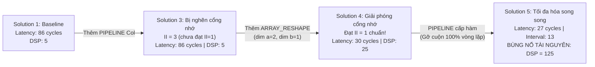

# TÀI LIỆU ÔN TẬP VÀ 20 CÂU HỎI VẤN ĐÁP BẢO VỆ LAB 3
## MÔN HỌC: THIẾT KẾ HỆ THỐNG TRÊN VI MẠCH (SOC DESIGN - SOCD334264)
**Khoa Điện – Điện tử, Trường Đại học Sư phạm Kỹ thuật TP.HCM (HCMUTE)**  
*Chuyên đề: Thiết kế phần cứng bằng Tổng hợp Mức cao (High-Level Synthesis - HLS)*

---

# PHẦN 1: TỔNG QUAN VÀ TÓM TẮT TRỌNG TÂM BÀI LAB 3

### 1. Thông tin chung & Mục tiêu cốt lõi
* **Tên bài Lab:** Thiết kế phần cứng bằng High-Level Synthesis sử dụng Vitis HLS / Vivado HLS trên thuật toán nhân ma trận (**Matrix Multiplication**).
* **Mục tiêu chính:**
  1. Hiểu sâu sắc nguyên lý **Tổng hợp Mức cao (High-Level Synthesis - HLS)**: Chuyển đổi trực tiếp thuật toán từ ngôn ngữ phần mềm bậc cao (C/C++) sang kiến trúc mạch phần cứng mức truyền thanh ghi (**RTL - Verilog/VHDL**).
  2. Nắm vững luồng kiểm chứng HLS chuẩn gồm 3 bước: **C Simulation** (kiểm tra tính đúng đắn thuật toán), **C Synthesis** (tổng hợp C sang phần cứng RTL) và **C/RTL Cosimulation** (đồng mô phỏng kiểm chứng dạng sóng phần cứng với testbench C).
  3. Sử dụng thành thạo các chỉ thị tối ưu hóa kiến trúc (**Optimization Directives/Pragmas**): `#pragma HLS PIPELINE`, `#pragma HLS UNROLL`, `#pragma HLS ARRAY_RESHAPE`.
  4. Phân tích và nắm vững mối quan hệ đánh đổi kinh điển (**Design Trade-offs**) giữa **Hiệu năng/Tốc độ** (Độ trễ - Latency, Khoảng thời gian khởi tạo - Initiation Interval) và **Chi phí Tài nguyên/Diện tích** (DSP48, BRAM, Flip-Flop, Look-Up Table).
  5. Hiểu nguyên lý **Tổng hợp Giao diện (Interface Synthesis)**: Cách công cụ HLS tự động chuyển đổi đối số hàm C (biến vô hướng, mảng một chiều, mảng hai chiều) thành các cổng vật lý (Port, BRAM Dual-port, FIFO, AXI Bus) và giao thức điều khiển bắt tay (`ap_ctrl_hs`).
  6. Thực hành tự động hóa thiết kế bằng kịch bản dòng lệnh **Tcl Script** (`vitis_hls -f run_hls.tcl`).

---

### 2. Thuật toán nhân ma trận mục tiêu (Baseline Algorithm)

Thuật toán nhân 2 ma trận vuông $A \times B = C$ (kích thước $5 \times 5$, kiểu dữ liệu đầu vào $a$, $b$ 8-bit, đầu ra $prod$ 16-bit) gồm 3 vòng lặp lồng nhau:
```cpp
void matrix_mult(mat_a a[5][5], mat_b b[5][5], result_t prod[5][5]) {
    Row: for(int i = 0; i < 5; i++) {
        Col: for(int j = 0; j < 5; j++) {
            prod[i][j] = 0;
            Product: for(int k = 0; k < 5; k++) {
                prod[i][j] += a[i][k] * b[k][j];
            }
        }
    }
}
```
* **Vòng lặp `Row` (Hàng):** Duyệt qua 5 hàng của ma trận A ($i = 0 \dots 4$).
* **Vòng lặp `Col` (Cột):** Duyệt qua 5 cột của ma trận B ($j = 0 \dots 4$).
* **Vòng lặp `Product` (Tích vô hướng):** Nhân và tích lũy tích giữa hàng $i$ của A và cột $j$ của B ($k = 0 \dots 4$). Tổng cộng có $5 \times 5 \times 5 = 125$ phép nhân tích lũy (MAC - Multiply-Accumulate).

---

### 3. Bảng so sánh 5 Giải pháp Tối ưu Phần cứng (Solution 1 đến Solution 5)

Quá trình khảo sát không gian kiến trúc trong Bài 3B ghi nhận sự biến thiên rõ rệt về hiệu năng và tài nguyên qua bảng tổng hợp sau:

| Thông số kỹ thuật | Solution 1 (Baseline) | Solution 2 (PIPELINE Product) | Solution 3 (PIPELINE Col) | Solution 4 (RESHAPE + PIPELINE) | Solution 5 (PIPELINE Function) |
| :--- | :---: | :---: | :---: | :---: | :---: |
| **Vị trí áp dụng Directive** | *Chưa áp dụng* | `Product` Loop | `Col` Loop | `Col` Loop + `ARRAY_RESHAPE` | Toàn bộ hàm `matrix_mult` |
| **Thời gian trễ (Est. Timing)**| $3.430\text{ ns}$ | $3.610\text{ ns}$ | $3.430\text{ ns}$ | $3.560\text{ ns}$ | **$3.372\text{ ns}$** |
| **Tổng độ trễ (Latency)** | $86\text{ chu kỳ}$ | $258\text{ chu kỳ}$ | $86\text{ chu kỳ}$ | **$30\text{ chu kỳ}$** | **$27\text{ chu kỳ}$** |
| **Khoảng khởi tạo (Interval)** | $87\text{ chu kỳ}$ | $259\text{ chu kỳ}$ | $87\text{ chu kỳ}$ | $31\text{ chu kỳ}$ | **$13\text{ chu kỳ}$** |
| **Khoảng cách lặp thực tế (II)**| $II = 3$ (Vi phạm) | $II = 2$ (Vi phạm) | $II = 3$ (Vi phạm) | **$II = 1$ (Đạt chuẩn)** | **Fully Unrolled** |
| **Khối nhân DSP48E1** | 5 | 1 | 5 | **25** (tăng gấp 5) | **125** (bùng nổ gấp 25) |
| **Flip-Flop (FF)** | 310 | 367 | 310 | 1026 | 3304 |
| **Look-Up Table (LUT)** | 482 | 512 | 482 | 502 | 1207 |
| **Bộ nhớ BRAM / URAM** | 0 | 0 | 0 | 0 | 0 |
| **Hiện tượng kỹ thuật chính** | Nghẽn cổng đọc RAM | Loop dependency | Memory port bottleneck | Giải quyết nghẽn cổng nhờ gom từ dữ liệu | Toàn bộ vòng lặp bị duỗi phẳng hoàn toàn |

---

### 4. Quy luật biến thiên kiến trúc từ thực nghiệm



1. **Từ Solution 1 sang Solution 3:** Khi đặt `PIPELINE` tại vòng lặp `Col`, mục tiêu là đạt $II = 1$. Tuy nhiên, do mảng dữ liệu $A$ và $B$ mặc định được ánh xạ vào RAM cổng kép (**Dual-Port RAM** chỉ có tối đa 2 cổng đọc mỗi chu kỳ), trong khi để tính tích ngoài cần đọc nhiều hơn 2 phần tử cùng lúc, công cụ HLS bị vi phạm tài nguyên truy cập bộ nhớ (**Resource Contention**), khiến II thực tế bị kéo giãn thành $II = 3$.
2. **Từ Solution 3 sang Solution 4 (Bước ngoặt tối ưu):** Chỉ thị `#pragma HLS ARRAY_RESHAPE` tái định hình mảng dữ liệu theo chiều truy cập:
   * Mảng $A$ được reshape theo chiều $2$ (`dim=2`): gộp 5 phần tử trên cùng 1 hàng thành 1 từ dữ liệu rộng duy nhất.
   * Mảng $B$ được reshape theo chiều $1$ (`dim=1`): gộp 5 phần tử trên cùng 1 cột thành 1 từ dữ liệu rộng duy nhất.
   * Kết quả: Giải phóng hoàn toàn nút thắt cổ chai ở cổng bộ nhớ, mạch đọc trọn vẹn dữ liệu chỉ trong 1 chu kỳ $\rightarrow$ **Đạt được $II = 1$ hoàn hảo**, Latency giảm sâu từ 86 xuống **30 chu kỳ** (nhanh gấp gần 3 lần).
3. **Từ Solution 4 sang Solution 5 (Tối ưu hóa cực hạn):** Khi đặt `PIPELINE` tại cấp hàm `matrix_mult`, HLS tự động trải phẳng hoàn toàn (**Fully Unroll**) cả 3 tầng vòng lặp. Toàn bộ 125 phép nhân được cấp phát phần cứng chạy song song:
   * Tốc độ cao nhất: Latency chỉ còn **27 chu kỳ**, Interval chỉ **13 chu kỳ**.
   * Chi phí phần cứng bùng nổ: Tiêu tốn **125 khối DSP**, 3304 FF và 1207 LUT.

---

### 5. Kết quả Tổng hợp Giao diện Phần cứng (Exercise 3C)

HLS tự động chuyển đổi các đối số phần mềm C++ sang các cổng vật lý phần cứng theo 2 nhóm chuẩn:
1. **Nhóm Giao diện Bộ nhớ (`AP_MEMORY`):**
   * Đối số `a` và `b`: Được tổng hợp thành **RAM cổng kép (Dual-Port RAM)** để tăng tốc độ đọc dữ liệu song song. Mỗi mảng gồm 2 chân địa chỉ 5-bit (`a_address0`, `a_address1`), 2 chân cho phép đọc (`a_ce0`, `a_ce1`) và 2 bus dữ liệu ngõ vào 8-bit (`a_q0`, `a_q1`).
   * Đối số `prod`: Được tổng hợp thành **RAM cổng đơn (Single-Port RAM)** chuyên dùng để ghi kết quả ma trận tích. Gồm chân địa chỉ 5-bit (`prod_address0`), chân cho phép bộ nhớ (`prod_ce0`), chân cho phép ghi (`prod_we0` - Write Enable) và bus dữ liệu ghi 16-bit (`prod_d0`).
2. **Nhóm Điều khiển Mức cao (`TOP LEVEL CONTROL` - Chuẩn `ap_ctrl_hs`):**
   * Sử dụng giao thức bắt tay 4 dây tín hiệu kinh điển của Xilinx HLS:
     * `ap_start` (Input): Báo hiệu cho khối IP bắt đầu thực thi tính toán.
     * `ap_ready` (Output): Báo hiệu IP đã sẵn sàng nhận dữ liệu ma trận đầu vào mới.
     * `ap_done` (Output): Báo hiệu IP đã hoàn tất quá trình tính toán và dữ liệu đầu ra hợp lệ.
     * `ap_idle` (Output): Báo hiệu IP đang ở trạng thái rảnh rỗi (chưa kích hoạt hoặc đã hoàn tất tác vụ).
   * Đi kèm chân xung nhịp `ap_clk` và chân khởi động lại `ap_rst`.

---

# PHẦN 2: BỘ 20 CÂU HỎI VẤN ĐÁP LAB 3 (KÈM LỜI GIẢI CHI TIẾT)

---

## NHÓM 1: BẢN CHẤT HIGH-LEVEL SYNTHESIS (HLS) & QUY TRÌNH THIẾT KẾ (CÂU 1 - 4)

### Câu 1: Em hãy giải thích High-Level Synthesis (HLS) là gì? Tại sao trong xu hướng thiết kế SoC hiện đại, HLS lại được ứng dụng rộng rãi thay vì viết mã RTL (Verilog/VHDL) thủ công?
* **Đáp án chuẩn:**
  * **Khái niệm:** High-Level Synthesis (Tổng hợp Mức cao) là công nghệ tự động hóa thiết kế điện tử (EDA) cho phép chuyển đổi trực tiếp các đặc tả thuật toán viết bằng ngôn ngữ phần mềm bậc cao (C, C++, SystemC) thành mạch phần cứng số ở mức truyền thanh ghi (**RTL - Verilog hoặc VHDL**) có thể nạp lên FPGA hoặc chế tạo ASIC.
  * **Lý do HLS thay thế viết RTL thủ công:**
    1. **Rút ngắn chu kỳ phát triển (Time-to-Market):** Viết mô tả thuật toán bằng C/C++ nhanh hơn viết Verilog gấp 5 đến 10 lần.
    2. **Khảo sát không gian kiến trúc cực nhanh (Rapid Architecture Exploration):** Với Verilog truyền thống, nếu muốn đổi từ kiến trúc tuần tự sang kiến trúc song song/đường ống (Pipeline), kỹ sư phải viết lại toàn bộ mã RTL, thiết kế lại máy trạng thái FSM và pipeline registers. Với HLS, người thiết kế chỉ cần thêm hoặc đổi một dòng chỉ thị (`#pragma`), công cụ sẽ tự động tổng hợp ra kiến trúc phần cứng mới chỉ trong vài phút.
    3. **Tối ưu hóa khâu kiểm chứng (Verification):** Kiểm tra tính đúng đắn của thuật toán bằng ngôn ngữ C thông qua C Simulation nhanh hơn hàng ngàn lần so với chạy mô phỏng dạng sóng RTL truyền thống.

---

### Câu 2: Trình bày quy trình 3 bước kiểm chứng chuẩn trong Vitis HLS: C Simulation, C Synthesis và C/RTL Cosimulation? Tại sao cần phải có bước Cosimulation?
* **Đáp án chuẩn:**
  * **3 bước kiểm chứng trong HLS:**
    1. **C Simulation:** Biên dịch và thực thi mã nguồn C/C++ trên CPU máy tính cùng với tệp kiểm thử `testbench.cpp`. Bước này nhằm kiểm tra tính đúng đắn thuần túy của logic thuật toán (ví dụ kiểm tra thuật toán nhân ma trận có tính ra kết quả đúng hay không) trước khi nghĩ đến phần cứng.
    2. **C Synthesis:** Trình biên dịch phân tích cú pháp C, trích xuất đường dẫn dữ liệu (Datapath), máy trạng thái (FSM), lập lịch (Scheduling) và liên kết tài nguyên (Binding) để sinh ra mã phần cứng RTL (Verilog/VHDL).
    3. **C/RTL Cosimulation (Đồng mô phỏng):** Tự động đóng gói mã Verilog vừa được sinh ra, sử dụng chính Testbench viết bằng ngôn ngữ C để bơm vector dữ liệu đầu vào cho mạch phần cứng và đối chiếu trực tiếp dữ liệu ngõ ra của phần cứng RTL với kết quả của mã C gốc.
  * **Tại sao bắt buộc phải có Cosimulation:**
    * C Simulation chỉ chứng minh mã C chạy đúng trên CPU.
    * Tuy nhiên, khi chuyển sang phần cứng, các vấn đề về định thời, độ trễ clock, cơ chế bắt tay bus, hay các lỗi ép kiểu dữ liệu nhị phân có thể khiến mạch RTL hoạt động sai. C/RTL Cosimulation là bước chứng minh $100\%$ rằng mạch RTL sinh ra hoàn toàn tương thích và cho kết quả chuẩn xác tuyệt đối theo đặc tả C.

---

### Câu 3: Phân biệt rõ hai khái niệm hiệu năng cốt lõi trong HLS: "Latency" (Độ trễ) và "Initiation Interval" (II - Khoảng thời gian khởi tạo)?
* **Đáp án chuẩn:**
  * **Latency (Độ trễ):**
    * Là tổng số chu kỳ xung nhịp (clock cycles) cần thiết để một khối xử lý hoàn thành việc tính toán trọn vẹn từ khi nhận dữ liệu đầu vào cho đến khi xuất kết quả đầu ra cuối cùng của một tập dữ liệu.
    * Đơn vị: Chu kỳ (cycles) hoặc thời gian ($ns$).
  * **Initiation Interval (II - Khoảng thời gian khởi tạo):**
    * Là số chu kỳ xung nhịp tối thiểu mà mạch cần đợi trước khi nó có thể **nhận một tập dữ liệu đầu vào hoàn toàn mới**.
    * II phản ánh trực tiếp **thông lượng (Throughput)** của hệ thống.
  * **Mối quan hệ:**
    * Trong một thiết kế không có đường ống (Non-pipelined), $II = \text{Latency}$. Mạch phải tính xong toàn bộ mới nhận được gói dữ liệu tiếp theo.
    * Trong thiết kế tạo đường ống lý tưởng (Ideal Pipelined), **$II = 1$**. Nghĩa là cứ sau **mỗi chu kỳ xung nhịp**, mạch lại có thể nuốt thêm một mẫu dữ liệu mới, mặc dù một mẫu dữ liệu đó có thể mất 30 chu kỳ (Latency = 30) mới tính xong.

---

### Câu 4: Phân tích quy luật đánh đổi (Design Trade-off) kinh điển giữa Hiệu năng (Performance) và Tài nguyên phần cứng (Hardware Resources) trong HLS?
* **Đáp án chuẩn:**
  * Đây là nguyên lý bất biến của kỹ thuật thiết kế vi mạch: **Không có thiết kế nào vừa nhanh nhất lại vừa tốn ít diện tích phần cứng nhất**.
  * **Thiết kế hướng tối ưu tài nguyên (Low Resource / Low Power):** Tái sử dụng tối đa các khối tính toán (ví dụ dùng chung 1 bộ nhân DSP48E1 qua máy trạng thái tuần tự FSM). Kết quả: Tốn cực ít phần cứng (như Solution 2 chỉ tốn 1 DSP), nhưng thời gian chạy rất lâu (Latency lên tới 258 chu kỳ).
  * **Thiết kế hướng tối ưu tốc độ/thông lượng (High Throughput / Low Latency):** Trải phẳng các vòng lặp, tạo đường ống song song tối đa (như Solution 5). Kết quả: Tốc độ xử lý cực nhanh (Latency chỉ 27 chu kỳ, Interval 13 chu kỳ), nhưng phải trả giá bằng việc phần cứng phình to khủng khiếp (tốn tới 125 khối DSP).
  * Nhiệm vụ của người kỹ sư SoC là dựa vào yêu cầu bài toán thực tế và giới hạn tài nguyên của dòng chip FPGA đích (ví dụ Zynq XC7Z020 chỉ có 220 DSP) để chọn điểm cân bằng tối ưu nhất.

---

## NHÓM 2: CÁC CHỈ THỊ TỐI ƯU HÓA HLS (DIRECTIVES / PRAGMAS) (CÂU 5 - 8)

### Câu 5: Chỉ thị `#pragma HLS PIPELINE` hoạt động như thế nào? Mục tiêu $II = 1$ mang ý nghĩa kỹ thuật gì?
* **Đáp án chuẩn:**
  * **Cơ chế hoạt động:** Chỉ thị PIPELINE thực hiện chèn các thanh ghi đệm (Pipeline Registers) vào giữa các tầng logic tổ hợp của vòng lặp hoặc hàm chức năng, chia một tác vụ tính toán dài thành nhiều phân đoạn nhỏ hoạt động đồng thời (tương tự như dây chuyền lắp ráp công nghiệp). Nhờ đó, thao tác của lần lặp tiếp theo có thể bắt đầu trước khi lần lặp trước đó kết thúc hoàn toàn.
  * **Ý nghĩa mục tiêu $II = 1$:**
    * Đạt được $II = 1$ là mục tiêu vàng trong thiết kế phần cứng HLS.
    * Nó có nghĩa là hệ thống đạt thông lượng cực đại: **Mỗi chu kỳ xung nhịp, hệ thống đều xuất ra 1 kết quả mới và sẵn sàng nhận 1 dữ liệu đầu vào mới**. Tốc độ xử lý của phần cứng lúc này đạt bằng đúng tần số xung nhịp của hệ thống (ví dụ xung 100 MHz thì xử lý được 100 triệu phần tử mỗi giây).

---

### Câu 6: Hiện tượng "II Violation" (Vi phạm khoảng thời gian khởi tạo) là gì? Trong bài Lab 3, những nguyên nhân nào đã dẫn đến hiện tượng này?
* **Đáp án chuẩn:**
  * **Khái niệm:** Khi lập trình viên đặt mục tiêu là $II = 1$, nhưng sau khi tổng hợp C Synthesis, công cụ HLS báo cáo $II = 2$ hoặc $II = 3$ kèm theo cảnh báo *II Violation*. Điều này có nghĩa là công cụ không thể lập lịch cho các thao tác bắt đầu sau mỗi 1 chu kỳ do xuất hiện các xung đột phần cứng.
  * **Hai nguyên nhân chính trong bài Lab 3:**
    1. **Nghẽn tài nguyên cổng bộ nhớ (Memory Resource Bottleneck):** Xuất hiện ở Solution 3. Do mảng dữ liệu $A$ và $B$ nằm trong Block RAM cổng kép (Dual-port BRAM) chỉ cho phép tối đa 2 thao tác đọc/ghi trong cùng 1 chu kỳ. Trong khi đó, để tính tích ma trận, mạch cần đọc đồng thời nhiều hơn 2 phần tử trên cùng một mảng trong 1 chu kỳ. Việc thiếu cổng truy xuất buộc HLS phải kéo dài thời gian chờ giữa các lần lặp lên thành 3 chu kỳ ($II = 3$).
    2. **Phụ thuộc dữ liệu giữa các lần lặp (Loop-carried Dependency):** Xuất hiện ở Solution 2. Thao tác cộng dồn `prod[i][j] += ...` ở chu kỳ sau phải chờ phép tính cộng dồn ở chu kỳ trước hoàn thành mới có dữ liệu mới để tính tiếp, dẫn đến trễ đường truyền tích lũy và bị đẩy $II$ lên 2.

---

### Câu 7: Phân biệt sự khác nhau giữa hai chỉ thị `#pragma HLS UNROLL` và `#pragma HLS PIPELINE`?
* **Đáp án chuẩn:**
  * **`#pragma HLS UNROLL` (Trải phẳng vòng lặp):**
    * Tác động lên không gian phần cứng (**Spatial Parallelism**).
    * Nó nhân bản (duplicate) phần cứng tính toán trong thân vòng lặp ra làm $N$ bản sao vật lý độc lập (với $N$ là số lần lặp Trip Count).
    * Tất cả các bản sao này hoạt động song song hoàn toàn trong cùng một thời điểm.
    * *Đặc điểm:* Giảm số chu kỳ thực thi nhưng tiêu tốn diện tích phần cứng (DSP, LUT, FF) tăng lên gấp $N$ lần.
  * **`#pragma HLS PIPELINE` (Tạo đường ống):**
    * Tác động lên thời gian thực thi (**Temporal Parallelism**).
    * Nó chia nhỏ đường dẫn dữ liệu thành các phân đoạn nối tiếp nhau qua các thanh ghi đệm. Phần cứng không nhất thiết phải nhân bản $N$ lần mà các lần lặp được thực hiện gối đầu lên nhau theo thời gian.
    * *Lưu ý đặc biệt:* Khi áp dụng `PIPELINE` cho một vòng lặp ngoài hoặc một hàm cấp cao nhất, công cụ HLS sẽ **tự động gỡ cuộn (Auto-unroll) toàn bộ các vòng lặp con nằm bên trong nó**.

---

### Câu 8: Chỉ thị `#pragma HLS ARRAY_RESHAPE` làm nhiệm vụ gì? Tại sao ở Solution 4, mảng `a` lại được đặt `dim=2` còn mảng `b` lại được đặt `dim=1`?
* **Đáp án chuẩn:**
  * **Nhiệm vụ của `ARRAY_RESHAPE`:** Chỉ thị này thực hiện chia nhỏ mảng nhưng không tạo ra nhiều khối RAM riêng lẻ (như `ARRAY_PARTITION`), mà nó **gộp các phần tử của mảng lại thành một từ dữ liệu có độ rộng lớn hơn (Wide Word)** lưu trong cùng một khối RAM. Nhờ đó, mạch có thể đọc/ghi đồng thời toàn bộ các phần tử được gộp chỉ qua một cổng bộ nhớ duy nhất trong 1 chu kỳ.
  * **Lý do chọn chiều `dim` ở Solution 4:**
    * Nhìn vào công thức nhân ma trận: $\text{prod}[i][j] = \sum a[i][k] \times b[k][j]$.
    * Biến chạy bên trong là $k$.
    * Với mảng $a[i][k]$: Biến $k$ nằm ở **chiều thứ 2** (chiều ngang - các phần tử trên cùng một hàng $i$). Đặt `dim=2` giúp gộp toàn bộ 5 phần tử của hàng $i$ ($a[i][0] \dots a[i][4]$) thành 1 từ dữ liệu 40-bit duy nhất ($5 \times 8\text{-bit}$). Khi tính, mạch lấy trọn cả hàng $A$ chỉ trong 1 chu kỳ!
    * Với mảng $b[k][j]$: Biến $k$ nằm ở **chiều thứ 1** (chiều dọc - các phần tử trên cùng một cột $j$). Đặt `dim=1` giúp gộp toàn bộ 5 phần tử trên cột $j$ ($b[0][j] \dots b[4][j]$) thành 1 từ dữ liệu 40-bit. Khi tính, mạch lấy trọn cả cột $B$ chỉ trong 1 chu kỳ!
    * Sự kết hợp này triệt tiêu hoàn toàn hiện tượng nghẽn cổng bộ nhớ, giúp hệ thống đạt được $II = 1$.

---

## NHÓM 3: PHÂN TÍCH SÂU 5 SOLUTIONS BÀI 3B (CÂU 9 - 13)

### Câu 9: Tại sao ở Solution 2, khi đặt chỉ thị PIPELINE tại vòng lặp trong cùng `Product`, tổng độ trễ (Latency) lại tăng vọt từ 86 chu kỳ lên tới 258 chu kỳ?
* **Đáp án chuẩn:**
  * Đây là một kết quả thoạt nhìn có vẻ nghịch lý nhưng rất thực tế trong HLS:
    1. Khi đặt `PIPELINE` tại vòng lặp trong cùng `Product`, vòng lặp `Product` chỉ có 5 lần lặp ($k = 0 \dots 4$). Việc dựng đường ống cho một vòng lặp quá ngắn khiến chi phí thiết lập và làm sạch đường ống (Pipeline Fill & Drain Overhead) chiếm tỷ trọng lớn so với thời gian tính toán thực tế.
    2. Xuất hiện sự phụ thuộc dữ liệu (**Loop Dependency**) tại phép cộng dồn `prod[i][j]`, khiến $II$ của vòng lặp này bị đẩy lên bằng 2.
    3. Quan trọng nhất: Vì chỉ đặt pipeline ở vòng lặp trong cùng, hai vòng lặp ngoài (`Row` và `Col`) vẫn phải chạy tuần tự từng bước một ($5 \times 5 = 25$ lần gọi đường ống). Việc chuyển tiếp giữa các lần lặp ngoài làm phát sinh độ trễ chuyển trạng thái máy FSM, khiến tổng số chu kỳ thực thi bị đội lên thành 258 chu kỳ.

---

### Câu 10: Tại sao ở Solution 3, khi chuyển chỉ thị PIPELINE ra vòng lặp `Col`, hệ thống vẫn bị vi phạm II (II = 3)? Điểm nghẽn ở đây là gì?
* **Đáp án chuẩn:**
  * Khi đặt `PIPELINE` tại vòng lặp `Col`, HLS sẽ tự động làm phẳng vòng lặp `Row` và tự động gỡ cuộn hoàn toàn vòng lặp con `Product` bên trong.
  * Khi vòng lặp `Product` bị gỡ cuộn, mạch cố gắng thực hiện đồng thời 5 phép nhân $a[i][k] \times b[k][j]$ trong cùng 1 chu kỳ.
  * Điều này đòi hỏi mạch phải đọc cùng lúc 5 phần tử của mảng $a$ và 5 phần tử của mảng $b$.
  * **Điểm nghẽn cốt lõi:** Bộ nhớ mảng mặc định của FPGA là Block RAM cổng kép (**Dual-Port BRAM**), mỗi chu kỳ chỉ cung cấp tối đa **2 cổng đọc**. Mạch cần 5 cổng đọc nhưng phần cứng chỉ có 2 cổng đọc. Do đó, công cụ HLS buộc phải xếp hàng tuần tự các thao tác đọc chia làm 3 chu kỳ liên tiếp ($2 + 2 + 1 = 5$), dẫn đến $II$ thực tế bị ép lên mức **$II = 3$**, không thể đạt được $II = 1$.

---

### Câu 11: Chỉ thị ARRAY_RESHAPE ở Solution 4 đã giải quyết triệt để nút thắt cổ chai của Solution 3 như thế nào để đưa II về 1 và giảm Latency xuống 30 chu kỳ?
* **Đáp án chuẩn:**
  * `ARRAY_RESHAPE` giải quyết bài toán bằng kỹ thuật **mở rộng độ rộng đường truyền dữ liệu (Bus Widening)**:
    * Thay vì lưu mảng $a$ dưới dạng 25 ô nhớ 8-bit rời rạc, HLS đóng gói 5 phần tử trên cùng hàng thành một từ dữ liệu lớn 40-bit ($5 \times 8\text{-bit}$).
    * Tương tự với mảng $b$, 5 phần tử trên cùng cột được đóng gói thành một từ dữ liệu lớn 40-bit.
    * Lúc này, khi vòng lặp `Product` cần 5 phần tử của hàng $A$ và 5 phần tử của cột $B$, mạch chỉ cần phát **đúng 1 lệnh đọc** là lấy được toàn bộ 40-bit dữ liệu qua cổng BRAM.
    * Không còn hiện tượng tranh chấp cổng nhớ $\rightarrow$ Đạt được $II = 1$ hoàn hảo.
    * Toàn bộ 25 vị trí của ma trận kết quả được tính toán liên tục sau mỗi chu kỳ, đưa tổng Latency của mạch giảm mạnh từ 86 chu kỳ xuống **chỉ còn 30 chu kỳ**.

---

### Câu 12: So sánh Solution 4 và Solution 5: Tại sao đặt PIPELINE ở cấp hàm lại khiến tài nguyên DSP48 bùng nổ từ 25 khối lên tới 125 khối?
* **Đáp án chuẩn:**
  * **Ở Solution 4 (PIPELINE ở vòng lặp `Col`):**
    * Mạch tạo đường ống theo từng cột. Mỗi chu kỳ, mạch chỉ thực hiện phép nhân giữa 1 hàng của A và 1 cột của B (gồm 5 phép nhân song song). Do đó, mạch chỉ cần cấp phát $5 \times 5 = 25$ bộ nhân DSP cho toàn bộ quá trình tính toán dạng đường ống.
  * **Ở Solution 5 (PIPELINE ở cấp hàm `matrix_mult`):**
    * Khi đặt `PIPELINE` ở cấp độ cao nhất của hàm, HLS bắt buộc phải gỡ cuộn hoàn toàn (**Fully Unroll**) toàn bộ 3 tầng vòng lặp `Row`, `Col` và `Product`.
    * Phép nhân ma trận $5 \times 5$ đòi hỏi tổng cộng: $5 \times 5 \times 5 = 125$ phép nhân phần tử.
    * Do toàn bộ cấu trúc bị duỗi phẳng hoàn toàn ra phần cứng, HLS buộc phải tổng hợp ra **125 bộ nhân vật lý độc lập** chạy song song trong cùng một chu kỳ nhịp.
    * Điều này dẫn đến sự bùng nổ tài nguyên: Số khối DSP tăng vọt từ **25 lên 125 khối** (chiếm hơn một nửa tổng số 220 DSP của chip Zynq-7000), đồng thời thanh ghi FF tăng từ 1026 lên 3304.

---

### Câu 13: Trong một bài toán thiết kế nhúng thực tế, em sẽ lựa chọn kiến trúc của Solution 4 hay Solution 5? Vì sao?
* **Đáp án chuẩn:**
  * **Lựa chọn tối ưu trong thực tế:** **Solution 4** là sự lựa chọn vượt trội và cân bằng nhất.
  * **Giải thích nguyên nhân:**
    1. **Về mặt hiệu năng:** Solution 4 có Latency là 30 chu kỳ, chỉ kém Solution 5 (27 chu kỳ) đúng 3 chu kỳ xung nhịp (chênh lệch chỉ $15\text{ ns}$, hoàn toàn không đáng kể trong hầu hết các ứng dụng thực tế).
    2. **Về mặt tài nguyên:** Solution 4 chỉ tốn **25 DSP**, trong khi Solution 5 ngốn tới **125 DSP** (gấp 5 lần).
    3. **Khả năng mở rộng (Scalability):** Nếu kích thước ma trận tăng lên $10 \times 10$ hoặc $32 \times 32$:
       * Kiến trúc Solution 5 sẽ đòi hỏi $32^3 = 32,768$ DSP $\rightarrow$ Ngay lập tức tràn tài nguyên FPGA và không thể tổng hợp được.
       * Kiến trúc Solution 4 chỉ đòi hỏi số DSP tăng tuyến tính theo kích thước khối, hoàn toàn triển khai vừa vặn trên các dòng FPGA tầm trung.

---

## NHÓM 4: TỔNG HỢP GIAO DIỆN PHẦN CỨNG (INTERFACE SYNTHESIS) - BÀI 3C (CÂU 14 - 17)

### Câu 14: "Interface Synthesis" (Tổng hợp Giao diện) trong HLS là gì? Tại sao người lập trình phần mềm không cần viết cổng RTL mà HLS vẫn sinh ra được các chân tín hiệu?
* **Đáp án chuẩn:**
  * **Interface Synthesis:** Là quá trình công cụ HLS tự động phân tích các kiểu dữ liệu và đối số truyền vào/ra của hàm C cấp cao nhất (Top function), từ đó sinh ra các cổng vật lý (Hardware Ports) và giao thức điều khiển phần cứng tương ứng trên khối IP RTL.
  * **Cơ chế tự động:**
    * Trong ngôn ngữ C, dữ liệu được truyền qua con trỏ, mảng hoặc tham số giá trị.
    * Trình tổng hợp HLS áp dụng các luật ánh xạ mặc định của nhà sản xuất (hoặc theo chỉ thị `#pragma HLS INTERFACE`):
      * Biến vô hướng đơn thuần (Scalar) $\rightarrow$ Cổng vào/ra dữ liệu dây nối thông thường (`wire`).
      * Mảng dữ liệu (Array) $\rightarrow$ Giao diện bộ nhớ RAM (`AP_MEMORY`), FIFO (`AP_FIFO`) hoặc AXI Bus.
      * Hàm chức năng $\rightarrow$ Khối tín hiệu bắt tay điều khiển chu trình thực thi (`ap_ctrl_hs` hoặc `ap_ctrl_chain`).

---

### Câu 15: Tại sao đối số mảng đầu vào `a`, `b` lại được tổng hợp thành RAM cổng kép (Dual-port RAM) trong khi mảng kết quả `prod` lại chỉ là RAM cổng đơn (Single-port RAM)?
* **Đáp án chuẩn:**
  * **Với mảng đầu vào `a` và `b`:**
    * Đây là các mảng chỉ đọc (**Read-only Arrays**).
    * Để hỗ trợ đọc dữ liệu song song tốc độ cao phục vụ các khối nhân MAC, HLS tự động tổng hợp thành giao diện RAM cổng kép (**Dual-Port RAM**). Mạch sinh ra 2 bộ chân địa chỉ (`address0`, `address1`) và 2 bộ chân dữ liệu đọc về (`q0`, `q1`), cho phép đọc đồng thời 2 phần tử bộ nhớ trong cùng 1 chu kỳ xung nhịp.
  * **Với mảng kết quả `prod`:**
    * Đây là mảng ghi kết quả đầu ra (**Write-only Array**).
    * Kết quả của phép nhân ma trận được tính toán và xuất ra tuần tự từng phần tử một tại mỗi chu kỳ.
    * Do tại mỗi chu kỳ mạch chỉ cần ghi 1 giá trị vào một ô nhớ xác định, nên chỉ cần giao diện RAM cổng đơn (**Single-Port RAM**) với 1 chân địa chỉ `prod_address0`, 1 chân cho phép ghi `prod_we0` và 1 chân xuất dữ liệu `prod_d0` là đủ đáp ứng hoàn hảo, giúp tiết kiệm chân và tài nguyên định tuyến.

---

### Câu 16: Trình bày chi tiết vai trò của 4 tín hiệu bắt tay trong giao thức điều khiển `ap_ctrl_hs`?
* **Đáp án chuẩn:**
  * Giao thức `ap_ctrl_hs` (Handshake Control) gồm 4 tín hiệu quản lý trạng thái đồng bộ:
    1. **`ap_start` (Input - Đầu vào):** Tín hiệu kích hoạt do hệ thống chủ (như CPU ARM hoặc DMA) phát ra. Khi kéo lên mức 1, khối IP bắt đầu chu trình đọc dữ liệu và tính toán.
    2. **`ap_ready` (Output - Đầu ra):** Tín hiệu báo sẵn sàng. IP phát xung mức 1 trong 1 chu kỳ để thông báo cho hệ thống bên ngoài biết rằng nó đã đọc xong toàn bộ dữ liệu đầu vào của lượt này và sẵn sàng nhận lệnh nạp dữ liệu mới.
    3. **`ap_done` (Output - Đầu ra):** Tín hiệu báo hoàn thành. IP phát mức 1 khi toàn bộ quá trình tính toán ma trận đã kết thúc thành công và dữ liệu trên các cổng ngõ ra là hợp lệ. Tín hiệu này thường được nối vào bộ ngắt (Interrupt) để báo về CPU ARM.
    4. **`ap_idle` (Output - Đầu ra):** Tín hiệu báo trạng thái rảnh rỗi. Mang giá trị 1 khi IP đang không hoạt động (đang chờ xung `ap_start`). Khi IP bắt đầu chạy, `ap_idle` tụt xuống 0.

---

### Câu 17: Nếu muốn đóng gói khối IP HLS này để kết nối trực tiếp vào hệ thống Zynq SoC với nhân ARM Cortex-A9 (như đã làm ở Lab 1 và Lab 2), em cần thêm chỉ thị giao diện gì vào mã nguồn C?
* **Đáp án chuẩn:**
  * Để kết nối trực tiếp vào hệ sinh thái Zynq SoC qua chuẩn bus AMBA AXI, ta sử dụng chỉ thị `#pragma HLS INTERFACE`:
    1. **Đóng gói cổng điều khiển vào bus AXI-Lite:**
       ```cpp
       #pragma HLS INTERFACE s_axilite port=return bundle=BUS_A
       ```
       Chỉ thị này sẽ gom các chân bắt tay (`ap_start`, `ap_done`, `ap_ready`, `ap_idle`) thành các thanh ghi điều khiển bên trong một giao diện Slave AXI-Lite. CPU ARM chỉ cần ghi `0x1` vào thanh ghi điều khiển qua bus AXI là kích hoạt được IP chạy.
    2. **Đóng gói dữ liệu:**
       * *Cách 1 (Dữ liệu nhỏ - AXI-Lite):* Ánh xạ các mảng `a`, `b`, `prod` trực tiếp vào thanh ghi AXI-Lite:
         ```cpp
         #pragma HLS INTERFACE s_axilite port=a bundle=BUS_A
         #pragma HLS INTERFACE s_axilite port=b bundle=BUS_A
         #pragma HLS INTERFACE s_axilite port=prod bundle=BUS_A
         ```
       * *Cách 2 (Dữ liệu lớn, thông lượng cao - AXI-Stream kết hợp DMA):*
         ```cpp
         #pragma HLS INTERFACE axis port=a
         #pragma HLS INTERFACE axis port=b
         #pragma HLS INTERFACE axis port=prod
         ```
         Khi đó, khối IP có thể kết nối với AXI DMA để bơm và hút dữ liệu liên tục từ DDR RAM với tốc độ hàng Gigabyte/giây.

---

## NHÓM 5: KHẮC PHỤC SỰ CỐ, TCL SCRIPT & MỐI LIÊN HỆ SOC (CÂU 18 - 20)

### Câu 18: Lợi ích của việc chạy HLS thông qua kịch bản Tcl Script (`vitis_hls -f run_hls.tcl`) trong Bài 3C so với thao tác bằng chuột trên giao diện đồ họa (GUI) là gì?
* **Đáp án chuẩn:**
  * **Lợi ích vượt trội của Tcl Script trong thiết kế vi mạch chuyên nghiệp:**
    1. **Tự động hóa hoàn toàn (Automation):** Cho phép tạo dự án, nạp file nguồn, đặt xung clock mục tiêu, thêm chỉ thị, chạy tổng hợp và xuất báo cáo chỉ bằng một dòng lệnh duy nhất trong terminal mà không cần bấm chuột qua hàng chục bước.
    2. **Khả năng tái lập và nhất quán (Reproducibility):** Đảm bảo mọi thành viên trong nhóm nghiên cứu hoặc quy trình tích hợp liên tục (CI/CD) đều tổng hợp ra cùng một kết quả phần cứng mà không sợ bị sai sót do thao tác tay.
    3. **Chạy hàng loạt (Batch Mode / Parameter Sweeping):** Cho phép viết vòng lặp Tcl để khảo sát tự động hàng trăm cấu hình tối ưu khác nhau (thử nghiệm tự động các giá trị unroll, pipeline, kích thước mảng) và tự động trích xuất bảng so sánh kết quả mà không cần con người ngồi chờ.

---

### Câu 19: Trong quy trình HLS, nếu bước C Simulation báo "Test Passed" nhưng khi sang bước C/RTL Cosimulation lại báo "Fail" thì những nguyên nhân kỹ thuật nào có thể xảy ra?
* **Đáp án chuẩn:**
  * **Các nguyên nhân tiềm ẩn khiến RTL chạy sai dù code C chạy đúng:**
    1. **Khởi tạo biến không xác định (Uninitialized Variables):** Trong C, biến toàn cục hoặc biến cục bộ có thể vô tình nhận giá trị 0 trên CPU. Nhưng khi tổng hợp ra phần cứng RTL, các Flip-Flop chưa được reset sẽ mang giá trị bất định (`'X'`), dẫn đến mạch số tính toán ra kết quả rác.
    2. **Sự khác biệt về độ rộng bit (Bit-width Mismatch / Overflow):** Trên máy tính, các phép toán số nguyên thường mặc định 32-bit hoặc 64-bit. Khi sang HLS sử dụng các kiểu dữ liệu tối ưu độ rộng (`ap_int<N>`, `ap_uint<N>`), nếu tính toán xảy ra tràn bit mà mã C chưa bắt được, phần cứng RTL sẽ bị sai số.
    3. **Vi phạm quy ước bắt tay (Handshake Protocol Violation):** Bộ điều khiển bên ngoài đọc dữ liệu ra quá sớm trước khi tín hiệu `ap_done` hoặc `prod_ce` tích cực.
    4. **Con trỏ và thao tác bộ nhớ không tương thích phần cứng:** Sử dụng cấp phát động (`malloc`), hàm đệ quy (recursion), hoặc đa con trỏ trỏ cùng một vùng nhớ mà HLS không thể ánh xạ chính xác sang RTL.

---

### Câu 20: Em hãy xâu chuỗi mối liên hệ từ Lab 1, Lab 2 sang Lab 3 và Lab 4 trong toàn bộ môn học SoC Design?
* **Đáp án chuẩn:**
  * Môn học được xây dựng theo lộ trình tiến hóa kiến trúc SoC rất chặt chẽ:
    * **Lab 1 (Nền tảng SoC & Phần mềm):** Sinh viên làm quen với kiến trúc lai Zynq (PS + PL), kết nối IP có sẵn của Xilinx (AXI GPIO) và điều khiển qua phần mềm C bằng cơ chế Polling đơn giản.
    * **Lab 2 (Hệ thống ngắt thời gian thực):** Nâng cấp phương thức giao tiếp từ Polling sang Hardware Interrupt (ARM GIC, Concat IP, AXI Timer), giúp tối ưu hóa hiệu năng và năng lượng cho CPU.
    * **Lab 3 (Tăng tốc phần cứng bằng HLS):** Không dùng các IP cơ bản có sẵn nữa, mà tự tay thiết kế khối tăng tốc phần cứng chuyên dụng (**Hardware Accelerator**) cho thuật toán phức tạp (như nhân ma trận) từ ngôn ngữ C/C++, tối ưu hóa đạt $II=1$ bằng các chỉ thị Pipeline, Reshape mảng.
    * **Lab 4 & Bài báo nghiên cứu cuối kỳ:** Đóng gói khối IP HLS vừa tạo ở Lab 3 thành chuẩn bus AXI (AXI4-Lite, AXI-Stream, DMA), tích hợp ngược trở lại vào Vivado Block Design (như Lab 1) để nhân ARM Cortex-A9 ra lệnh tăng tốc cho các bài toán xử lý ảnh, AI và ma trận khối băng thông cao.

---

# PHẦN 3: BẢNG TRA CỨU NHANH CÁC THUẬT NGỮ CỐT LÕI (GLOSSARY)

| Thuật ngữ | Tên đầy đủ | Ý nghĩa kỹ thuật cốt lõi trong Lab 3 |
| :--- | :--- | :--- |
| **HLS** | High-Level Synthesis | Quá trình tự động biên dịch thuật toán C/C++ thành mạch phần cứng RTL (Verilog/VHDL). |
| **Latency** | Độ trễ thực thi | Số chu kỳ xung nhịp để tính xong hoàn chỉnh một gói dữ liệu từ ngõ vào ra ngõ ra. |
| **II** | Initiation Interval | Số chu kỳ xung nhịp tối thiểu giữa 2 lần nhận dữ liệu mới liên tiếp; lý tưởng nhất là $II = 1$. |
| **Throughput** | Thông lượng | Khối lượng dữ liệu xử lý thành công trên một đơn vị thời gian; tỷ lệ nghịch với II. |
| **PIPELINE** | Đường ống hóa | Kỹ thuật chèn thanh ghi chia nhỏ mạch, cho phép các bước lặp thực thi gối đầu lên nhau. |
| **UNROLL** | Trải phẳng vòng lặp | Nhân bản phần cứng trong thân vòng lặp để thực hiện tính toán song song hoàn toàn. |
| **ARRAY_RESHAPE** | Tái định hình mảng | Gộp các phần tử của mảng thành từ dữ liệu rộng để đọc/ghi đồng thời trong 1 chu kỳ. |
| **AP_MEMORY** | Giao diện bộ nhớ | Chuẩn giao tiếp phần cứng của HLS để kết nối các mảng C với Block RAM trong FPGA. |
| **ap_ctrl_hs** | Giao thức bắt tay | Nhóm 4 tín hiệu điều khiển trạng thái thực thi của IP: `ap_start`, `ap_done`, `ap_ready`, `ap_idle`. |
| **Cosimulation** | Đồng mô phỏng C/RTL | Dùng testbench C để kiểm tra trực tiếp dạng sóng và dữ liệu của mạch Verilog sinh ra. |

---

# PHẦN 4: 5 LỜI KHUYÊN ĐẮT GIÁ KHI VẤN ĐÁP LAB 3 VỚI GIẢNG VIÊN

1. **Khẳng định ngay điểm cốt lõi của $II = 1$:** Khi thầy hỏi *"Tại sao mục tiêu tối ưu HLS luôn là đưa II về 1?"*, trả lời ngay: *"Thưa thầy, II = 1 có nghĩa là hệ thống đạt thông lượng cực đại: cứ mỗi chu kỳ xung nhịp mạch lại có thể nhận thêm 1 dữ liệu mới và xuất ra 1 kết quả mới, tốc độ xử lý phần cứng đạt ngang bằng với tần số xung nhịp clock."*
2. **Nắm chắc giải pháp khắc phục nghẽn cổng nhớ:** Thầy hỏi *"Tại sao Solution 3 bị II = 3 mà sang Solution 4 lại đạt II = 1?"*. Trả lời gãy gọn: *"Dạ do Solution 3 bị nghẽn cổng đọc của Block RAM (chỉ có 2 cổng đọc trong khi cần 5 dữ liệu). Sang Solution 4, ta dùng `ARRAY_RESHAPE` để gom 5 phần tử thành 1 từ dữ liệu rộng 40-bit, nên mạch chỉ cần 1 cổng đọc là lấy trọn dữ liệu trong 1 chu kỳ, xóa bỏ nghẽn cổng và đạt II = 1."*
3. **Hiểu bản chất sự bùng nổ DSP ở Solution 5:** Thầy hỏi *"Tại sao Solution 5 tốn tới 125 DSP?"*. Trả lời: *"Dạ vì khi đặt PIPELINE ở cấp hàm, HLS tự động fully unroll toàn bộ 3 tầng vòng lặp (Trip count = $5 \times 5 \times 5 = 125$), dẫn đến 125 bộ nhân phần cứng vật lý được tạo ra chạy song song."*
4. **Giải thích được 4 tín hiệu bắt tay `ap_ctrl_hs`:** Nhớ như in: `ap_start` (bắt đầu chạy), `ap_ready` (sẵn sàng nhận dữ liệu mới), `ap_done` (tính toán xong, kết quả hợp lệ), `ap_idle` (đang rảnh rỗi chờ lệnh).
5. **Tự tin phân tích mối quan hệ Trade-off:** Không ngần ngại thừa nhận thiết kế nhanh hơn sẽ tốn diện tích hơn; nhấn mạnh rằng kỹ sư vi mạch giỏi là người biết chọn kiến trúc cân bằng tài nguyên (như Solution 4) thay vì chỉ chăm chăm tối đa hóa tốc độ mà làm tràn chip (như Solution 5).
