# TÀI LIỆU ÔN TẬP VÀ 20 CÂU HỎI VẤN ĐÁP BẢO VỆ LAB 4
## MÔN HỌC: THIẾT KẾ HỆ THỐNG TRÊN VI MẠCH (SOC DESIGN - SOCD334264)
**Khoa Điện – Điện tử, Trường Đại học Sư phạm Kỹ thuật TP.HCM (HCMUTE)**  
*Chuyên đề: Thiết kế, Đóng gói và Tích hợp Custom IP Core trên Zynq SoC (Verilog, Simulink HDL Coder, Vitis HLS)*

---

# PHẦN 1: TỔNG QUAN VÀ TÓM TẮT TRỌNG TÂM BÀI LAB 4

### 1. Thông tin chung & Mục tiêu cốt lõi
* **Tên bài Lab:** Quy trình tạo và tích hợp IP Core tùy chỉnh (Custom IP Core) trên nền tảng Zynq SoC bằng nhiều phương pháp khác nhau (Verilog HDL, MathWorks HDL Coder, Vitis HLS).
* **Mục tiêu chính:**
  1. Hiểu sâu sắc cấu trúc bus tiêu chuẩn công nghiệp **AMBA AXI4-Lite Slave** và cơ chế **Memory-Mapped I/O (MMIO)** để giao tiếp giữa CPU ARM (PS) và phần cứng tự chế (PL).
  2. Nắm vững quy trình đóng gói IP (**IP Packaging**) bằng công cụ *Create and Package New IP* trong Vivado.
  3. Làm chủ **3 phương pháp luận thiết kế phần cứng** hiện đại trên FPGA:
     * **Phương pháp 1 (Mức RTL truyền thống):** Viết mã Verilog HDL, can thiệp vào các thanh ghi phần mềm (`slv_reg0`) để định tuyến tín hiệu ra cổng ngoài (`LEDs_out[7:0]`).
     * **Phương pháp 2 (Mức Hệ thống dựa trên Mô hình - MBD):** Thiết kế bộ lọc thích nghi khử nhiễu **LMS (Least Mean Squares)** trên MATLAB/Simulink, tối ưu hóa dấu phẩy tĩnh (`sfix16_En14`), và tự động sinh mã RTL/AXI-Lite qua **HDL Workflow Advisor**.
     * **Phương pháp 3 (Tổng hợp Mức cao - HLS):** Thiết kế bộ dao động số điều khiển tần số **NCO (Numerically Controlled Oscillator)** bằng C++ trong Vitis HLS, ứng dụng kiểu dữ liệu tối ưu phần cứng `ap_fixed<16,2>` cho bảng tra sóng sin 4096 mẫu.
  4. Hoàn thiện luồng **Hardware/Software Codesign**: Gán chân vật lý qua file `.xdc`, xuất nền tảng phần cứng `.xsa`, tạo BSP trên Vitis IDE và viết mã C nhúng cấp thấp (`Xil_Out32`) điều khiển phần cứng trực tiếp.

---

### 2. So sánh tổng hợp 3 Phương pháp Thiết kế Custom IP trong Lab 4

```mermaid
flowchart TD
    subgraph P1["PHƯƠNG PHÁP 1: Verilog HDL (Bài 4A)"]
        A1["Tạo AXI4-Lite Slave bằng Vivado Wizard"] --> A2["Can thiệp file _S00_AXI.v: assign LEDs_out = slv_reg0[7:0]"]
        A2 --> A3["Ánh xạ chân qua XDC (PMOD1/PMOD2 trên ZC702)"]
        A3 --> A4["Ưu: Tối ưu diện tích/timing tối đa<br/>Nhược: Tốn công, dễ lỗi khi thuật toán phức tạp"]
    end

    subgraph P2["PHƯƠNG PHÁP 2: MathWorks HDL Coder (Bài 4B)"]
        B1["Mô phỏng bộ lọc LMS trên Simulink"] --> B2["Chuẩn hóa fixed-point: sfix16_En14"]
        B2 --> B3["HDL Workflow Advisor: Coprocessing Blocking<br/>Tự sinh AXI Slave offset 0x100, 0x104, 0x108"]
        B3 --> B4["Ưu: Trực quan, kiểm chứng sớm, sinh AXI tự động<br/>Nhược: Code cồng kềnh, phụ thuộc bản quyền MATLAB"]
    end

    subgraph P3["PHƯƠNG PHÁP 3: Vitis HLS (Bài 4C)"]
        C1["Thuật toán NCO bằng C++ trong Vitis HLS"] --> C2["Tối ưu bộ nhớ với ap_fixed<16,2> cho sine_lut[4096]"]
        C2 --> C3["Đóng gói IP: 4 BRAM, 0 DSP, Latency=1 cycle"]
        C3 --> C4["Ưu: Khảo sát kiến trúc cực nhanh, chuyên cho bộ tăng tốc<br/>Nhược: Che khuất chi tiết vật lý, đòi hỏi tư duy phần cứng"]
    end
```



---

### 3. Tóm tắt chi tiết 3 bài tập thực hành

#### Bài 4A: Tạo Custom IP bằng Verilog HDL (Khối điều khiển LED)
* **Giao diện AXI4-Lite Slave (`S00_AXI`):**
  * Bus dữ liệu 32-bit (`C_S00_AXI_DATA_WIDTH = 32`).
  * Bus địa chỉ 4-bit (`C_S00_AXI_ADDR_WIDTH = 4`) $\rightarrow$ Không gian nhớ $2^4 = 16\text{ bytes}$, vừa đủ để chứa **4 thanh ghi phần mềm 32-bit**: `slv_reg0` (offset `0x0`), `slv_reg1` (offset `0x4`), `slv_reg2` (offset `0x8`), `slv_reg3` (offset `0xC`).
* **Can thiệp mã nguồn Verilog:**
  1. Trong file giao diện lõi `led_controller_v1_0_S00_AXI.v`: Khai báo thêm cổng xuất `output wire [7:0] LEDs_out;` và viết lệnh gán liên tục:
     ```verilog
     assign LEDs_out = slv_reg0[7:0];
     ```
  2. Trong file bao bọc mức cao nhất `led_controller_v1_0.v`: Khai báo cổng `LEDs_out` ở lớp vỏ ngoài và nối cổng này vào module lõi `_S00_AXI`.
* **Ràng buộc vật lý (XDC):** Ánh xạ 8 bit của `LEDs_out_0[7:0]` tới các chân PMOD1/PMOD2 của kit ZC702 (đèn DS15 - DS22, chân E15, D15...), thiết lập chuẩn điện áp `IOSTANDARD LVCMOS25` (2.5V).
* **Phần mềm Vitis:** Sử dụng thư viện `xil_io.h` và hàm `Xil_Out32(LED_BASEADDR, value)` để ghi dữ liệu từ nhân ARM vào `slv_reg0`.

#### Bài 4B: Tạo Custom IP bằng MathWorks HDL Coder (Bộ lọc khử nhiễu LMS)
* **Thuật toán LMS (Least Mean Squares):** Bộ lọc thích nghi nhận 2 tín hiệu:
  * $x(k)$: Nhiễu tham chiếu từ nguồn DSP Sine Wave.
  * $d(k)$: Tín hiệu âm thanh gốc đã bị trộn tạp âm.
  * Thuật toán tự điều chỉnh hệ số để triệt tiêu nhiễu $x(k)$ ra khỏi $d(k)$, sinh ra tín hiệu sai số $e(k)$ chính là âm thanh sạch sau lọc.
* **Chuẩn hóa kiểu dữ liệu Fixed-Point:** Chuyển đổi từ `double` (chuẩn IEEE 754 ngốn tài nguyên) sang định dạng **`sfix16_En14`**: Số có dấu (signed), tổng độ dài 16-bit, trong đó 14-bit dành cho phần thập phân (Fractional length), giúp phép toán được thực thi bằng logic số nguyên với độ chính xác cao.
* **Cấu hình HDL Workflow Advisor:**
  * **Chế độ đồng bộ:** Chọn *Coprocessing - blocking* (IP đóng vai trò bộ đồng xử lý cho CPU; CPU gửi dữ liệu và tạm dừng chờ kết quả phản hồi).
  * **Bảng ánh xạ giao diện (Target Platform Interface Table):** Tự động sinh giao diện AXI4-Lite Slave với các offset cách nhau 4 byte (32-bit):
    * Cổng vào $x(k)$ $\rightarrow$ thanh ghi offset `0x100`.
    * Cổng vào $d(k)$ $\rightarrow$ thanh ghi offset `0x104`.
    * Cổng ra $e(k)$ $\rightarrow$ thanh ghi offset `0x108`.

#### Bài 4C: Tạo Custom IP bằng Vitis HLS (Bộ dao động số NCO)
* **Khối NCO (Numerically Controlled Oscillator):** Tạo dạng sóng sin tuần hoàn dựa trên bộ cộng dồn pha và bảng tra cứu (Look-Up Table).
* **Ứng dụng thư viện `ap_fixed.h`:** Khai báo bảng tra sóng sin 4096 mẫu `sine_lut[4096]` với kiểu dữ liệu **`ap_fixed<16,2>`**:
  * Tổng độ dài: 16 bit.
  * Phần nguyên: 2 bit (1 bit dấu + 1 bit biểu diễn biên độ $[-1, 1]$).
  * Phần thập phân: $16 - 2 = 14\text{ bit}$ (độ phân giải đạt $2^{-14} \approx 0.000061$, sóng cực mịn).
* **Hiệu quả tối ưu hóa phần cứng:**
  * **Bộ nhớ (BRAM):** Giảm dung lượng mảng từ 131.072 bit (nếu dùng `float` 32-bit) xuống còn 65.536 bit, nằm vừa khít trong **4 khối BRAM_18K**.
  * **DSP:** Sử dụng **0 khối DSP** (tiết kiệm hoàn toàn bộ nhân DSP cho các tác vụ khác).
  * **Tài nguyên logic:** Chỉ tốn 141 FF và 98 LUT (chủ yếu dùng cho mạch máy trạng thái của giao tiếp AXI4-Lite).
  * **Hiệu năng:** Latency = 1 chu kỳ xung nhịp, thời gian trễ $6.331\text{ ns}$ (đáp ứng tốt chu kỳ clock $10\text{ ns}$ / $100\text{ MHz}$).

---

# PHẦN 2: BỘ 20 CÂU HỎI VẤN ĐÁP LAB 4 (KÈM LỜI GIẢI CHI TIẾT)

---

## NHÓM 1: BẢN CHẤT CUSTOM IP & CHUẨN BUS AXI4-LITE (CÂU 1 - 4)

### Câu 1: Custom IP Core là gì? Tại sao trong thiết kế hệ thống SoC thực tế, ta bắt buộc phải tự thiết kế Custom IP thay vì chỉ dùng các IP có sẵn của Xilinx?
* **Đáp án chuẩn:**
  * **Khái niệm:** Custom IP Core (Lõi sở hữu trí tuệ tùy biến) là một khối mạch phần cứng do người kỹ sư tự thiết kế, đóng gói theo các chuẩn giao tiếp tiêu chuẩn công nghiệp (như AMBA AXI) để thực hiện một chức năng phần cứng chuyên biệt.
  * **Lý do bắt buộc phải tự tạo Custom IP:**
    1. **Các ngoại vi chuyên biệt:** Các thư viện có sẵn của Xilinx chỉ cung cấp các ngoại vi chuẩn chung (GPIO, UART, Timer, SPI). Khi hệ thống cần giao tiếp với phần cứng đặc thù (điều khiển động cơ bước đa trục, giao tiếp cảm biến quang học riêng, giao tiếp màn hình chuyên dụng), không có sẵn IP nào đáp ứng được.
    2. **Tăng tốc phần cứng (Hardware Acceleration):** Các thuật toán tính toán đặc thù (mã hóa mật mã, xử lý ảnh tùy biến, lọc số thích nghi LMS, mạng nơ-ron AI) nếu chạy bằng phần mềm trên CPU ARM sẽ rất chậm. Việc đóng gói thuật toán thành Custom IP trên vùng PL giúp tăng tốc độ xử lý lên hàng trăm lần nhờ tính toán song song phần cứng.
    3. **Tính tái sử dụng (Reusability):** Một khi đã đóng gói thành IP chuẩn, khối mạch đó có thể dễ dàng kéo thả và tái sử dụng trên nhiều dự án Vivado khác nhau.

---

### Câu 2: Trình bày cấu trúc của giao tiếp AMBA AXI4-Lite Slave. Tại sao chuẩn này lại có đúng 5 kênh giao tiếp độc lập?
* **Đáp án chuẩn:**
  * **Chuẩn AXI4-Lite:** Là phiên bản tinh giản của chuẩn AXI4, chuyên dùng cho việc đọc/ghi các thanh ghi cấu hình điều khiển (Control/Status Registers) giữa Master (CPU) và Slave (Custom IP). Mỗi giao dịch chỉ truyền đúng 1 từ dữ liệu 32-bit (không hỗ trợ burst).
  * **5 kênh giao tiếp độc lập:**
    1. **Kênh địa chỉ ghi (Write Address Channel - AW):** CPU gửi địa chỉ của thanh ghi cần ghi (`s_axi_awaddr`).
    2. **Kênh dữ liệu ghi (Write Data Channel - W):** CPU đẩy dữ liệu 32-bit cần ghi vào thanh ghi (`s_axi_wdata`).
    3. **Kênh phản hồi ghi (Write Response Channel - B):** Slave phát tín hiệu xác nhận thao tác ghi đã thành công hay lỗi (`s_axi_bresp`).
    4. **Kênh địa chỉ đọc (Read Address Channel - AR):** CPU gửi địa chỉ của thanh ghi cần đọc (`s_axi_araddr`).
    5. **Kênh dữ liệu đọc (Read Data Channel - R):** Slave trả dữ liệu đọc được từ thanh ghi về cho CPU kèm cờ trạng thái (`s_axi_rdata`, `s_axi_rresp`).
  * **Lý do tách thành 5 kênh độc lập:** Cho phép các thao tác đọc và ghi diễn ra **hoàn toàn đồng thời (Full-Duplex)** hai chiều mà không bị tranh chấp đường truyền bus, tối đa hóa thông lượng giao tiếp.

---

### Câu 3: Trong Bài 4A, tham số `C_S00_AXI_DATA_WIDTH = 32` và `C_S00_AXI_ADDR_WIDTH = 4` có ý nghĩa kỹ thuật gì? Tại sao độ rộng địa chỉ 4-bit lại tương ứng với đúng 4 thanh ghi?
* **Đáp án chuẩn:**
  * **Ý nghĩa:**
    * `C_S00_AXI_DATA_WIDTH = 32`: Kênh dữ liệu rộng 32-bit, tương thích hoàn toàn với kiến trúc từ dữ liệu (word) 32-bit của nhân vi xử lý ARM Cortex-A9 trên Zynq-7000.
    * `C_S00_AXI_ADDR_WIDTH = 4`: Kênh địa chỉ bus có độ rộng 4-bit.
  * **Tại sao tương ứng với 4 thanh ghi:**
    * Không gian địa chỉ giải mã được tính bằng: $2^{\text{ADDR\_WIDTH}} = 2^4 = 16\text{ bytes}$.
    * Trong kiến trúc ARM 32-bit, bộ nhớ được đánh địa chỉ theo từng byte (Byte-addressable), và mỗi thanh ghi 32-bit chiếm đúng **4 bytes** ($32\text{ bits} / 8 = 4\text{ bytes}$).
    * Do đó, với 16 bytes địa chỉ, khối IP chia thành vừa vặn:
      $$\frac{16\text{ bytes}}{4\text{ bytes/thanh ghi}} = 4\text{ thanh ghi 32-bit}$$
    * Bốn thanh ghi này có địa chỉ offset là:
      * `slv_reg0`: offset `0x0` (nhị phân `0000`)
      * `slv_reg1`: offset `0x4` (nhị phân `0100`)
      * `slv_reg2`: offset `0x8` (nhị phân `1000`)
      * `slv_reg3`: offset `0xC` (nhị phân `1100`)
    * Lưu ý 2 bit thấp của địa chỉ luôn bằng `00` do căn chỉnh theo từ 32-bit (Word-aligned).

---

### Câu 4: Cơ chế Memory-Mapped I/O (MMIO) hoạt động như thế nào khi CPU ARM ghi dữ liệu điều khiển khối Custom IP bằng hàm `Xil_Out32()`?
* **Đáp án chuẩn:**
  * **Bản chất Memory-Mapped I/O:** Khối Custom IP không có cổng I/O riêng biệt mà được cấp phát một dải địa chỉ xác định trong không gian bộ nhớ vật lý chung của CPU (được định nghĩa là `BASEADDR` trong `xparameters.h`, ví dụ `0x43C00000`).
  * **Luồng thực thi của hàm `Xil_Out32(LED_BASEADDR, val)`:**
    1. Nhân ARM Cortex-A9 thực thi lệnh máy ghi bộ nhớ (Store - `STR`). Lệnh này phát địa chỉ `LED_BASEADDR` và dữ liệu `val` ra cổng Master `M_AXI_GP0`.
    2. Giao dịch đi vào khối **AXI Interconnect**. Bộ định tuyến giải mã địa chỉ, nhận diện địa chỉ này thuộc về dải của khối Custom IP, mở đường dẫn tới cổng `S00_AXI`.
    3. Mạch máy trạng thái AXI-Lite bên trong IP bắt tay (handshake), chốt dữ liệu `val` vào thanh ghi phần mềm nội bộ `slv_reg0`.
    4. Nhờ câu lệnh Verilog `assign LEDs_out = slv_reg0[7:0];`, 8 bit dữ liệu vừa chốt lập tức xuất thành mức điện áp vật lý trên các chân chip đưa ra 8 đèn LED.

---

## NHÓM 2: PHƯƠNG PHÁP 1 - TẠO IP BẰNG VERILOG RTL (BÀI 4A) (CÂU 5 - 8)

### Câu 5: Trình bày quy trình các bước để tạo một lõi Custom IP Core mới bằng công cụ "Create and Package New IP" trong Vivado?
* **Đáp án chuẩn:**
  * Quy trình gồm 5 bước chuẩn tắc:
    1. Trên thanh công cụ Vivado, chọn **Tools > Create and Package New IP...**.
    2. Chọn tùy chọn **Create a new AXI4 peripheral** để sinh ra một ngoại vi AXI chuẩn.
    3. Đặt tên IP (ví dụ `led_controller`), phiên bản (`1.0`), chọn vị trí lưu IP Repository.
    4. Cấu hình giao diện AXI: Chọn giao diện Slave (`S00_AXI`), loại AXI-Lite, dữ liệu 32-bit, số lượng thanh ghi là 4 (`slv_reg0` đến `slv_reg3`).
    5. Chọn **Edit IP** để Vivado mở một dự án tạm thời (temporary project). Tại đây, kỹ sư can thiệp vào mã Verilog để thêm logic chức năng, sau đó mở cửa sổ **Package IP** để kiểm tra các cổng (Ports), tham số (Parameters) và nhấn **Review and Package** để hoàn tất đóng gói.

---

### Câu 6: Trong Bài 4A, em đã can thiệp vào mã Verilog của những file nào để đưa được dữ liệu từ thanh ghi nội bộ `slv_reg0` ra các chân đèn LED vật lý bên ngoài?
* **Đáp án chuẩn:**
  * Quá trình can thiệp diễn ra ở **2 tệp mã nguồn Verilog**:
    1. **Tệp giao diện lõi (`led_controller_v1_0_S00_AXI.v`):**
       * Tại phần khai báo cổng (Port declaration): Thêm cổng xuất dữ liệu:
         ```verilog
         output wire [7:0] LEDs_out
         ```
       * Tại phần thân mạch (User Logic): Viết câu lệnh gán liên tục để nối trực tiếp 8 bit thấp của thanh ghi `slv_reg0` ra cổng vừa khai báo:
         ```verilog
         assign LEDs_out = slv_reg0[7:0];
         ```
    2. **Tệp bao bọc mức cao nhất (`led_controller_v1_0.v`):**
       * Tại phần khai báo cổng của module Top: Khai báo chân cắm ngoại vi ra lớp vỏ ngoài:
         ```verilog
         output wire [7:0] LEDs_out
         ```
       * Tại phần khởi tạo module lõi (`instantiation of S00_AXI`): Sử dụng kỹ thuật ánh xạ cổng (Port mapping) để nối cổng `LEDs_out` của module lõi ra cổng `LEDs_out` của module vỏ ngoài:
         ```verilog
         .LEDs_out(LEDs_out)
         ```

---

### Câu 7: Tệp ràng buộc vật lý XDC (`led_constraints.xdc`) đóng vai trò gì? Giải thích ý nghĩa của hai câu lệnh `PACKAGE_PIN` và `IOSTANDARD LVCMOS25`?
* **Đáp án chuẩn:**
  * **Vai trò của file XDC:** Là cầu nối vật lý giữa các cổng logic trừu tượng trong sơ đồ thiết kế phần mềm (`LEDs_out_0[7:0]`) với các chân kim loại thực tế (Physical Pins) của vỏ chip FPGA.
  * **Ý nghĩa hai câu lệnh:**
    1. `set_property PACKAGE_PIN <Tên_chân> [get_ports <Tên_cổng>]`: Định vị tọa độ chân vật lý của vi mạch silicon. Ví dụ gán bit `LEDs_out_0[0]` vào chân vật lý `E15` trên bo mạch ZC702.
    2. `set_property IOSTANDARD LVCMOS25 [get_ports <Tên_cổng>]`: Thiết lập chuẩn điện áp ngõ ra/ngõ vào của khối đệm I/O (I/O Buffer). `LVCMOS25` quy định mức logic 1 là điện áp $2.5\text{V}$ và mức 0 là $0\text{V}$, phù hợp với đặc tính phần cứng của bo mạch ZC702. Nếu thiết lập sai chuẩn điện áp, công cụ sẽ báo lỗi DRC (Design Rule Check) hoặc có thể gây chập cháy phần cứng.

---

### Câu 8: Tại sao trên bo mạch ZC702, 8 đèn LED của phần PL lại được đấu nối vào các chân của header PMOD1 và PMOD2?
* **Đáp án chuẩn:**
  * Trên bo mạch Zynq-7000 ZC702 Evaluation Kit:
    * Khác với ZedBoard (có dải 8 LED chuyên dụng sẵn trên mạch), trên kit ZC702, các đèn LED người dùng thuộc phần logic lập trình được (từ đèn DS15 đến DS22) được nhà sản xuất mắc song song trực tiếp với các chân I/O của hai cổng mở rộng **PMOD1** và **PMOD2**.
    * Việc này cho phép kỹ sư linh hoạt: vừa có thể quan sát trạng thái logic trực tiếp bằng mắt qua dải đèn LED trên board, vừa có thể cắm máy hiện sóng (Oscilloscope) hoặc mạch mở rộng vào các chân header PMOD tương ứng để đo đạc dạng sóng tín hiệu tốc độ cao.

---

## NHÓM 3: PHƯƠNG PHÁP 2 - TẠO IP BẰNG SIMULINK HDL CODER (BÀI 4B) (CÂU 9 - 12)

### Câu 9: Trình bày nguyên lý hoạt động của mô hình bộ lọc khử nhiễu thích nghi LMS trong Simulink? Các tín hiệu $x(k)$, $d(k)$ và $e(k)$ đại diện cho điều gì?
* **Đáp án chuẩn:**
  * **Nguyên lý bộ lọc thích nghi LMS (Least Mean Squares):** Bộ lọc tự động điều chỉnh các trọng số (weights) theo thời gian thực dựa trên thuật toán giảm gradient để giảm thiểu giá trị bình phương trung bình của tín hiệu sai số giữa tín hiệu mong muốn và tín hiệu ước lượng.
  * **Ý nghĩa các tín hiệu:**
    * **$x(k)$ (Nhiễu tham chiếu - Reference Noise):** Tín hiệu thu thập từ nguồn gây nhiễu (trong bài là nguồn sóng sin DSP Sine Wave).
    * **$d(k)$ (Âm thanh lẫn tạp âm - Desired Signal):** Tín hiệu âm thanh gốc bị trộn lẫn với tín hiệu nhiễu $x(k)$.
    * **$e(k)$ (Tín hiệu sai số - Error Signal):** Là hiệu số giữa tín hiệu $d(k)$ và ước lượng nhiễu do bộ lọc tạo ra ($e(k) = d(k) - y(k)$). Trong bài toán khử nhiễu âm thanh, khi bộ lọc đã hội tụ, $e(k)$ chính là **tín hiệu âm thanh sạch sau khi đã triệt tiêu hoàn toàn tạp âm**.

---

### Câu 10: Tại sao trước khi đưa tín hiệu vào khối LMS, ta bắt buộc phải sử dụng khối chuyển đổi kiểu dữ liệu sang `sfix16_En14`? Định dạng `sfix16_En14` có ý nghĩa như thế nào?
* **Đáp án chuẩn:**
  * **Lý do chuyển đổi:**
    * Môi trường mô phỏng Simulink mặc định sử dụng kiểu số thực dấu phẩy động 64-bit (`double` theo chuẩn IEEE 754).
    * Phần cứng FPGA không thể thực thi trực tiếp số `double` nếu không tiêu tốn một lượng khổng lồ các bộ cộng/nhân và làm tăng độ trễ mạch.
    * Do đó, bắt buộc phải lượng tử hóa (Quantization) về kiểu **số dấu phẩy tĩnh (Fixed-Point)** để HDL Coder có thể tổng hợp thành các bộ nhân số nguyên trên khối phần cứng DSP48E1.
  * **Ý nghĩa của định dạng `sfix16_En14`:**
    * `s`: Signed (Số nguyên có dấu, sử dụng bù 2).
    * `fix16`: Tổng độ rộng từ dữ liệu là **16 bit**.
    * `En14`: Số bit dành cho phần thập phân (Fractional Length) là **14 bit**.
    * Như vậy, 1 bit dùng cho bit dấu, 1 bit dùng cho phần nguyên (dải giá trị $[-1, 1)$), và 14 bit dành cho phần lẻ, cho độ phân giải cực cao: $\Delta = 2^{-14} \approx 0.000061$.

---

### Câu 11: Trong công cụ HDL Workflow Advisor, tùy chọn "Processor/FPGA synchronization" được cấu hình là "Coprocessing - blocking". Chế độ này hoạt động như thế nào?
* **Đáp án chuẩn:**
  * **Coprocessing (Đồng xử lý):** Khối IP lọc LMS đóng vai trò là một bộ đồng xử lý tính toán tăng tốc cho nhân CPU ARM.
  * **Blocking (Chặn đồng bộ):**
    * Khi chương trình C trên Zynq PS gửi các mẫu dữ liệu $x(k)$ và $d(k)$ xuống các thanh ghi của IP LMS qua bus AXI, luồng thực thi của CPU sẽ **tạm dừng (Block/Wait)** để chờ đợi phần cứng FPGA tính toán.
    * Sau khi khối LMS hoàn tất việc lọc và cập nhật trọng số, nó ghi kết quả $e(k)$ vào thanh ghi đầu ra và gửi tín hiệu báo hoàn thành (Handshake/Interrupt).
    * Lúc này, CPU mới được giải phóng để đọc kết quả $e(k)$ về và tiếp tục chu trình tiếp theo. Cơ chế này đảm bảo tính toàn vẹn dữ liệu nghiêm ngặt theo từng mẫu thời gian.

---

### Câu 12: Bảng ánh xạ giao diện (Target Platform Interface Table) của HDL Coder đã tự động sinh ra các thanh ghi AXI4-Lite với địa chỉ offset `0x100`, `0x104` và `0x108`. Tại sao khoảng cách giữa chúng lại là 4 byte dù dữ liệu chỉ là 16-bit?
* **Đáp án chuẩn:**
  * **Cơ chế căn chỉnh địa chỉ chuẩn AXI:**
    * Chuẩn giao tiếp bus AXI4-Lite trên hệ thống Zynq-7000 quy định kênh truyền dữ liệu có độ rộng chuẩn là **32-bit (4 bytes)**.
    * Mặc dù tín hiệu $x(k)$, $d(k)$ và $e(k)$ trong Simulink chỉ sử dụng 16-bit (`sfix16`), nhưng khi ánh xạ lên bus AXI, công cụ HDL Coder sẽ cấp phát trọn vẹn **một thanh ghi 32-bit hoàn chỉnh cho mỗi cổng** (dữ liệu 16-bit được đặt ở các bit thấp, các bit cao được điền bit dấu hoặc 0).
    * Do mỗi thanh ghi 32-bit chiếm 4 byte bộ nhớ, nên các địa chỉ offset bắt buộc phải cách nhau một khoảng là $4\text{ bytes}$ (tương ứng mã Hex là $+0x4$):
      * Cổng vào $x(k)$: offset `0x100`
      * Cổng vào $d(k)$: offset `0x104`
      * Cổng ra $e(k)$: offset `0x108`
    * Đây chính là quá trình tự động hóa hoàn toàn thao tác gán thanh ghi mà ở Bài 4A ta phải viết thủ công bằng Verilog.

---

## NHÓM 4: PHƯƠNG PHÁP 3 - TẠO IP BẰNG VITIS HLS (BÀI 4C) (CÂU 13 - 16)

### Câu 13: Bộ dao động số điều khiển tần số (NCO - Numerically Controlled Oscillator) là gì? Khối NCO trong Bài 4C hoạt động theo nguyên lý nào?
* **Đáp án chuẩn:**
  * **Khái niệm NCO:** Là một khối mạch điện tử số có khả năng tạo ra các tín hiệu tuần hoàn (sóng sin/cosin) ở dạng số với tần số và pha có thể lập trình chính xác bằng các tham số số học.
  * **Nguyên lý hoạt động trong Bài 4C (Phương pháp tra bảng - Direct Digital Synthesis / LUT Method):**
    1. Một mảng hằng số gồm 4096 giá trị mẫu của sóng sin được tính toán trước và nạp cố định vào bảng tra cứu `sine_lut[4096]`.
    2. Mỗi chu kỳ xung nhịp, hệ thống nhận một bước nhảy pha `step_size` từ CPU.
    3. Bộ tích lũy pha (Phase Accumulator) cộng dồn `step_size` để tạo ra giá trị pha hiện tại.
    4. Giá trị pha này được dùng làm địa chỉ để trích xuất trực tiếp giá trị biên độ sóng sin tương ứng từ mảng `sine_lut` đưa ra đầu ra chỉ trong đúng 1 chu kỳ xung nhịp.

---

### Câu 14: Phân tích cú pháp kiểu dữ liệu `ap_fixed<16, 2>` trong thư viện `ap_fixed.h`? Tại sao lại chọn 2 bit phần nguyên và 14 bit phần thập phân cho sóng sin?
* **Đáp án chuẩn:**
  * **Cú pháp `ap_fixed<W, I>`:**
    * `W` (Total Word Length): Tổng số bit của biến $= 16\text{ bit}$.
    * `I` (Integer Bits): Số bit dành cho phần nguyên (bao gồm cả bit dấu) $= 2\text{ bit}$.
    * Số bit phần thập phân: $B = W - I = 16 - 2 = 14\text{ bit}$.
  * **Lý do chọn cấu hình `<16, 2>` cho hàm Sin:**
    * Hàm sin chuẩn có giá trị biên độ dao động chặt chẽ trong đoạn $[-1.0, +1.0]$.
    * Cần đúng **2 bit phần nguyên**:
      * 1 bit dùng làm bit dấu (0 là dương, 1 là âm).
      * 1 bit dùng để biểu diễn giá trị biên độ đạt mức $+1$ hoặc $-1$.
    * Cấu hình này vừa vặn $100\%$ dải động của sóng sin mà không lãng phí bất kỳ bit dư thừa nào cho phần nguyên. Toàn bộ 14 bit còn lại được dồn cho phần thập phân, mang lại độ mịn và tỷ số tín hiệu trên nhiễu lượng tử (SQNR) tối ưu cho dạng sóng.

---

### Câu 15: Trình bày 3 lợi ích vượt trội của việc dùng `ap_fixed<16, 2>` thay cho kiểu `float` 32-bit tiêu chuẩn khi tổng hợp bảng tra `sine_lut[4096]`?
* **Đáp án chuẩn:**
  * **3 lợi ích cốt lõi:**
    1. **Tiết kiệm 50% dung lượng bộ nhớ nhúng Block RAM:**
       * Nếu dùng `float` (32-bit): $4096 \times 32\text{ bits} = 131,072\text{ bits}$ (đòi hỏi 8 khối BRAM_18K).
       * Dùng `ap_fixed<16,2>` (16-bit): $4096 \times 16\text{ bits} = 65,536\text{ bits}$ (chỉ tốn đúng **4 khối BRAM_18K**, tiết kiệm một nửa bộ nhớ trên chip).
    2. **Tiết kiệm hoàn toàn khối xử lý tín hiệu số DSP48E1:**
       * Phép toán trên `ap_fixed` bản chất là tính toán số nguyên. Do NCO chỉ tra bảng địa chỉ và cộng dồn pha, số khối DSP tiêu tốn bằng **0 khối**. Nếu dùng `float`, công cụ buộc phải cấp phát các khối nhân/cộng float phức tạp tốn nhiều DSP.
    3. **Tối ưu hóa độ trễ và tần số hoạt động (Timing):**
       * Tra bảng 16-bit hoàn tất chỉ trong đúng **1 chu kỳ xung nhịp (Latency = 1 cycle)** với thời gian trễ đường dẫn chỉ $6.331\text{ ns}$, cho phép mạch chạy ổn định ở tần số $100\text{ MHz}$ với biên độ dự phòng an toàn cao.

---

### Câu 16: Phân tích báo cáo C Synthesis của khối NCO: Tại sao khối này tiêu tốn 141 Flip-Flop và 98 LUT dù thuật toán tra bảng sin không có phép toán logic phức tạp?
* **Đáp án chuẩn:**
  * **Bản chất phần cứng:** Bảng tra cứu `sine_lut` đã được Vitis HLS ánh xạ hoàn toàn vào **4 khối Block RAM chuyên dụng (BRAM)**, không tốn LUT/FF để lưu trữ dữ liệu.
  * **Nguồn gốc của 141 FF và 98 LUT:**
    * Phần lớn số lượng Flip-Flop và LUT này **không thuộc về thuật toán NCO**, mà được Vitis HLS tự động sinh ra để xây dựng **lớp vỏ giao tiếp chuẩn AXI4-Lite Slave**.
    * Lớp vỏ AXI4-Lite này bao gồm:
      * Bộ giải mã địa chỉ ghi/đọc bus AXI.
      * Mạch máy trạng thái hữu hạn (FSM) quản lý giao thức bắt tay 5 kênh của AXI.
      * Các thanh ghi điều khiển nội bộ (`ap_start`, `ap_done`, `ap_ready`, `ap_idle`) và thanh ghi chứa tham số `step_size`.
    * Đây là chi phí phần cứng tối thiểu bắt buộc để biến một hàm C++ thành một IP Core có khả năng cắm và chạy (Plug-and-Play) trên bus hệ thống của Zynq SoC.

---

## NHÓM 5: SO SÁNH TỔNG HỢP & QUY TRÌNH SOC CODESIGN (CÂU 17 - 20)

### Câu 17: Hãy so sánh ưu và nhược điểm của 3 phương pháp thiết kế Custom IP trong Lab 4? Khi nào một kỹ sư SoC nên chọn phương pháp nào?
* **Đáp án chuẩn:**
  * **Bảng so sánh 3 phương pháp:**

| Tiêu chí | Verilog HDL thủ công (Bài 4A) | Simulink HDL Coder (Bài 4B) | Vitis HLS C/C++ (Bài 4C) |
| :--- | :--- | :--- | :--- |
| **Mức độ trừu tượng** | Thấp nhất (Cấp thanh ghi RTL) | Rất cao (Mô hình khối toán học) | Cao (Thuật toán C/C++) |
| **Kiểm soát phần cứng**| Tuyệt đối (từng cổng logic, timing) | Kém (mã máy sinh ra tự động) | Trung bình (thông qua Directives) |
| **Thời gian phát triển**| Rất lâu, dễ phát sinh lỗi cú pháp | Cực nhanh cho khối xử lý tín hiệu DSP | Rất nhanh cho các bộ tăng tốc thuật toán |
| **Khả năng tối ưu** | Tối ưu diện tích/công suất tốt nhất | Mã RTL cồng kềnh, khó sửa tay | Tối ưu thông lượng và pipeline linh hoạt |
  * **Trường hợp ứng dụng thực tế:**
    * Chọn **Verilog HDL**: Khi thiết kế các bộ điều khiển giao tiếp ngoại vi cấp thấp (I2C, SPI, UART, PWM, giao tiếp bộ nhớ đệm), nơi đòi hỏi độ chính xác định thời tuyệt đối đến từng chu kỳ xung nhịp.
    * Chọn **Simulink HDL Coder**: Khi phát triển các hệ thống điều khiển tự động, thuật toán viễn thông phức tạp, bộ lọc âm thanh/hình ảnh số (DSP), nơi kỹ sư cần mô phỏng và kiểm chứng thuật toán toán học ngay trên sơ đồ khối.
    * Chọn **Vitis HLS**: Khi phát triển các **bộ tăng tốc phần cứng (Hardware Accelerators)** cho các thuật toán tính toán nặng (nhân ma trận, xử lý ảnh thị giác máy tính, nén dữ liệu, AI/Machine Learning).

---

### Câu 18: Trình bày quy trình hoàn chỉnh để tích hợp Custom IP Core vào Vivado Block Design và xuất sang Vitis IDE để chạy mã C?
* **Đáp án chuẩn:**
  * Quy trình gồm 4 giai đoạn chuẩn:
    1. **Khai báo IP Repository:** Trong Vivado, mở *Settings > IP > Repository*, trỏ đường dẫn tới thư mục chứa Custom IP vừa đóng gói để IP xuất hiện trong *IP Catalog*.
    2. **Tích hợp Block Design:** Kéo thả Custom IP vào sơ đồ `zynq_system.bd`. Bấm **Run Connection Automation** để Vivado tự động nối xung nhịp, reset và kết nối cổng Slave `S_AXI` của IP vào mạng chuyển mạch `AXI Interconnect` của Zynq PS.
    3. **Gán chân và tạo Bitstream:** Khai báo chân ngoại vi vật lý (như `LEDs_out`) trong file ràng buộc `.xdc`. Chạy trọn vẹn luồng *Synthesis $\rightarrow$ Implementation $\rightarrow$ Generate Bitstream*.
    4. **Xuất Hardware sang Vitis:** Chọn *File > Export > Export Hardware*, tích chọn **Include bitstream** để sinh file `.xsa`. Mở Vitis IDE, nạp file `.xsa` để tạo Platform/BSP và viết code C trong file `main.c` sử dụng địa chỉ cơ sở trong `xparameters.h` để điều khiển.

---

### Câu 19: Sự khác biệt bản chất giữa việc điều khiển IP có sẵn của Xilinx (AXI GPIO ở Lab 1) và điều khiển Custom IP tự tạo (ở Lab 4A) trong mã nguồn C trên Vitis là gì?
* **Đáp án chuẩn:**
  * **Với IP chuẩn của Xilinx (AXI GPIO - Lab 1):**
    * Được Xilinx cung cấp sẵn bộ thư viện driver cấp cao chuyên dụng (`xgpio.h`).
    * Lập trình viên lập trình thông qua các hàm trừu tượng hóa của driver: `XGpio_Initialize()`, `XGpio_SetDataDirection()`, `XGpio_DiscreteWrite()`.
    * Không cần biết cấu trúc thanh ghi hay địa chỉ offset bên trong IP.
  * **Với Custom IP tự tạo (Lab 4A):**
    * Chưa có driver cấp cao chuyên dụng do người dùng tự tạo ra phần cứng.
    * Lập trình viên tương tác trực tiếp ở mức thanh ghi vật lý (**Register-Level Programming**) thông qua thư viện vào/ra cơ bản `xil_io.h`.
    * Sử dụng trực tiếp hàm đọc/ghi ô nhớ:
      ```c
      Xil_Out32(LED_BASEADDR + OFFSET, data);
      Xil_In32(LED_BASEADDR + OFFSET);
      ```
    * Lập trình viên phải nắm rõ bản đồ địa chỉ thanh ghi (Register Map) do chính mình thiết kế bên trong mã nguồn Verilog.

---

### Câu 20: Em hãy tổng kết và xâu chuỗi sự tiến hóa kiến trúc qua toàn bộ 4 bài Lab của môn học Thiết kế SoC (SOC Design)?
* **Đáp án chuẩn:**
  * Môn học là một hành trình hoàn chỉnh từ mức cơ bản đến làm chủ toàn diện công nghệ SoC:
    * **Lab 1 (Cơ sở SoC & HW/SW Codesign):** Làm quen với kiến trúc lai Zynq (PS + PL), tích hợp IP chuẩn có sẵn của hãng (AXI GPIO), xuất file `.xsa` và lập trình điều khiển LED bằng cơ chế Polling đơn giản.
    * **Lab 2 (Ngắt phần cứng thời gian thực):** Giải phóng CPU khỏi vòng lặp thăm dò vô ích, xây dựng hệ thống xử lý ngắt bằng phần cứng (ARM GIC, Concat IP, AXI Timer) để phản hồi tức thời theo sự kiện bất đồng bộ và tuần hoàn.
    * **Lab 3 (Tối ưu thuật toán phần cứng với HLS):** Chuyển từ việc dùng IP có sẵn sang việc tự viết mã C/C++ để tổng hợp thành phần cứng tăng tốc (nhân ma trận), làm chủ các kỹ thuật tạo đường ống Pipeline và Reshape mảng để đạt thông lượng cực đại $II = 1$.
    * **Lab 4 (Đóng gói & Tích hợp Custom IP đa phương pháp):** Đỉnh cao của luồng thiết kế SoC. Sinh viên tự thiết kế, đóng gói các khối phần cứng chuyên dụng theo cả 3 phương pháp luận (Verilog RTL, Simulink MBD, Vitis HLS), tích hợp chúng vào bus AMBA AXI để tạo thành một hệ thống trên một vi mạch (System-on-Chip) hoàn chỉnh, làm chủ từ mức vật lý cổng logic đến phần mềm nhúng cấp cao.

---

# PHẦN 3: BẢNG TRA CỨU NHANH CÁC THUẬT NGỮ CỐT LÕI (GLOSSARY)

| Thuật ngữ | Tên đầy đủ | Ý nghĩa kỹ thuật cốt lõi trong Lab 4 |
| :--- | :--- | :--- |
| **Custom IP** | Custom Intellectual Property | Khối mạch phần cứng tự thiết kế và đóng gói theo chuẩn giao tiếp bus. |
| **AXI4-Lite** | AXI4 Light Protocol | Chuẩn bus giao tiếp 32-bit tinh giản, không hỗ trợ burst, dùng điều khiển thanh ghi. |
| **MMIO** | Memory-Mapped I/O | Kỹ thuật ánh xạ thanh ghi của IP vào không gian địa chỉ bộ nhớ chung của CPU. |
| **XDC** | Xilinx Design Constraints | Tệp khai báo ràng buộc vật lý (tọa độ chân chip `PACKAGE_PIN` và chuẩn điện áp `IOSTANDARD`). |
| **LMS** | Least Mean Squares | Thuật toán lọc thích nghi khử nhiễu tín hiệu tự động điều chỉnh trọng số. |
| **Fixed-Point** | Số dấu phẩy tĩnh | Kiểu dữ liệu số học biểu diễn số lẻ bằng logic số nguyên để tối ưu phần cứng. |
| **sfix16_En14** | Signed Fixed-point 16-bit (14 frac) | Kiểu số có dấu 16-bit với 14-bit phần thập phân trong MATLAB/Simulink. |
| **NCO** | Numerically Controlled Oscillator | Bộ dao động số điều khiển tần số tạo sóng sin tuần hoàn bằng phương pháp tra bảng BRAM. |
| **ap_fixed** | Arbitrary Precision Fixed-point | Thư viện C++ của Vitis HLS hỗ trợ kiểu dữ liệu dấu phẩy tĩnh độ rộng bit tùy biến. |
| **Xil_Out32** | Xilinx Output 32-bit | Hàm C cấp thấp trong `xil_io.h` dùng để ghi trực tiếp 1 từ 32-bit vào địa chỉ bộ nhớ. |

---

# PHẦN 4: 5 LỜI KHUYÊN ĐẮT GIÁ KHI VẤN ĐÁP LAB 4 VỚI GIẢNG VIÊN

1. **Hiểu rõ cách "luồn dây" trong Verilog (Bài 4A):** Khi thầy hỏi *"Làm sao em đưa được dữ liệu từ thanh ghi slv_reg0 ra đèn LED ngoài?"*, hãy trả lời rành mạch: *"Thưa thầy, trong file `_S00_AXI.v`, em khai báo cổng `output wire [7:0] LEDs_out` và dùng lệnh gán liên tục `assign LEDs_out = slv_reg0[7:0];`. Sau đó ở file vỏ ngoài `led_controller_v1_0.v`, em map cổng này ra ngoài lớp vỏ để xuất hiện chân cắm trên Block Design, rồi dùng file XDC gán chân vật lý."*
2. **Giải thích được tại sao dùng `ap_fixed<16, 2>` (Bài 4C):** Thầy hỏi *"Tại sao bảng tra sóng sin lại dùng ap_fixed<16, 2> mà không dùng float?"* $\rightarrow$ Trả lời ngay: *"Dạ vì sóng sin có biên độ dao động trong khoảng $[-1, 1]$. Dùng 2 bit phần nguyên là vừa đủ cho 1 bit dấu và 1 bit giá trị $\pm 1$. 14 bit còn lại dồn cho phần thập phân giúp sóng cực mịn, đồng thời giảm $50\%$ dung lượng bộ nhớ (chỉ tốn 4 BRAM thay vì 8 BRAM nếu dùng float) và không tốn khối nhân DSP."*
3. **Phân biệt rành mạch 3 phương pháp:** Khi được yêu cầu so sánh:
   * *Verilog:* Kiểm soát tốt nhất, timing chính xác, diện tích nhỏ $\rightarrow$ hợp với giao tiếp ngoại vi, FSM.
   * *Simulink HDL Coder:* Trực quan, mô phỏng toán học sớm $\rightarrow$ hợp với bộ lọc DSP, điều khiển tự động.
   * *Vitis HLS:* Khảo sát kiến trúc cực nhanh bằng C++ $\rightarrow$ hợp với bộ tăng tốc tính toán (Accelerator).
4. **Hiểu bản chất của hàm `Xil_Out32`:** Nắm chắc hàm này nhận tham số là `(Địa chỉ cơ sở + Offset, Giá trị)`. Đây là thao tác ghi thẳng vào thanh ghi bus AXI của IP mà không cần driver trung gian.
5. **Nắm được ý nghĩa xâu chuỗi 4 bài Lab:** Tự tin trình bày sự tiến hóa từ Lab 1 (PS/PL cơ bản) $\rightarrow$ Lab 2 (Ngắt) $\rightarrow$ Lab 3 (Tối ưu HLS) $\rightarrow$ Lab 4 (Đóng gói Custom IP hoàn chỉnh). Sự tự tin và cái nhìn tổng quan này luôn đảm bảo điểm số cao nhất từ hội đồng vấn đáp!
